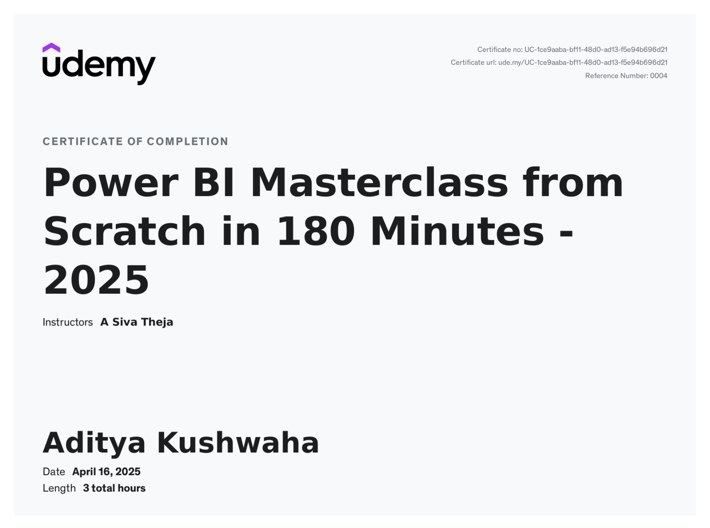

  

  <a href="https://aditya-kushwaha-work.vercel.app"><b>Portfolio website</b></a> ·
  <a href="https://www.linkedin.com/in/aditya-kushwaha16">LinkedIn</a> ·
  <a href="mailto:adityakushwahagzpa@gmail.com">Email</a> ·
  <a href="https://github.com/adityakushwahagzpa-design?tab=repositories">All projects</a> ·
  <a href="https://claude.ai/artifact/79tcc2n2tHsQnLGVNVRSmB"><b>AI projects website</b></a>

---

## About

MBA (Finance) from **Christ University, Bengaluru (2025)** and B.Com from the **University of Lucknow**, focused on **fund services**: the daily work of pricing a fund, striking its NAV, matching trades, tracking settlements and corporate actions, and reconciling the books against brokers and custodians. My portfolio rebuilds that work end to end, with every break explained and logged. Each project comes with its Excel workbook or code, a report and a README on the method and findings.

**Open to:** KYC / AML · Fund Accounting & Fund Services · Investment Operations · Reconciliations · Finance Operations &nbsp;|&nbsp; **Based in:** Bengaluru · available to join immediately &nbsp;|&nbsp; **Currently learning:** advanced Power BI data modelling

| Role | Organisation | Period |
|:--|:--|:--|
| Summer Intern — Finance (Cost Analysis and Tendering Process) | NTPC Ltd., Noida | Apr 2024 – Jun 2024 |
| Summer Intern — Operations | NTPC Ltd., Rihand Nagar | Mar 2023 – May 2023 |
| Head, Arthashastra — the Finance Club | Christ University, Bengaluru | 2024 – 2025 |

<b>Experience details</b>

 
### Summer Intern — Finance · NTPC Ltd.
**Noida (EOC)** &nbsp;|&nbsp; *Apr 2024 – Jun 2024*

Project: Cost Analysis and Tendering Process. Financial and quotation review for procurement under the tendering process.

- Review of 40+ vendor quotations against cost estimates and budget, with 6 flagged for further review
- Eligibility check of 20+ vendor submissions, of which 7+ did not meet the required criteria
- Approval checks against delegation of power (DoP) limits and a vendor document checklist
- A vendor-wise evidence file and DoP check, set up on own initiative, so every approval traced back to its documents

   

### Summer Intern — Operations · NTPC Ltd.
**Rihand Nagar** &nbsp;|&nbsp; *Mar 2023 – May 2023*

Operational record-keeping within a 5-member team across an 8-week placement.

- Upkeep of 50+ operational records a day across 6+ departments, about 2,000 records in total
- End-of-shift record updates with no major errors; minor documentation gaps flagged
- Exposure to coordination between operations, maintenance and administration

  

### Head — Arthashastra, the Finance Club · Christ University
**Bengaluru** &nbsp;|&nbsp; *2024 – 2025*

Leadership of the university finance club and its 5-member core team.

- 25 finance events in total, including 10 guest lectures
- Finance Quiz and Business Case Competition with 200 participants each
- Stock market simulations and case-based activities, newly introduced

  

---

## Selected Projects

| Project | Problem and result | Tools |
|:--|:--|:--|
| **[Bank Transactions Analysis (SQL)](https://github.com/adityakushwahagzpa-design/adityakushwahagzpa-design/tree/main/projects/sql-bank-transactions-analysis)** | 4-table PostgreSQL bank database, 20 queries up to window functions and CTEs; AML rules flag 6 structuring customers and 7 reactivated dormant accounts | PostgreSQL, Python · [Live demo](https://claude.ai/artifact/S6zn4Ch5bCgmwDRhcatok9) |
| **[Money Mule Ring Detector](https://github.com/adityakushwahagzpa-design/adityakushwahagzpa-design/tree/main/projects/money-mule-ring-detector)** | AML graph analytics on ~64,000 synthetic transfers; all 8 hidden rings found (GNN precision 0.91, recall 1.00) | Python, NetworkX, PyTorch Geometric, Neo4j |
| **[AML Case Manager](https://github.com/adityakushwahagzpa-design/adityakushwahagzpa-design/tree/main/projects/aml-case-manager)** | 518,023 bank transfers as a graph; Cypher cycle, fan-in and fan-out rules opened 43 cases, 88% containing laundering, and caught 100% of cycles and 95–98% of fan patterns; shows which of IBM's 8 patterns rules miss | Python, Cypher (graph DB), PostgreSQL, FastAPI |
| **[Real-Time Fraud Monitor](https://github.com/adityakushwahagzpa-design/adityakushwahagzpa-design/tree/main/projects/real-time-fraud-monitor)** | 403,847 card transactions checked live against velocity, impossible-travel and unusual-amount rules in config; precision and recall per rule (velocity 100% precise; fixing the travel rule cut 16,343 alerts to 53) | Python, FastAPI, PostgreSQL, React |
| **[Customer 360 Intelligence Platform](https://github.com/adityakushwahagzpa-design/adityakushwahagzpa-design/tree/main/projects/customer-360-intelligence-platform)** | ML identity resolution across core banking, CRM and cards (F1 0.992 vs 0.724 for phone/email matching), a 360 table, churn and product-propensity models (top 10% catch 33% of leavers), lifetime value, next best action with credit/KYC guardrails, and a Claude RM assistant | Python, LightGBM, rapidfuzz, Claude API · [Live demo](https://claude.ai/artifact/TH3bhBV64x7DbEzoZr7CCi) |
| **[Real-Time Business Anomaly Detection](https://github.com/adityakushwahagzpa-design/adityakushwahagzpa-design/tree/main/projects/realtime-business-anomaly-detection)** | Minute-by-minute monitor of 19.9 million payments across UPI, Card and NetBanking: all 7 planted incidents caught (6 within 3 minutes), 0 false alarms in 12 days, planned festival surge correctly ignored | Python · [Live demo](https://claude.ai/artifact/FKL5CFuR285YSbzgCNuDuA) |
| **[AI Text-to-SQL Analytics Assistant](https://github.com/adityakushwahagzpa-design/adityakushwahagzpa-design/tree/main/projects/ai-text-to-sql-assistant)** | Ask a bank database questions in plain English: Claude writes and self-corrects SQL using a glossary of banking terms (NPA, CASA, fiscal year); a two-layer read-only guard blocked all 25 red-team attacks; 30-question benchmark with verified answers | Python, Claude API, SQLite, sqlglot · [Live demo](https://claude.ai/artifact/VwD7HrFjo1dt9iPNo5iuGY) |
| **[Stock Exchange Matching Engine](https://github.com/adityakushwahagzpa-design/adityakushwahagzpa-design/tree/main/projects/stock-exchange-matching-engine)** | Price-time priority order book with limit, market and cancel orders, live over WebSockets; checked trade by trade against a reference engine on 200 random sequences; ~500,000 orders a second | Python, FastAPI, WebSockets, React, PostgreSQL |
| **[Credit Appraisal Model](https://github.com/adityakushwahagzpa-design/credit-appraisal-model)** | ₹20 crore term-loan appraisal; DSCR 2.39x, recommended at grade CR-2 | Excel |
| **[Month-End Close & Trial Balance](https://github.com/adityakushwahagzpa-design/adityakushwahagzpa-design/tree/main/projects/month-end-close-trial-balance)** | Record to Report close for October 2026: 17 regular and 9 adjusting entries (accruals, prepayments, depreciation, allowance, inventory count); ₹2.14 lakh of adjustments take profit from ₹4.41 lakh to ₹2.27 lakh; trial balance agrees at ₹91.76 lakh and bank, AR and AP reconciliations close at zero | Excel · [Live demo](https://claude.ai/artifact/RYujnqGHE2LEN3378WAsTu) |
| **[IFRS 16 / Ind AS 116 Lease Accounting](https://github.com/adityakushwahagzpa-design/adityakushwahagzpa-design/tree/main/projects/ifrs16-lease-accounting)** | 5-year warehouse lease: ₹99.46 lakh of rent measured as a ₹77.27 lakh liability at a 10% borrowing rate; 60-month schedule; FY27 charge ₹22.85 lakh vs ₹18.00 lakh rent; ₹12.83 lakh current portion | Excel · [Live calculator](https://claude.ai/artifact/Niy3TrAqhL8FQEzQTpoMLu) |
| **[AP Three-Way Match](https://github.com/adityakushwahagzpa-design/ap-three-way-match)** | PO, GRN and invoice matching with quantity and price variance flags and an approval-ready payment list | Excel, PDF |
| **[Fund Operations Month-End Reconciliation](https://github.com/adityakushwahagzpa-design/adityakushwahagzpa-design/tree/main/projects/fund-operations-reconciliation)** | Fund book vs broker vs custodian for a ₹37 crore fund: trade matching, T+1 settlement monitoring, corporate actions, position and cash reconciliation. 97.6% of 668 records auto-cleared, the ₹56.9 lakh cash gap fully explained, and open breaks shown to understate NAV by 154 bps | Python, Excel |
| **[Fund Accounting & Daily NAV Model](https://github.com/adityakushwahagzpa-design/fund-accounting-nav-model)** | Daily NAV cycle for a ₹71 crore hybrid fund; NAV move from ₹31.40 to ₹32.01 traced line by line with cash, holdings and accrual reconciliations | Excel |
| **[HDFC Flexi Cap Fund — Returns & Risk](https://github.com/adityakushwahagzpa-design/hdfc-flexi-cap-fund-analysis)** | 10 years of daily AMFI NAVs: CAGR, SIP XIRR, Sharpe, Sortino, beta and alpha vs the NIFTY 500 and 37 peer funds; best 3-year Sharpe (0.78) of the group | Excel, PDF |
| **[AI-Powered Revenue Forecasting Engine](https://github.com/adityakushwahagzpa-design/adityakushwahagzpa-design/tree/main/projects/ai-revenue-forecasting-engine)** | LightGBM forecast (6.6% daily error in backtest) plus a Claude AI analyst that answers what-if questions by running the model through tool calls; Q1 2026 forecast ₹104.2 crore (+16.9%, range ₹99.4–108.6 crore) | Python, LightGBM, Claude API · [Live demo](https://claude.ai/artifact/HRDSJjGuvzysgtu8szUpTq) |
| **[Marketing Attribution & ROI Intelligence](https://github.com/adityakushwahagzpa-design/adityakushwahagzpa-design/tree/main/projects/marketing-attribution-roi-intelligence)** | 8 attribution models on 60,000 customer journeys (ML counterfactual within 1.1 pts of the true channel shares vs 12.1 for last touch), a marketing mix model calibrated with lift tests, a budget optimiser (+3.5% revenue for the same spend) and a Claude AI analyst | Python, LightGBM, SciPy, Claude API · [Live demo](https://claude.ai/artifact/Krw3sHXTRenx1wzDHvvrSL) |
| **[Zomato Restaurant Analysis (SQL)](https://github.com/adityakushwahagzpa-design/adityakushwahagzpa-design/tree/main/projects/zomato-restaurant-analysis-sql)** | 9,551 real Zomato restaurants in 3 tables and 18 queries: 31% of price range 3–4 restaurants rated 4.0+ vs 4% in range 1; delivery moves ratings by under 0.2 points; 24.7% of Indian listings unrated | PostgreSQL, Python |
| **[IPL Data Analysis 2008–2026 (Python + SQL)](https://github.com/adityakushwahagzpa-design/adityakushwahagzpa-design/tree/main/projects/ipl-data-analysis-python)** | 1,243 matches and 295,732 deliveries: average first-innings score up from 162.4 to 188.5 since the 2023 Impact Player rule; chasing teams win 54.7%, toss winners only 51.6%; 15 PostgreSQL queries cross-checked against pandas | Python, pandas, PostgreSQL |
| **[Flipkart Product Analysis Dashboard (Excel + SQL)](https://github.com/adityakushwahagzpa-design/adityakushwahagzpa-design/tree/main/projects/flipkart-product-analysis-dashboard)** | 2,000 products and 25,000 order lines: Mobiles are 9.9% of products but 41.6% of GMV; 70%+ discounts mean a 3.57 rating and 17.5% returns; Assured products sell 64% more units each; 14 PostgreSQL queries (top 10% of products = 65.4% of GMV) | Excel, PostgreSQL |
| **[Bull vs Bear AI Debate](https://github.com/adityakushwahagzpa-design/adityakushwahagzpa-design/tree/main/projects/bull-bear-ai-debate)** | Three Claude agents (Bull, Bear, Judge) debate NVIDIA, Tesla and Apple using only cited 10-K and market evidence; every citation checked in code and invented ones penalised; referee view: Apple leans bull, Tesla leans bear, NVIDIA mixed | Python, Claude API, SEC EDGAR · [Live demo](https://claude.ai/artifact/JCbXAFMn8LCeTeF1wwTbGX) |
| **[Nifty 50 Portfolio Analysis (Google Sheets)](https://github.com/adityakushwahagzpa-design/adityakushwahagzpa-design/tree/main/projects/nifty-portfolio-analysis-google-sheets)** | Live GOOGLEFINANCE portfolio of seven stocks: diversification cut volatility from 22.1% to 13.2%, but returns trailed the Nifty 50 (21.5% vs 27.0%) | Google Sheets |
| **[Nippon Life India AMC — Stock Pitch](https://github.com/adityakushwahagzpa-design/adityakushwahagzpa-design/tree/main/projects/nam-india-stock-pitch)** | FCFE DCF and peer P/E blend to a ₹1,000 target vs ₹1,040 price: HOLD | Excel, PDF deck |
| **[Tata Motors PV — Equity Research](https://github.com/adityakushwahagzpa-design/tata-motors-equity-research)** | One-page research report on the post-demerger passenger vehicle business, linked to its valuation model | Excel, PDF |
| **[Alibaba IPO Financial Model](https://github.com/adityakushwahagzpa-design/adityakushwahagzpa-design/tree/main/projects/alibaba-ipo-financial-model)** | Three-statement model and DCF from the 2014 F-1 prospectus: US$77.30 per ADS vs the US$68 IPO price (27.7x FY2015E EV/EBITDA at IPO) | Excel, [Google Sheets](https://docs.google.com/spreadsheets/d/1BfAjW2cjShVDo6ldrYYk3yn0Ud62uiApXVrn0d1LCts/edit?usp=sharing) |

<b>More project details</b>

 

**KYC / AML Projects**

<b>Bank Transactions Analysis & AML Alerts</b>

 

A four-table banking database with two AML alerts of the kind compliance teams run.

| | |
|:--|:--|
| **Stack** | SQL, PostgreSQL |
| **Scope** | 1,200 customers, 143,836 transactions across 8 channels, 20 queries |
| **Key Result** | 6 customers flagged for cash structuring below ₹50,000, all rated Low or Medium KYC risk; 7 dormant accounts reactivated by credits of ₹2.4–8.6 lakh |
| **Website** | [Link](https://claude.ai/artifact/S6zn4Ch5bCgmwDRhcatok9) |
| **Repository** | [sql-bank-transactions-analysis](https://github.com/adityakushwahagzpa-design/adityakushwahagzpa-design/tree/main/projects/sql-bank-transactions-analysis) |

Joins, window functions and CTEs, from customer and channel analysis up to transaction monitoring.

<b>Customer 360 Intelligence Platform for Banking</b>

 

One trusted record per customer across core banking, CRM and cards, with KYC guardrails on every offer.

| | |
|:--|:--|
| **Stack** | Python, SQLite, LightGBM, rapidfuzz |
| **Scope** | 14,410 customer records from 3 systems |
| **Key Result** | 0.992 F1 on 4-field record matching vs 0.724 on phone or email alone; 98.9% correct matches; 0 credit offers to High KYC risk customers |
| **Website** | [Link](https://claude.ai/artifact/TH3bhBV64x7DbEzoZr7CCi) |
| **Repository** | [customer-360-intelligence-platform](https://github.com/adityakushwahagzpa-design/adityakushwahagzpa-design/tree/main/projects/customer-360-intelligence-platform) |

Identity resolution, a 360 profile, churn and product models, and next best action with credit and KYC checks.

<b>AI Text-to-SQL Assistant for Banking</b>

 

Ask a bank database questions in plain English, with a read-only guard on every query.

| | |
|:--|:--|
| **Stack** | SQL, SQLite, Python, Claude API |
| **Scope** | 6,000 customers, 144,169 transactions, 1,800 loans |
| **Key Result** | 25 of 25 data-change or data-leak attempts stopped; 0 database changes; 30-question benchmark with verified answers |
| **Website** | [Link](https://claude.ai/artifact/VwD7HrFjo1dt9iPNo5iuGY) |
| **Repository** | [ai-text-to-sql-assistant](https://github.com/adityakushwahagzpa-design/adityakushwahagzpa-design/tree/main/projects/ai-text-to-sql-assistant) |

A glossary of banking terms (NPA, SMA, CASA) and two layers of read-only access control.

<b>AML Case Manager</b>

 

Bank transfers as a graph, Cypher pattern rules, and cases in PostgreSQL for human review.

| | |
|:--|:--|
| **Stack** | Python, Cypher (Kùzu; Neo4j loader included), PostgreSQL, FastAPI |
| **Scope** | 518,023 transfers, 25,000 accounts, 519 labelled laundering transfers in IBM’s 8 patterns (synthetic, HI-Small format) |
| **Key Result** | 43 cases, 88% with laundering; 59% of laundering transfers covered (100% of cycles and gather-scatter, 0% of random, bipartite and stack) |
| **Repository** | [aml-case-manager](https://github.com/adityakushwahagzpa-design/adityakushwahagzpa-design/tree/main/projects/aml-case-manager) |

Time-ordered 3–5 hop cycles, fan-in and fan-out in 24-hour windows, a case view with the money-flow graph, and status tracking.

<b>Real-Time Transaction Fraud Monitor</b>

 

Every card transaction checked the moment it arrives against configurable rules, with a live alert queue.

| | |
|:--|:--|
| **Stack** | Python, FastAPI, PostgreSQL, React |
| **Scope** | 403,847 card transactions, 1,000 cards, 488 labelled fraud (synthetic, Sparkov-style) |
| **Key Result** | Velocity 100% precise; refined impossible-travel rule 71.7% precise (from 1.2%); all rules together catch 37.9% of fraud at about 3 µs per check |
| **Repository** | [real-time-fraud-monitor](https://github.com/adityakushwahagzpa-design/adityakushwahagzpa-design/tree/main/projects/real-time-fraud-monitor) |

Per-card sliding window, last location and running amount statistics; precision and recall per rule and per fraud pattern; threshold tuning.

**Python Finance Projects**

<b>Stock Exchange Matching Engine</b>

 

A miniature stock exchange with a live order book.

| | |
|:--|:--|
| **Stack** | Python, FastAPI, WebSockets, React, PostgreSQL |
| **Scope** | Limit, market and cancel orders; trades stored in PostgreSQL in batches |
| **Key Result** | 209 tests pass, including 200 random sequences matched trade by trade against a reference engine; about 480,000–580,000 orders a second |
| **Repository** | [stock-exchange-matching-engine](https://github.com/adityakushwahagzpa-design/adityakushwahagzpa-design/tree/main/projects/stock-exchange-matching-engine) |

Price-time priority with two heaps, prices in paise (never floats), lazy cancels, trades at the resting order’s price.

<b>Money Mule Ring Detector</b>

 

Graph analytics that find money mule rings in a bank transfer network.

| | |
|:--|:--|
| **Stack** | NetworkX, scikit-learn, PyTorch Geometric (GraphSAGE), Neo4j |
| **Scope** | 2,000+ accounts, ~64,000 transfers, 8 hidden rings (synthetic) |
| **Key Result** | All 8 rings found; graph neural network precision 0.91, recall 1.00 vs rules 1.00 / 0.84 |
| **Repository** | [money-mule-ring-detector](https://github.com/adityakushwahagzpa-design/adityakushwahagzpa-design/tree/main/projects/money-mule-ring-detector) |

AML rule scoring, Louvain ring grouping, machine learning and Cypher queries for cycles and fan-in hubs.

<b>Card Fraud Detection</b>

 

Anomaly detection vs supervised machine learning on real card transactions.

| | |
|:--|:--|
| **Stack** | scikit-learn (Isolation Forest, Local Outlier Factor, autoencoder, gradient boosting) |
| **Scope** | 284,807 transactions, 492 frauds |
| **Key Result** | Supervised model caught 73% of frauds reviewing only 0.1% of transactions; best label-free method 45% |
| **Repository** | [card-fraud-anomaly-detection](https://github.com/adityakushwahagzpa-design/adityakushwahagzpa-design/tree/main/projects/card-fraud-anomaly-detection) |

Time-based split and review-budget metrics, the way a fraud operations team measures detection.

<b>Credit Default Prediction (ML)</b>

 

Machine learning model that predicts credit card default and turns it into a 300–900 credit score.

| | |
|:--|:--|
| **Stack** | scikit-learn (logistic regression, random forest, gradient boosting), pandas |
| **Scope** | 30,000 borrowers, UCI data set |
| **Key Result** | Gini 0.55; default rate 66.9% in the lowest score band vs 6.0% in the highest; cut-off halves the approved default rate to 10.3% |
| **Repository** | [credit-default-prediction-ml](https://github.com/adityakushwahagzpa-design/adityakushwahagzpa-design/tree/main/projects/credit-default-prediction-ml) |

ROC AUC, Gini, KS and calibration, with a cost-based approval cut-off and fairness-aware feature choice.

<b>Financial Statement Analyzer</b>

 

Automatic extraction of four years of statements for 12 Nifty 50 companies, with ratios and health scores.

| | |
|:--|:--|
| **Stack** | pandas, openpyxl (live Excel formulas), yfinance |
| **Scope** | 12 companies, FY2023–FY2026, 17 ratios |
| **Key Result** | ROCE ranges from 54.9% (TCS) to 9.0% (Reliance); fastest growers L&T and Bharti also carry the most debt |
| **Repository** | [financial-statement-analyzer](https://github.com/adityakushwahagzpa-design/adityakushwahagzpa-design/tree/main/projects/financial-statement-analyzer) |

Piotroski F-score and Altman Z''-score, plus an Excel workbook where every ratio is a formula.

<b>India Market Data Dashboard</b>

 

Python dashboard of Indian indices, ETFs, currency, commodities and crypto in one report.

| | |
|:--|:--|
| **Stack** | Python, pandas, NumPy, Matplotlib, yfinance |
| **Scope** | 10 assets, 2 years of daily prices |
| **Key Result** | Brent crude +42.0% over the year with the highest volatility (47.0%); Nifty Bank and Brent the best diversification pair (correlation -0.28) |
| **Refresh** | Auto-updated every Monday by GitHub Actions |
| **Repository** | [india-market-data-dashboard](https://github.com/adityakushwahagzpa-design/adityakushwahagzpa-design/tree/main/projects/india-market-data-dashboard) |

Returns over four periods, annualised volatility, maximum drawdown and a correlation matrix, with charts and an auto-written report.

<b>NSE Stock Terminal</b>

 

Command-line company snapshot for any NSE stock, in the style of a market data terminal.

| | |
|:--|:--|
| **Stack** | Python, pandas, Matplotlib, yfinance |
| **Scope** | 8-stock watchlist; any NSE symbol on demand |
| **Key Result** | TCS highest ROE in the watchlist (45.6%) at 17x P/E; ICICI Bank +17.6% over the year, Infosys -24.2% |
| **Repository** | [nse-stock-terminal](https://github.com/adityakushwahagzpa-design/adityakushwahagzpa-design/tree/main/projects/nse-stock-terminal) |

Price, valuation, profitability, leverage, dividends and four years of revenue and profit, with a price chart and a comparison table.

<b>Stock Analyst Agents</b>

 

Four rule-based analyst agents score each stock and explain their reasoning; a portfolio manager combines the scores.

| | |
|:--|:--|
| **Stack** | Python classes, pandas, NumPy, Matplotlib, yfinance |
| **Scope** | 12 Nifty 50 stocks |
| **Agents** | Value (30%), Quality (30%), Momentum (20%), Risk (20%) |
| **Key Result** | ICICI Bank (+0.72) and SBI (+0.52) the only Positive views; strong quality offset by weak momentum for Infosys and HUL |
| **Repository** | [ai-stock-analyst-agents](https://github.com/adityakushwahagzpa-design/adityakushwahagzpa-design/tree/main/projects/ai-stock-analyst-agents) |

Transparent rules instead of machine learning, so every view traces back to the P/E, ROE, moving averages or volatility behind it.

<b>Financial News Sentiment Analysis</b>

 

Sentiment scoring of news headlines for 10 large Indian companies, matched to share-price moves.

| | |
|:--|:--|
| **Stack** | Python, VADER sentiment, feedparser, pandas, yfinance |
| **Scope** | About 250–330 headlines over three months |
| **Key Result** | Same-day correlation of 0.47 to 0.62 between sentiment and returns, but almost none with next-day returns |
| **Repository** | [financial-news-sentiment-analysis](https://github.com/adityakushwahagzpa-design/adityakushwahagzpa-design/tree/main/projects/financial-news-sentiment-analysis) |

VADER with a custom finance word list; the result shows headlines mostly describe moves that already happened rather than predict them.

<b>Insider Cluster-Buy Radar</b>

 

Flags US stocks where 3+ insiders bought shares within 14 days, using SEC Form 4 data.

| | |
|:--|:--|
| **Stack** | pandas, PostgreSQL, SQLAlchemy, SEC EDGAR, yfinance |
| **Scope** | 8,417 insider purchases, Q1 2025 to Q1 2026 |
| **Key Result** | 491 clusters: +2.1 pts vs SPY after 1 week, but median -5.4 pts after 3 months |
| **Refresh** | Auto-updated every Monday by GitHub Actions |
| **Repository** | [insider-cluster-buy-radar](https://github.com/adityakushwahagzpa-design/adityakushwahagzpa-design/tree/main/projects/insider-cluster-buy-radar) |

Weekly alert list from a PostgreSQL database, with returns measured at three horizons.

<b>Earnings Call Stress Detector</b>

 

FinBERT and word-list scoring of management tone in the Q&A of S&P 500 earnings calls.

| | |
|:--|:--|
| **Stack** | Hugging Face FinBERT, pandas, SciPy, yfinance; Whisper and librosa for audio |
| **Scope** | 338 calls, 246 companies, 2023–2025 |
| **Key Result** | Q&A less positive than prepared remarks in 82% of calls; stress index did not predict next-day returns (rho 0.07, p 0.21) |
| **Repository** | [earnings-call-stress-detector](https://github.com/adityakushwahagzpa-design/adityakushwahagzpa-design/tree/main/projects/earnings-call-stress-detector) |

Prepared remarks vs Q&A tone, uncertainty words and evasive phrases, tested against market reactions.

<b>Personal Inflation Tracker</b>

 

OCR of grocery receipts into a personal price index, compared with official US CPI.

| | |
|:--|:--|
| **Stack** | Tesseract OCR, pandas, BLS API, Streamlit |
| **Scope** | 24 sample receipts (fictional store), 14 items; real BLS CPI |
| **Key Result** | OCR read 97.3% of lines; sample basket inflation 4.8% vs 1.8% CPI food at home |
| **Repository** | [personal-inflation-tracker](https://github.com/adityakushwahagzpa-design/adityakushwahagzpa-design/tree/main/projects/personal-inflation-tracker) |

Price checks on every receipt line and a fixed-basket index by item and category. Receipts are clearly labelled sample data.

<b>Portfolio Performance Analytics</b>

 

Return, risk and diversification of an NSE stock and gold portfolio against the Nifty 50.

| | |
|:--|:--|
| **Stack** | pandas, SciPy (XIRR), yfinance, Streamlit |
| **Scope** | Sample portfolio, 145 transactions, real NSE prices |
| **Key Result** | XIRR 6.5% vs 5.3% for the same cash flows in the Nifty 50; gold 26% of value but 35% of risk |
| **Repository** | [portfolio-performance-analytics](https://github.com/adityakushwahagzpa-design/adityakushwahagzpa-design/tree/main/projects/portfolio-performance-analytics) |

XIRR, time-weighted return, Sharpe, Sortino, beta, drawdown and risk contribution by holding.

<b>Nifty 50 Market Trend Dashboard</b>

 

Trend, momentum and breadth for every Nifty 50 stock.

| | |
|:--|:--|
| **Stack** | pandas, NumPy, yfinance, Streamlit |
| **Scope** | 50 stocks, 2 years of daily prices |
| **Key Result** | Nifty flat over the year but +13.1% in a month; breadth rebounded from 10% to 69% of stocks above the 200-day average |
| **Refresh** | Auto-updated every Monday by GitHub Actions |
| **Repository** | [nifty-market-trend-dashboard](https://github.com/adityakushwahagzpa-design/adityakushwahagzpa-design/tree/main/projects/nifty-market-trend-dashboard) |

Moving averages, golden and death crosses, RSI, drawdowns and sector returns.

**Finance Projects**

<b>Credit Appraisal Model</b>

 

Term-loan appraisal in the format of a bank credit note.

| | |
|:--|:--|
| **Stack** | Excel |
| **Scope** | ₹20 crore term loan |
| **Key Result** | DSCR of 2.39x; loan recommended at grade CR-2 |
| **Method** | Financial spreading, DSCR, 5 Cs scorecard |
| **Repository** | [credit-appraisal-model](https://github.com/adityakushwahagzpa-design/credit-appraisal-model) |

Borrower financial analysis, repayment capacity, risk scoring and a final credit recommendation.

<b>AP Three-Way Match</b>

 

Accounts payable control model matching purchase orders, goods receipts and vendor invoices.

| | |
|:--|:--|
| **Stack** | Excel, PDF |
| **Scope** | PO, GRN and invoice matching with exception flags |
| **Basis** | Vendor document checks from the NTPC finance internship |
| **Repository** | [ap-three-way-match](https://github.com/adityakushwahagzpa-design/ap-three-way-match) |

Quantity and price variance checks, exception reporting and an approval-ready payment list.

<b>Fund Accounting & Daily NAV Model</b>

 

Daily NAV model for a fictional hybrid fund, built the way a fund accounting team runs the daily cycle.

| | |
|:--|:--|
| **Stack** | Excel |
| **Scope** | ₹71 crore hybrid fund, daily valuation and reconciliation cycle |
| **Key Result** | NAV movement from ₹31.40 to ₹32.01 traced line by line |
| **Controls** | Cash, holdings and accrual reconciliations |
| **Repository** | [fund-accounting-nav-model](https://github.com/adityakushwahagzpa-design/fund-accounting-nav-model) |

Pricing of holdings, income and expense accruals, NAV per unit computation and the reconciliation checks that sit behind a signed-off NAV.

<b>PhonePe Transaction Insights Dashboard</b>

 

Interactive dashboard of digital payment transactions and loan data.

| | |
|:--|:--|
| **Stack** | Power BI, Excel, PDF |
| **Scope** | Transaction and loan data across 14 states |
| **Output** | State-wise and category-wise KPI views |
| **Repository** | [phonepe-transaction-insights-dashboard](https://github.com/adityakushwahagzpa-design/phonepe-transaction-insights-dashboard) |

Data modelling, KPI design and drill-downs built for a management review.

<b>Nippon Life India AMC — Stock Pitch (HOLD, Target ₹1,000)</b>

 

10-slide equity research pitch with a 9-sheet valuation model, priced on 20 Nov 2026.

| | |
|:--|:--|
| **Stack** | Excel, PDF deck |
| **Scope** | FY22–Q2 FY27 financials, FY31E forecast, 6 listed AMC peers |
| **Key Result** | DCF ₹787 and P/E ₹1,135 blend to a ₹1,000 target vs ₹1,040 price: HOLD |
| **Method** | 15-year FCFE DCF, peer P/E, bull/base/bear scenarios |
| **Repository** | [nam-india-stock-pitch](https://github.com/adityakushwahagzpa-design/adityakushwahagzpa-design/tree/main/projects/nam-india-stock-pitch) |

A strong franchise gaining share, but the price already assumes a decade of strong growth.

<b>Indian Asset Management Industry — Deep Dive</b>

 

9-section industry report with charts, a value-chain diagram and a 7-sheet data book.

| | |
|:--|:--|
| **Stack** | Research report (PDF), Excel |
| **Scope** | ₹83 lakh crore industry, top 10 AMCs, FY26 fee pool of 21 AMCs, SEBI 2026 rules |
| **Key Result** | Distributors take 49% of the ₹60,300 crore fee pool; AMCs turn 47% into ₹17,285 crore of profit |
| **Repository** | [indian-amc-industry-deep-dive](https://github.com/adityakushwahagzpa-design/adityakushwahagzpa-design/tree/main/projects/indian-amc-industry-deep-dive) |

Value chain, competitive dynamics, regulation and where value is created across Indian mutual funds.

<b>Tata Motors Passenger Vehicles — Equity Research</b>

 

One-page equity research report on the post-demerger passenger vehicle business, backed by a linked model.

| | |
|:--|:--|
| **Stack** | Excel, PDF |
| **Scope** | Tata Motors PV (domestic PV + JLR) |
| **Output** | One-page research report with valuation and charts |
| **Repository** | [tata-motors-equity-research](https://github.com/adityakushwahagzpa-design/tata-motors-equity-research) |

Business overview, financial summary, valuation and key risks, with the report and workbook linked to each other.

<b>Starbucks — Three-Statement Model & DCF</b>

 

Fully linked income statement, balance sheet and cash flow model feeding a discounted cash flow valuation.

| | |
|:--|:--|
| **Stack** | Excel, PDF |
| **Scope** | Three linked statements, forecast drivers, DCF |
| **Key Result** | Intrinsic value of about $62 against a market price of about $94 |
| **Repository** | [starbucks-3-statement-dcf](https://github.com/adityakushwahagzpa-design/starbucks-3-statement-dcf) |

Forecast assumptions, free cash flow build, WACC and terminal value, with sensitivity of value to key inputs.

<b>Burger King — LBO Model</b>

 

Leveraged buyout model of the 2010 Burger King take-private transaction.

| | |
|:--|:--|
| **Stack** | Excel, PDF |
| **Scope** | Sources and uses, debt schedule, exit analysis |
| **Output** | Sponsor returns (IRR and MoM) under the deal structure |
| **Repository** | [burger-king-lbo-model](https://github.com/adityakushwahagzpa-design/burger-king-lbo-model) |

Transaction structure, debt paydown from operating cash flow and returns at exit.

<b>Indian IPO Market Analysis</b>

 

Research study of Indian IPO subscriptions and listing-day performance across mainboard and SME issues.

| | |
|:--|:--|
| **Stack** | Excel, PDF |
| **Scope** | 2,020 Indian IPOs |
| **Focus** | Subscription levels, listing gains, segment comparison |
| **Repository** | [ipo-market-analysis-india](https://github.com/adityakushwahagzpa-design/ipo-market-analysis-india) |

Data collection across NSE and BSE issues, segment-wise analysis and the link between subscription demand and listing-day returns.

**Data Analysis Projects**

<b>Zomato Restaurant Analysis (SQL)</b>

 

Real Zomato restaurant data cleaned in Python, split into three tables and analysed with 18 PostgreSQL queries.

| | |
|:--|:--|
| **Stack** | PostgreSQL, SQL, Python (pandas, Matplotlib) |
| **Scope** | 9,551 restaurants in 15 countries (8,652 in India), 19,705 restaurant–cuisine rows |
| **Key Result** | 31% of price range 3–4 restaurants rated 4.0+ vs 4% in range 1; online delivery moves ratings by under 0.2 points; North Indian on 45.6% of menus |
| **Repository** | [zomato-restaurant-analysis-sql](https://github.com/adityakushwahagzpa-design/adityakushwahagzpa-design/tree/main/projects/zomato-restaurant-analysis-sql) |

Joins, CASE and FILTER, a self-join for cuisine pairs, window functions, CTEs, PERCENTILE_CONT and CORR.

<b>IPL Data Analysis 2008–2026 (Python + SQL)</b>

 

Every IPL match from 2008 to the 2026 final, analysed ball by ball in pandas.

| | |
|:--|:--|
| **Stack** | Python (pandas, Matplotlib), PostgreSQL, SQL |
| **Scope** | 1,243 matches, 295,732 deliveries, 19 seasons |
| **Key Result** | Average first-innings score up from 162.4 (2008–2022) to 188.5 (2023–2026); sixes per match 10.7 → 19.3; chasing teams win 54.7% |
| **Repository** | [ipl-data-analysis-python](https://github.com/adityakushwahagzpa-design/adityakushwahagzpa-design/tree/main/projects/ipl-data-analysis-python) |

Season, phase, toss, team, venue, batting and bowling tables in pandas, plus 15 PostgreSQL queries (views, CTEs, RANK, running totals) that match the pandas results.

<b>Flipkart Product Analysis Dashboard (Excel + SQL)</b>

 

A one-page Excel dashboard on a Flipkart-style catalogue, with every figure a live formula.

| | |
|:--|:--|
| **Stack** | Excel (SUMIF, COUNTIFS, AVERAGEIF, INDEX/MATCH, charts), PostgreSQL, SQL, Python (openpyxl) |
| **Scope** | 2,000 products in 8 categories, 25,000 order lines for 2025 (synthetic) |
| **Key Result** | Mobiles 9.9% of products but 41.6% of GMV; 70%+ discounts: 3.57 rating and 17.5% returns; Flipkart Assured: 64% more units per product, half the returns |
| **Repository** | [flipkart-product-analysis-dashboard](https://github.com/adityakushwahagzpa-design/adityakushwahagzpa-design/tree/main/projects/flipkart-product-analysis-dashboard) |

7 KPI cards, 5 summary tables and 4 charts (87,145 formulas, 0 errors), plus 14 PostgreSQL queries that reproduce every dashboard figure and add GMV concentration, price bands and category leaders.

**Classic finance research papers in Python** — seven landmark papers applied to market data, refreshed weekly by GitHub Actions

| Paper | What the project shows |
|:--|:--|
| [Markowitz (1952) — Portfolio Selection](https://github.com/adityakushwahagzpa-design/adityakushwahagzpa-design/tree/main/projects/markowitz-efficient-frontier) | Efficient frontier of ten Nifty 50 stocks; diversification cut volatility from 22% to 13%, but optimised weights failed out of sample |
| [Modigliani & Miller (1958, 1963)](https://github.com/adityakushwahagzpa-design/adityakushwahagzpa-design/tree/main/projects/modigliani-miller-capital-structure) | Firm value, cost of equity and WACC across leverage; trade-off optimum near D/E 0.75 at India's 25.17% tax rate |
| [Sharpe (1964) — CAPM](https://github.com/adityakushwahagzpa-design/adityakushwahagzpa-design/tree/main/projects/capm-beta-security-market-line) | Betas of 20 Nifty stocks (0.54 to 1.31); the security market line was almost flat over five years |
| [Fama (1970) — Efficient Markets](https://github.com/adityakushwahagzpa-design/adityakushwahagzpa-design/tree/main/projects/efficient-market-hypothesis-tests) | Random-walk tests on 19 years of Nifty data; a 50/200-day trend rule earned 4.9% a year vs 10.9% buy-and-hold |
| [Black & Scholes (1973)](https://github.com/adityakushwahagzpa-design/adityakushwahagzpa-design/tree/main/projects/black-scholes-option-pricing) | Nifty option prices and Greeks, checked by parity, binomial tree and Monte Carlo; fat tails test the model's assumption |
| [Kahneman & Tversky (1979) — Prospect Theory](https://github.com/adityakushwahagzpa-design/adityakushwahagzpa-design/tree/main/projects/prospect-theory-loss-aversion) | Loss aversion applied to Nifty vs fixed deposit: equities win only if checked every 18 months or less often |
| [Fama & French (1993)](https://github.com/adityakushwahagzpa-design/adityakushwahagzpa-design/tree/main/projects/fama-french-three-factor) | Three-factor model on eight US ETFs; R² up from 0.87 to 0.96, and the value premium turned negative after 2007 |

<b>All 68 Projects</b>

 

| Area | Repositories |
|:--|:--|
| **SQL & Python** | [zepto-sql-analysis](https://github.com/adityakushwahagzpa-design/zepto-sql-analysis) · [netflix-content-analysis](https://github.com/adityakushwahagzpa-design/netflix-content-analysis) · [sql-bank-transactions-analysis](https://github.com/adityakushwahagzpa-design/adityakushwahagzpa-design/tree/main/projects/sql-bank-transactions-analysis) · [zomato-restaurant-analysis-sql](https://github.com/adityakushwahagzpa-design/adityakushwahagzpa-design/tree/main/projects/zomato-restaurant-analysis-sql) · [ipl-data-analysis-python](https://github.com/adityakushwahagzpa-design/adityakushwahagzpa-design/tree/main/projects/ipl-data-analysis-python) · [aml-case-manager](https://github.com/adityakushwahagzpa-design/adityakushwahagzpa-design/tree/main/projects/aml-case-manager) · [real-time-fraud-monitor](https://github.com/adityakushwahagzpa-design/adityakushwahagzpa-design/tree/main/projects/real-time-fraud-monitor) |
| **Python Research & ML** | [ai-revenue-forecasting-engine](https://github.com/adityakushwahagzpa-design/adityakushwahagzpa-design/tree/main/projects/ai-revenue-forecasting-engine) · [marketing-attribution-roi-intelligence](https://github.com/adityakushwahagzpa-design/adityakushwahagzpa-design/tree/main/projects/marketing-attribution-roi-intelligence) · [ai-text-to-sql-assistant](https://github.com/adityakushwahagzpa-design/adityakushwahagzpa-design/tree/main/projects/ai-text-to-sql-assistant) · [customer-360-intelligence-platform](https://github.com/adityakushwahagzpa-design/adityakushwahagzpa-design/tree/main/projects/customer-360-intelligence-platform) · [realtime-business-anomaly-detection](https://github.com/adityakushwahagzpa-design/adityakushwahagzpa-design/tree/main/projects/realtime-business-anomaly-detection) · [bull-bear-ai-debate](https://github.com/adityakushwahagzpa-design/adityakushwahagzpa-design/tree/main/projects/bull-bear-ai-debate) · [money-mule-ring-detector](https://github.com/adityakushwahagzpa-design/adityakushwahagzpa-design/tree/main/projects/money-mule-ring-detector) · [insider-cluster-buy-radar](https://github.com/adityakushwahagzpa-design/adityakushwahagzpa-design/tree/main/projects/insider-cluster-buy-radar) · [earnings-call-stress-detector](https://github.com/adityakushwahagzpa-design/adityakushwahagzpa-design/tree/main/projects/earnings-call-stress-detector) · [personal-inflation-tracker](https://github.com/adityakushwahagzpa-design/adityakushwahagzpa-design/tree/main/projects/personal-inflation-tracker) |
| **Python Analytics & ML** | [credit-default-prediction-ml](https://github.com/adityakushwahagzpa-design/adityakushwahagzpa-design/tree/main/projects/credit-default-prediction-ml) · [card-fraud-anomaly-detection](https://github.com/adityakushwahagzpa-design/adityakushwahagzpa-design/tree/main/projects/card-fraud-anomaly-detection) · [financial-statement-analyzer](https://github.com/adityakushwahagzpa-design/adityakushwahagzpa-design/tree/main/projects/financial-statement-analyzer) · [portfolio-performance-analytics](https://github.com/adityakushwahagzpa-design/adityakushwahagzpa-design/tree/main/projects/portfolio-performance-analytics) · [nifty-market-trend-dashboard](https://github.com/adityakushwahagzpa-design/adityakushwahagzpa-design/tree/main/projects/nifty-market-trend-dashboard) |
| **Credit** | [credit-appraisal-model](https://github.com/adityakushwahagzpa-design/credit-appraisal-model) |
| **Finance Ops** | [month-end-close-trial-balance](https://github.com/adityakushwahagzpa-design/adityakushwahagzpa-design/tree/main/projects/month-end-close-trial-balance) · [ifrs16-lease-accounting](https://github.com/adityakushwahagzpa-design/adityakushwahagzpa-design/tree/main/projects/ifrs16-lease-accounting) · [ap-three-way-match](https://github.com/adityakushwahagzpa-design/ap-three-way-match) · [cash-application-ar-ageing](https://github.com/adityakushwahagzpa-design/cash-application-ar-ageing) · [bank-reconciliation-excel](https://github.com/adityakushwahagzpa-design/bank-reconciliation-excel) · [ar-ap-ledger-excel](https://github.com/adityakushwahagzpa-design/ar-ap-ledger-excel) |
| **Fund Services** | [fund-accounting-nav-model](https://github.com/adityakushwahagzpa-design/fund-accounting-nav-model) · [hdfc-flexi-cap-fund-analysis](https://github.com/adityakushwahagzpa-design/hdfc-flexi-cap-fund-analysis) · [fund-operations-reconciliation](https://github.com/adityakushwahagzpa-design/adityakushwahagzpa-design/tree/main/projects/fund-operations-reconciliation) |
| **Valuation** | [alibaba-ipo-financial-model](https://github.com/adityakushwahagzpa-design/adityakushwahagzpa-design/tree/main/projects/alibaba-ipo-financial-model) · [tata-motors-equity-research](https://github.com/adityakushwahagzpa-design/tata-motors-equity-research) · [eternal-financial-model-dcf](https://github.com/adityakushwahagzpa-design/eternal-financial-model-dcf) · [starbucks-3-statement-dcf](https://github.com/adityakushwahagzpa-design/starbucks-3-statement-dcf) · [amazon-dcf-model](https://github.com/adityakushwahagzpa-design/amazon-dcf-model) · [burger-king-lbo-model](https://github.com/adityakushwahagzpa-design/burger-king-lbo-model) · [comparable-company-analysis](https://github.com/adityakushwahagzpa-design/comparable-company-analysis) · [precedent-transaction-analysis](https://github.com/adityakushwahagzpa-design/precedent-transaction-analysis) · [infosys-financial-statements](https://github.com/adityakushwahagzpa-design/infosys-financial-statements) · [itc-financial-statement-analysis](https://github.com/adityakushwahagzpa-design/itc-financial-statement-analysis) |
| **Market Research** | [ipo-market-analysis-india](https://github.com/adityakushwahagzpa-design/ipo-market-analysis-india) · [correlation-matrix-diversification](https://github.com/adityakushwahagzpa-design/correlation-matrix-diversification) · [nifty-portfolio-analysis-google-sheets](https://github.com/adityakushwahagzpa-design/adityakushwahagzpa-design/tree/main/projects/nifty-portfolio-analysis-google-sheets) |
| **Dashboards** | [phonepe-transaction-insights-dashboard](https://github.com/adityakushwahagzpa-design/phonepe-transaction-insights-dashboard) · [flipkart-product-analysis-dashboard](https://github.com/adityakushwahagzpa-design/adityakushwahagzpa-design/tree/main/projects/flipkart-product-analysis-dashboard) · [european-sales-dashboard](https://github.com/adityakushwahagzpa-design/european-sales-dashboard) · [bajaj-sales-profit-dashboard](https://github.com/adityakushwahagzpa-design/bajaj-sales-profit-dashboard) · [financial-performance-dashboard-tableau](https://github.com/adityakushwahagzpa-design/financial-performance-dashboard-tableau) |
| **MIS & Trackers** | [customer-sales-mis-report](https://github.com/adityakushwahagzpa-design/customer-sales-mis-report) · [training-deployment-tracker](https://github.com/adityakushwahagzpa-design/training-deployment-tracker) · [client-churn-dashboard](https://github.com/adityakushwahagzpa-design/client-churn-dashboard) · [security-cost-roi-analysis](https://github.com/adityakushwahagzpa-design/security-cost-roi-analysis) · [investment-portfolio-tracker](https://github.com/adityakushwahagzpa-design/investment-portfolio-tracker) |
| **AI in Finance** | [ai-fpa-agent-claude](https://github.com/adityakushwahagzpa-design/ai-fpa-agent-claude) |
| **Equity & Industry Research** | [nam-india-stock-pitch](https://github.com/adityakushwahagzpa-design/adityakushwahagzpa-design/tree/main/projects/nam-india-stock-pitch) · [indian-amc-industry-deep-dive](https://github.com/adityakushwahagzpa-design/adityakushwahagzpa-design/tree/main/projects/indian-amc-industry-deep-dive) |
| **Python Finance** | [india-market-data-dashboard](https://github.com/adityakushwahagzpa-design/adityakushwahagzpa-design/tree/main/projects/india-market-data-dashboard) · [nse-stock-terminal](https://github.com/adityakushwahagzpa-design/adityakushwahagzpa-design/tree/main/projects/nse-stock-terminal) · [ai-stock-analyst-agents](https://github.com/adityakushwahagzpa-design/adityakushwahagzpa-design/tree/main/projects/ai-stock-analyst-agents) · [financial-news-sentiment-analysis](https://github.com/adityakushwahagzpa-design/adityakushwahagzpa-design/tree/main/projects/financial-news-sentiment-analysis) · [stock-exchange-matching-engine](https://github.com/adityakushwahagzpa-design/adityakushwahagzpa-design/tree/main/projects/stock-exchange-matching-engine) |
| **Classic Finance Papers** | [markowitz-efficient-frontier](https://github.com/adityakushwahagzpa-design/adityakushwahagzpa-design/tree/main/projects/markowitz-efficient-frontier) · [modigliani-miller-capital-structure](https://github.com/adityakushwahagzpa-design/adityakushwahagzpa-design/tree/main/projects/modigliani-miller-capital-structure) · [capm-beta-security-market-line](https://github.com/adityakushwahagzpa-design/adityakushwahagzpa-design/tree/main/projects/capm-beta-security-market-line) · [efficient-market-hypothesis-tests](https://github.com/adityakushwahagzpa-design/adityakushwahagzpa-design/tree/main/projects/efficient-market-hypothesis-tests) · [black-scholes-option-pricing](https://github.com/adityakushwahagzpa-design/adityakushwahagzpa-design/tree/main/projects/black-scholes-option-pricing) · [prospect-theory-loss-aversion](https://github.com/adityakushwahagzpa-design/adityakushwahagzpa-design/tree/main/projects/prospect-theory-loss-aversion) · [fama-french-three-factor](https://github.com/adityakushwahagzpa-design/adityakushwahagzpa-design/tree/main/projects/fama-french-three-factor) |

---

## Skills

| Category | Level | Skills | Shown in |
|:--|:--|:--|:--|
| **KYC / AML & compliance** | ★★★★☆ | Customer due diligence and KYC risk rating · transaction monitoring (cash structuring, dormant-account reactivation) · PMLA, FATF and RBI norms · SAP GRC | [Bank transactions (SQL)](https://github.com/adityakushwahagzpa-design/adityakushwahagzpa-design/tree/main/projects/sql-bank-transactions-analysis) ([demo](https://claude.ai/artifact/S6zn4Ch5bCgmwDRhcatok9)) · [Money mule detector](https://github.com/adityakushwahagzpa-design/adityakushwahagzpa-design/tree/main/projects/money-mule-ring-detector) |
| **Banking & credit** | ★★★★☆ | Credit appraisal (DSCR, 5 Cs, financial ratios) · lending decisions · banking and financial regulations (RBI) · retail banking channels (UPI, NEFT, RTGS, IMPS) | [Credit appraisal](https://github.com/adityakushwahagzpa-design/credit-appraisal-model) · [Bank transactions (SQL)](https://github.com/adityakushwahagzpa-design/adityakushwahagzpa-design/tree/main/projects/sql-bank-transactions-analysis) · MBA coursework |
| **Risk management** | ★★★★☆ | Market risk (volatility, VaR, drawdown) · credit risk (scorecards, Gini, KS) · operational risk and controls · financial risk management | [Portfolio analytics](https://github.com/adityakushwahagzpa-design/adityakushwahagzpa-design/tree/main/projects/portfolio-performance-analytics) · [Credit default model](https://github.com/adityakushwahagzpa-design/adityakushwahagzpa-design/tree/main/projects/credit-default-prediction-ml) · NYIF Risk Management |
| **Controls & exception management** | ★★★★☆ | Exception log with owner, action, age and status · negative-holdings control · NAV impact of open breaks (bps) · SOP and delegation-of-power checks · audit trail of evidence | [Month-end reconciliation](https://github.com/adityakushwahagzpa-design/adityakushwahagzpa-design/tree/main/projects/fund-operations-reconciliation) · NTPC internship |
| **Audit, controls & forensic** | ★★★☆☆ | Auditing principles · internal controls and evidence checks · governance, risk and compliance (SAP GRC) · forensic accounting · corporate governance and business ethics | NTPC internship · Forensic Accounting (WVU) · SAP GRC · MBA coursework |
| **Excel & data** | ★★★★☆ | Advanced Excel (SUMIFS / AVERAGEIFS, VLOOKUP, SUMPRODUCT, conditional formatting, formula-driven reconciliations) · SQL / PostgreSQL (joins, window functions, CTEs) · Python (pandas) · Google Sheets (GOOGLEFINANCE) | All projects |
| **Reporting & ERP** | ★★★☆☆ | Power BI · Tableau · MIS reporting · SAP FICO · MS Office · Google Workspace | [Selected projects](#selected-projects) |
| **Fund accounting & NAV** | ★★★★☆ | Daily NAV calculation · security pricing and stale-price checks · income and expense accruals (bond interest, TER) · dividend receivables · subscriptions and redemptions at NAV · NAV tolerance checks against the benchmark | [NAV model](https://github.com/adityakushwahagzpa-design/fund-accounting-nav-model) |
| **Trade & settlement operations** | ★★★★☆ | Trade capture and matching to broker confirmations · T+1 settlement monitoring · failed and late settlements · duplicate and missing bookings | [Month-end reconciliation](https://github.com/adityakushwahagzpa-design/adityakushwahagzpa-design/tree/main/projects/fund-operations-reconciliation) |
| **Corporate actions** | ★★★★☆ | Dividends, bonus issues and stock splits · entitlement checks between book and custodian · holdings and price adjustments | [NAV model](https://github.com/adityakushwahagzpa-design/fund-accounting-nav-model) · [Month-end reconciliation](https://github.com/adityakushwahagzpa-design/adityakushwahagzpa-design/tree/main/projects/fund-operations-reconciliation) |
| **Reconciliations** | ★★★★☆ | Position and cash reconciliation vs custodian · cash bridge with every break explained · bank reconciliation · AP three-way match · AR ageing | [Month-end reconciliation](https://github.com/adityakushwahagzpa-design/adityakushwahagzpa-design/tree/main/projects/fund-operations-reconciliation) · [Bank reconciliation](https://github.com/adityakushwahagzpa-design/bank-reconciliation-excel) · [AP three-way match](https://github.com/adityakushwahagzpa-design/ap-three-way-match) |
| **Fund & market knowledge** | ★★★★☆ | Mutual fund structure (AMC, custodian, registrar, TER) · equity and debt instruments · fund performance and risk (CAGR, XIRR, Sharpe, beta, drawdown) · SEBI and AMFI data | [HDFC Flexi Cap analysis](https://github.com/adityakushwahagzpa-design/hdfc-flexi-cap-fund-analysis) · [AMC industry deep dive](https://github.com/adityakushwahagzpa-design/adityakushwahagzpa-design/tree/main/projects/indian-amc-industry-deep-dive) |
| **Accounting & financial reporting** | ★★★★☆ | Financial and corporate accounting · income statement, balance sheet and cash flow analysis · general ledger analysis · accruals and receivables · 17-ratio analysis (DuPont, liquidity, leverage, cash conversion) · Record to Report basics | [Financial statement analyzer](https://github.com/adityakushwahagzpa-design/adityakushwahagzpa-design/tree/main/projects/financial-statement-analyzer) · B.Com coursework |
| **Procure to Pay & Order to Cash** | ★★★★☆ | Invoice processing and PO–GRN–invoice three-way match · vendor evaluation and tendering · cash application · AR ageing and collections · AP and AR ledgers | [AP three-way match](https://github.com/adityakushwahagzpa-design/ap-three-way-match) · [Cash application & AR ageing](https://github.com/adityakushwahagzpa-design/cash-application-ar-ageing) · NTPC internship |
| **FP&A & MIS reporting** | ★★★★☆ | Budgeting · budget vs actual and variance analysis · rolling forecasts · KPI dashboards · management commentary · MIS trackers | [AI FP&A agent](https://github.com/adityakushwahagzpa-design/ai-fpa-agent-claude) · [Sales MIS report](https://github.com/adityakushwahagzpa-design/customer-sales-mis-report) · [Training tracker](https://github.com/adityakushwahagzpa-design/training-deployment-tracker) · KPMG Financial Forecasting & Modelling |
| **Taxation & law** | ★★★☆☆ | Income tax and GST fundamentals · business and company law | B.Com coursework |
| **Valuation & corporate finance** | ★★★★☆ | Three-statement models · DCF, LBO, comparable companies and precedent transactions · WACC and capital structure · M&A | [Eternal DCF](https://github.com/adityakushwahagzpa-design/adityakushwahagzpa-design/tree/main/projects/eternal-financial-model-dcf) · [Modigliani–Miller](https://github.com/adityakushwahagzpa-design/adityakushwahagzpa-design/tree/main/projects/modigliani-miller-capital-structure) · M&A (Illinois) |
| **Equity research & capital markets** | ★★★★☆ | Research reports and stock pitches · IPO subscription and listing analysis · AMC industry analysis · NSE / BSE market data | [Tata Motors](https://github.com/adityakushwahagzpa-design/tata-motors-equity-research) · [Nippon AMC pitch](https://github.com/adityakushwahagzpa-design/adityakushwahagzpa-design/tree/main/projects/nam-india-stock-pitch) · IPO thesis |
| **Portfolio & investment management** | ★★★★☆ | Mean-variance optimisation · CAPM and beta · Fama–French factors · market efficiency tests · performance attribution (Sharpe, Sortino, XIRR, drawdown) | [Markowitz](https://github.com/adityakushwahagzpa-design/adityakushwahagzpa-design/tree/main/projects/markowitz-efficient-frontier) · [CAPM](https://github.com/adityakushwahagzpa-design/adityakushwahagzpa-design/tree/main/projects/capm-beta-security-market-line) · [Portfolio analytics](https://github.com/adityakushwahagzpa-design/adityakushwahagzpa-design/tree/main/projects/portfolio-performance-analytics) |
| **Derivatives** | ★★★☆☆ | Option pricing (Black–Scholes, binomial tree, Monte Carlo) · Greeks · put–call parity | [Black–Scholes](https://github.com/adityakushwahagzpa-design/adityakushwahagzpa-design/tree/main/projects/black-scholes-option-pricing) |
| **Standards, tools & testing** | ★★★☆☆ | IFRS and Ind AS · SOX and internal-control testing · Bloomberg Terminal · Excel VBA and macros | MBA (Finance) coursework |
| **Working style** |  | Attention to detail · deadline-driven month-end work · clear written explanations of breaks · night-shift ready | |

★★★★☆ applied in hands-on projects &nbsp;·&nbsp; ★★★☆☆ working knowledge from coursework and certifications

---

## Achievements & Certifications

| Recognition | Details |
|:--|:--|
| **Head, Arthashastra Finance Club** | Christ University, 2024 – 2025 |
| **25 Finance Events** | 10 guest lectures; quiz and case competition with 200 participants each |
| **Oracle OCI Triple Certification** | Generative AI Professional, Data Science Professional, AI Foundations Associate |
| **20 Professional Certifications** | Finance, accounting, risk, data and AI |
| **68 Portfolio Projects** | Fund accounting, valuation, equity and industry research, credit, dashboards, finance operations, AML analytics, machine learning and Python |
| **Two NTPC Internships** | Finance (Noida) and Operations (Rihand Nagar) |

| Provider | Certification |
|:--|:--|
|  | [OCI 2025 Generative AI Professional](https://brm-certview.oracle.com/ords/certview/ecertificate?ssn=OC7028826&trackId=OCI25GAIOCP&key=a61027373e673119d758ffa506926557c454f856) · [Data Science Professional](https://brm-certview.oracle.com/ords/certview/ecertificate?ssn=OC7028826&trackId=OCI25DSOCP&key=c4bd2642f4b4cd8183a3e0390392cbd24fa37cf0) · [AI Foundations Associate](https://brm-certview.oracle.com/ords/certview/ecertificate?ssn=OC7028826&trackId=OCI25AICFA&key=f027d7dc8ba887246b0f8a81103bb7b011a9bdc5) |
|  | [SAP FICO for Finance Professionals](https://www.mygreatlearning.com/certificate/RTCBKOTD) (Great Learning) · [Essentials of SAP GRC](https://alison.com/verify/af5fd318af) (Alison) · [SAP FICO For Beginners](https://www.udemy.com/certificate/UC-41038520-e480-49dc-a9a3-f8452cab66cb/) (Udemy) |
|  | [Certified Financial Forecasting and Modelling using Excel](certificates/KPMG_Financial_Forecasting_Modeling_Excel.jpg) |
|  | [Power BI Data Analyst](https://www.coursera.org/account/accomplishments/specialization/certificate/W4VEPVXEAQ5G) · [SQL Server](https://www.coursera.org/account/accomplishments/specialization/certificate/ASWEA4ZA3RBR) · [Preparing Data for Analysis with Excel](https://www.coursera.org/account/accomplishments/certificate/PV1HUSXCO5M8) |
|  | [Mergers & Acquisitions](https://www.coursera.org/account/accomplishments/specialization/certificate/2MGMFYCZ9BVG) (University of Illinois) · [Forensic Accounting and Fraud Examination](https://www.coursera.org/account/accomplishments/certificate/KCNHY3ZJYRCO) (West Virginia University) |
|  | [Risk Management](https://www.coursera.org/account/accomplishments/specialization/certificate/FO39YZC4SS59) |
|  | [EY Audit](https://www.theforage.com/completion-certificates/Z3pPDqCPapFTSGBgi/d2mpB4NEF4HQBkbhE_Z3pPDqCPapFTSGBgi_68c164a82621ca2c39e5e21d_1757740832646_completion_certificate.pdf) · [Standard Chartered Credit Analyst](https://www.theforage.com/completion-certificates/ZsgybEFo5RxyHxwXL/TwxTEuyPugfgMGm8H_ZsgybEFo5RxyHxwXL_68c164a82621ca2c39e5e21d_1757686119755_completion_certificate.pdf) |
|  | [IFRS 15 & ASC 606](https://www.coursera.org/account/accomplishments/certificate/MP6IQEQ2WTOW) (EDUCBA) · [BFSI Essentials](https://www.coursera.org/account/accomplishments/specialization/certificate/666T7IY4LPRO) (Board Infinity) · [Statutory Compliance & Taxation](https://www.coursera.org/account/accomplishments/certificate/N5K6LGSGAQ9Y) (Tally) · [Power BI Masterclass](https://ude.my/UC-1ce9aaba-bf11-48d0-ad13-f5e94b696d21) (Udemy) · [Generative AI for Product Managers](https://www.coursera.org/account/accomplishments/specialization/certificate/4D2NTB8PZ008) (IBM iX) |

<b>Certificate Copies</b>

 

**SAP FICO for Finance Professionals** — Great Learning, Nov 2026 · [Verify](https://www.mygreatlearning.com/certificate/RTCBKOTD) · [PDF](certificates/SAP_FICO_Great_Learning.pdf)

**SAP Governance, Risk, and Compliance (GRC)** — Alison, Nov 2026 · Credential ID 6754-61766250 · [Verify](https://alison.com/verify/af5fd318af) · [PDF](certificates/SAP_GRC_Alison.pdf)

CPD-certified course on managing governance, risk and compliance in SAP:
- **Access Control** – user access reviews and segregation of duties (SoD) checks
- **Process Control** – internal control testing and compliance monitoring
- **Risk Management** – risk identification, assessment and response
- **Global Trade Services** – import and export compliance

**Certified Financial Forecasting and Modeling using Excel** — KPMG in India, Nov 2024 · [Certificate](certificates/KPMG_Financial_Forecasting_Modeling_Excel.jpg)

An 18-hour KPMG programme during the MBA at Christ University: Excel models from historical data, revenue and cost forecasting, scenario and sensitivity analysis, and DCF basics.

**Power BI Masterclass from Scratch in 180 Minutes – 2025** — Udemy, Apr 2025 · [Verify](https://ude.my/UC-1ce9aaba-bf11-48d0-ad13-f5e94b696d21) · [PDF](certificates/Power_BI_Masterclass_Udemy.pdf)

All credentials: [LinkedIn certifications page](https://www.linkedin.com/in/aditya-kushwaha16/details/certifications/)

---

## Contribution Heatmap

  

  <picture>
    <source media="(prefers-color-scheme: dark)" srcset="https://raw.githubusercontent.com/adityakushwahagzpa-design/adityakushwahagzpa-design/output/github-snake-dark.svg"/>
    <source media="(prefers-color-scheme: light)" srcset="https://raw.githubusercontent.com/adityakushwahagzpa-design/adityakushwahagzpa-design/output/github-snake.svg"/>
    
  </picture>

---

## GitHub Stats

  
  

  

  
  

---

## Connect

| | |
|:--|:--|
| **LinkedIn** | [linkedin.com/in/aditya-kushwaha16](https://www.linkedin.com/in/aditya-kushwaha16) |
| **Email** | [adityakushwahagzpa@gmail.com](mailto:adityakushwahagzpa@gmail.com) |
| **GitHub** | [github.com/adityakushwahagzpa-design](https://github.com/adityakushwahagzpa-design) |
| **Portfolio** | [All repositories](https://github.com/adityakushwahagzpa-design?tab=repositories) |

  

