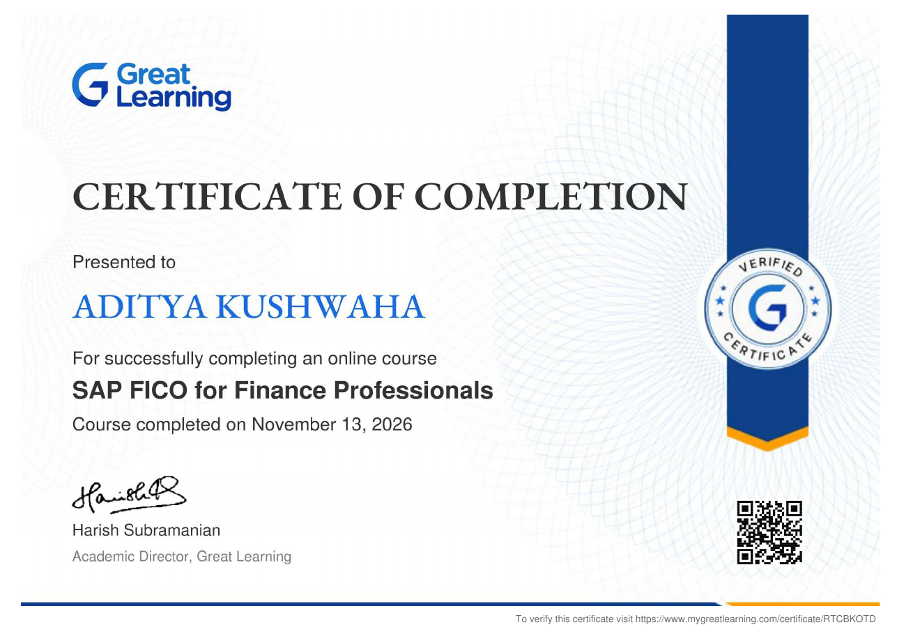
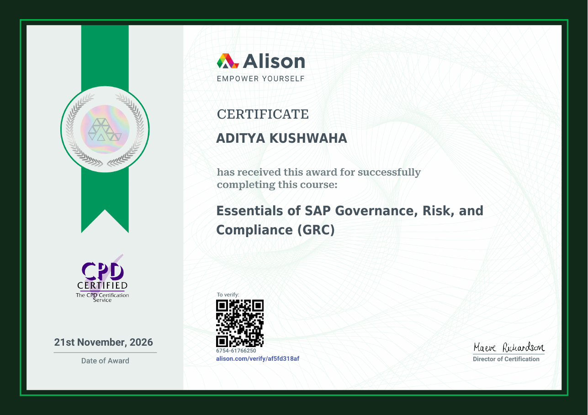
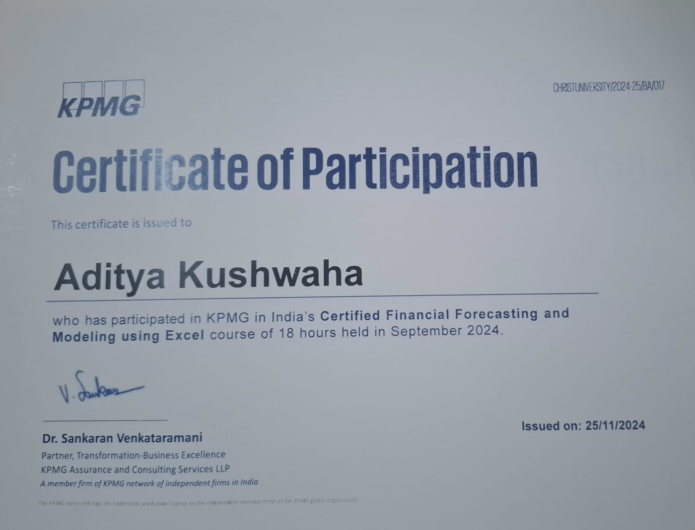

  

  <a href="https://www.linkedin.com/in/aditya-kushwaha16">LinkedIn</a> ·
  <a href="mailto:adityakushwahagzpa@gmail.com">Email</a> ·
  <a href="https://github.com/adityakushwahagzpa-design?tab=repositories">All projects</a>

---

## About

MBA (Finance) from **Christ University, Bengaluru (2025)** and B.Com from the **University of Lucknow**. I work where finance meets data: building models, reconciling numbers and turning raw records into reports people can trust. Each project here comes with its Excel workbook or code, a PDF report and a README explaining the method and findings.

**Open to:** Regulatory Compliance · KYC / AML · Fund Accounting · Finance Operations · MIS Reporting · Credit and Data Analysis &nbsp;|&nbsp; **Based in:** Bengaluru · available to join immediately &nbsp;|&nbsp; **Currently learning:** advanced Power BI data modelling

| Role | Organisation | Period |
|:--|:--|:--|
| Summer Intern — Finance (Cost Analysis and Tendering Process) | NTPC Ltd., Noida | Apr 2024 – Jun 2024 |
| Summer Intern — Operations | NTPC Ltd., Rihand Nagar | Mar 2023 – May 2023 |
| Head, Arthashastra — the Finance Club | Christ University, Bengaluru | 2024 – 2025 |

<b>Experience details</b>

 
### Summer Intern — Finance · NTPC Ltd.
**Noida (EOC)** &nbsp;|&nbsp; *Apr 2024 – Jun 2024*

Project: Cost Analysis and Tendering Process. Financial and quotation review for procurement under the tendering process.

- Review of 40+ vendor quotations against cost estimates and budget, with 6 flagged for further review
- Eligibility check of 20+ vendor submissions, of which 7+ did not meet the required criteria
- Approval checks against delegation of power (DoP) limits and a vendor document checklist
- A vendor-wise evidence file for every submission, set up on own initiative

   

### Summer Intern — Operations · NTPC Ltd.
**Rihand Nagar** &nbsp;|&nbsp; *Mar 2023 – May 2023*

Operational record-keeping within a 5-member team across an 8-week placement.

- Upkeep of 50+ operational records a day across 6+ departments, about 2,000 records in total
- End-of-shift record updates with no major errors; minor documentation gaps flagged
- Exposure to coordination between operations, maintenance and administration

  

### Head — Arthashastra, the Finance Club · Christ University
**Bengaluru** &nbsp;|&nbsp; *2024 – 2025*

Leadership of the university finance club and its 5-member core team.

- 25 finance events in total, including 10 guest lectures
- Finance Quiz and Business Case Competition with 200 participants each
- Stock market simulations and case-based activities, newly introduced

  

---

## Achievements & Certifications

| Recognition | Details |
|:--|:--|
| **Head, Arthashastra Finance Club** | Christ University, 2024 – 2025 |
| **25 Finance Events** | 10 guest lectures; quiz and case competition with 200 participants each |
| **Oracle OCI Triple Certification** | Generative AI Professional, Data Science Professional, AI Foundations Associate |
| **20 Professional Certifications** | Finance, accounting, risk, data and AI |
| **45 Portfolio Projects** | Fund accounting, valuation, equity and industry research, credit, dashboards, finance operations, AML analytics, machine learning and Python |
| **Two NTPC Internships** | Finance (Noida) and Operations (Rihand Nagar) |

| Provider | Certification |
|:--|:--|
|  | [OCI 2025 Generative AI Professional · Data Science Professional · AI Foundations Associate](https://www.linkedin.com/in/aditya-kushwaha16/details/certifications/) |
|  | [SAP FICO for Finance Professionals](https://www.mygreatlearning.com/certificate/RTCBKOTD) (Great Learning) · [Essentials of SAP GRC](https://alison.com/verify/af5fd318af) (Alison) · SAP FICO (Udemy) |
|  | [Certified Financial Forecasting and Modelling using Excel](certificates/KPMG_Financial_Forecasting_Modeling_Excel.jpg) |
|  | Power BI Data Analyst · SQL Server · Preparing Data for Analysis with Excel |
|  | Mergers & Acquisitions (University of Illinois) · Forensic Accounting (West Virginia University) |
|  | Risk Management |
|  | EY Audit · Standard Chartered Credit Analyst |
|  | IFRS 15 & ASC 606 (EDUCBA) · BFSI Essentials (Board Infinity) · Statutory Compliance & Taxation (Tally) · [Power BI Masterclass](https://ude.my/UC-1ce9aaba-bf11-48d0-ad13-f5e94b696d21) (Udemy) · Generative AI for Product Managers (IBM iX) |

<b>Certificate Copies</b>

 

**SAP FICO for Finance Professionals** — Great Learning, Nov 2026 · [Verify](https://www.mygreatlearning.com/certificate/RTCBKOTD) · [PDF](certificates/SAP_FICO_Great_Learning.pdf)

**SAP Governance, Risk, and Compliance (GRC)** — Alison, Nov 2026 · Credential ID 6754-61766250 · [Verify](https://alison.com/verify/af5fd318af) · [PDF](certificates/SAP_GRC_Alison.pdf)

CPD-certified course on managing governance, risk and compliance in SAP:
- **Access Control** – user access reviews and segregation of duties (SoD) checks
- **Process Control** – internal control testing and compliance monitoring
- **Risk Management** – risk identification, assessment and response
- **Global Trade Services** – import and export compliance

**Certified Financial Forecasting and Modeling using Excel** — KPMG in India, Nov 2024 · [Certificate](certificates/KPMG_Financial_Forecasting_Modeling_Excel.jpg)

An 18-hour KPMG programme during the MBA at Christ University: Excel models from historical data, revenue and cost forecasting, scenario and sensitivity analysis, and DCF basics.

**Power BI Masterclass from Scratch in 180 Minutes – 2025** — Udemy, Apr 2025 · [Verify](https://ude.my/UC-1ce9aaba-bf11-48d0-ad13-f5e94b696d21) · [PDF](certificates/Power_BI_Masterclass_Udemy.pdf)

All credentials: [LinkedIn certifications page](https://www.linkedin.com/in/aditya-kushwaha16/details/certifications/)

---

## Selected Projects

| Project | Problem and result | Tools |
|:--|:--|:--|
| **[Fund Accounting & Daily NAV Model](https://github.com/adityakushwahagzpa-design/fund-accounting-nav-model)** | Daily NAV cycle for a ₹71 crore hybrid fund; NAV move from ₹31.40 to ₹32.01 traced line by line with cash, holdings and accrual reconciliations | Excel |
| **[Nippon Life India AMC — Stock Pitch](https://github.com/adityakushwahagzpa-design/adityakushwahagzpa-design/tree/main/projects/nam-india-stock-pitch)** | FCFE DCF and peer P/E blend to a ₹1,000 target vs ₹1,040 price: HOLD | Excel, PDF deck |
| **[Money Mule Ring Detector](https://github.com/adityakushwahagzpa-design/adityakushwahagzpa-design/tree/main/projects/money-mule-ring-detector)** | AML graph analytics on ~64,000 synthetic transfers; all 8 hidden rings found (GNN precision 0.91, recall 1.00) | Python, NetworkX, PyTorch Geometric, Neo4j |
| **[Credit Appraisal Model](https://github.com/adityakushwahagzpa-design/credit-appraisal-model)** | ₹20 crore term-loan appraisal; DSCR 2.39x, recommended at grade CR-2 | Excel |
| **[AP Three-Way Match](https://github.com/adityakushwahagzpa-design/ap-three-way-match)** | PO, GRN and invoice matching with quantity and price variance flags and an approval-ready payment list | Excel, PDF |
| **[Tata Motors PV — Equity Research](https://github.com/adityakushwahagzpa-design/tata-motors-equity-research)** | One-page research report on the post-demerger passenger vehicle business, linked to its valuation model | Excel, PDF |

<b>More project details</b>

 

<b>Nippon Life India AMC — Stock Pitch (HOLD, Target ₹1,000)</b>

 

10-slide equity research pitch with a 9-sheet valuation model, priced on 20 Nov 2026.

| | |
|:--|:--|
| **Stack** | Excel, PDF deck |
| **Scope** | FY22–Q2 FY27 financials, FY31E forecast, 6 listed AMC peers |
| **Key Result** | DCF ₹787 and P/E ₹1,135 blend to a ₹1,000 target vs ₹1,040 price: HOLD |
| **Method** | 15-year FCFE DCF, peer P/E, bull/base/bear scenarios |
| **Repository** | [nam-india-stock-pitch](https://github.com/adityakushwahagzpa-design/adityakushwahagzpa-design/tree/main/projects/nam-india-stock-pitch) |

A strong franchise gaining share, but the price already assumes a decade of strong growth.

<b>Indian Asset Management Industry — Deep Dive</b>

 

9-section industry report with charts, a value-chain diagram and a 7-sheet data book.

| | |
|:--|:--|
| **Stack** | Research report (PDF), Excel |
| **Scope** | ₹83 lakh crore industry, top 10 AMCs, FY26 fee pool of 21 AMCs, SEBI 2026 rules |
| **Key Result** | Distributors take 49% of the ₹60,300 crore fee pool; AMCs turn 47% into ₹17,285 crore of profit |
| **Repository** | [indian-amc-industry-deep-dive](https://github.com/adityakushwahagzpa-design/adityakushwahagzpa-design/tree/main/projects/indian-amc-industry-deep-dive) |

Value chain, competitive dynamics, regulation and where value is created across Indian mutual funds.

<b>Fund Accounting & Daily NAV Model</b>

 

Daily NAV model for a fictional hybrid fund, built the way a fund accounting team runs the daily cycle.

| | |
|:--|:--|
| **Stack** | Excel |
| **Scope** | ₹71 crore hybrid fund, daily valuation and reconciliation cycle |
| **Key Result** | NAV movement from ₹31.40 to ₹32.01 traced line by line |
| **Controls** | Cash, holdings and accrual reconciliations |
| **Repository** | [fund-accounting-nav-model](https://github.com/adityakushwahagzpa-design/fund-accounting-nav-model) |

Pricing of holdings, income and expense accruals, NAV per unit computation and the reconciliation checks that sit behind a signed-off NAV.

<b>Tata Motors Passenger Vehicles — Equity Research</b>

 

One-page equity research report on the post-demerger passenger vehicle business, backed by a linked model.

| | |
|:--|:--|
| **Stack** | Excel, PDF |
| **Scope** | Tata Motors PV (domestic PV + JLR) |
| **Output** | One-page research report with valuation and charts |
| **Repository** | [tata-motors-equity-research](https://github.com/adityakushwahagzpa-design/tata-motors-equity-research) |

Business overview, financial summary, valuation and key risks, with the report and workbook linked to each other.

<b>Starbucks — Three-Statement Model & DCF</b>

 

Fully linked income statement, balance sheet and cash flow model feeding a discounted cash flow valuation.

| | |
|:--|:--|
| **Stack** | Excel, PDF |
| **Scope** | Three linked statements, forecast drivers, DCF |
| **Key Result** | Intrinsic value of about $62 against a market price of about $94 |
| **Repository** | [starbucks-3-statement-dcf](https://github.com/adityakushwahagzpa-design/starbucks-3-statement-dcf) |

Forecast assumptions, free cash flow build, WACC and terminal value, with sensitivity of value to key inputs.

<b>Burger King — LBO Model</b>

 

Leveraged buyout model of the 2010 Burger King take-private transaction.

| | |
|:--|:--|
| **Stack** | Excel, PDF |
| **Scope** | Sources and uses, debt schedule, exit analysis |
| **Output** | Sponsor returns (IRR and MoM) under the deal structure |
| **Repository** | [burger-king-lbo-model](https://github.com/adityakushwahagzpa-design/burger-king-lbo-model) |

Transaction structure, debt paydown from operating cash flow and returns at exit.

<b>Indian IPO Market Analysis</b>

 

Research study of Indian IPO subscriptions and listing-day performance across mainboard and SME issues.

| | |
|:--|:--|
| **Stack** | Excel, PDF |
| **Scope** | 2,020 Indian IPOs |
| **Focus** | Subscription levels, listing gains, segment comparison |
| **Repository** | [ipo-market-analysis-india](https://github.com/adityakushwahagzpa-design/ipo-market-analysis-india) |

Data collection across NSE and BSE issues, segment-wise analysis and the link between subscription demand and listing-day returns.

<b>Credit Appraisal Model</b>

 

Term-loan appraisal in the format of a bank credit note.

| | |
|:--|:--|
| **Stack** | Excel |
| **Scope** | ₹20 crore term loan |
| **Key Result** | DSCR of 2.39x; loan recommended at grade CR-2 |
| **Method** | Financial spreading, DSCR, 5 Cs scorecard |
| **Repository** | [credit-appraisal-model](https://github.com/adityakushwahagzpa-design/credit-appraisal-model) |

Borrower financial analysis, repayment capacity, risk scoring and a final credit recommendation.

<b>AP Three-Way Match</b>

 

Accounts payable control model matching purchase orders, goods receipts and vendor invoices.

| | |
|:--|:--|
| **Stack** | Excel, PDF |
| **Scope** | PO, GRN and invoice matching with exception flags |
| **Basis** | Vendor document checks from the NTPC finance internship |
| **Repository** | [ap-three-way-match](https://github.com/adityakushwahagzpa-design/ap-three-way-match) |

Quantity and price variance checks, exception reporting and an approval-ready payment list.

<b>PhonePe Transaction Insights Dashboard</b>

 

Interactive dashboard of digital payment transactions and loan data.

| | |
|:--|:--|
| **Stack** | Power BI, Excel, PDF |
| **Scope** | Transaction and loan data across 14 states |
| **Output** | State-wise and category-wise KPI views |
| **Repository** | [phonepe-transaction-insights-dashboard](https://github.com/adityakushwahagzpa-design/phonepe-transaction-insights-dashboard) |

Data modelling, KPI design and drill-downs built for a management review.

**Python Finance Projects**

<b>India Market Data Dashboard</b>

 

Python dashboard of Indian indices, ETFs, currency, commodities and crypto in one report.

| | |
|:--|:--|
| **Stack** | Python, pandas, NumPy, Matplotlib, yfinance |
| **Scope** | 10 assets, 2 years of daily prices |
| **Key Result** | Brent crude +42.0% over the year with the highest volatility (47.0%); Nifty Bank and Brent the best diversification pair (correlation -0.28) |
| **Refresh** | Auto-updated every Monday by GitHub Actions |
| **Repository** | [india-market-data-dashboard](https://github.com/adityakushwahagzpa-design/adityakushwahagzpa-design/tree/main/projects/india-market-data-dashboard) |

Returns over four periods, annualised volatility, maximum drawdown and a correlation matrix, with charts and an auto-written report.

<b>NSE Stock Terminal</b>

 

Command-line company snapshot for any NSE stock, in the style of a market data terminal.

| | |
|:--|:--|
| **Stack** | Python, pandas, Matplotlib, yfinance |
| **Scope** | 8-stock watchlist; any NSE symbol on demand |
| **Key Result** | TCS highest ROE in the watchlist (45.6%) at 17x P/E; ICICI Bank +17.6% over the year, Infosys -24.2% |
| **Repository** | [nse-stock-terminal](https://github.com/adityakushwahagzpa-design/adityakushwahagzpa-design/tree/main/projects/nse-stock-terminal) |

Price, valuation, profitability, leverage, dividends and four years of revenue and profit, with a price chart and a comparison table.

<b>Stock Analyst Agents</b>

 

Four rule-based analyst agents score each stock and explain their reasoning; a portfolio manager combines the scores.

| | |
|:--|:--|
| **Stack** | Python classes, pandas, NumPy, Matplotlib, yfinance |
| **Scope** | 12 Nifty 50 stocks |
| **Agents** | Value (30%), Quality (30%), Momentum (20%), Risk (20%) |
| **Key Result** | ICICI Bank (+0.72) and SBI (+0.52) the only Positive views; strong quality offset by weak momentum for Infosys and HUL |
| **Repository** | [ai-stock-analyst-agents](https://github.com/adityakushwahagzpa-design/adityakushwahagzpa-design/tree/main/projects/ai-stock-analyst-agents) |

Transparent rules instead of machine learning, so every view traces back to the P/E, ROE, moving averages or volatility behind it.

<b>Financial News Sentiment Analysis</b>

 

Sentiment scoring of news headlines for 10 large Indian companies, matched to share-price moves.

| | |
|:--|:--|
| **Stack** | Python, VADER sentiment, feedparser, pandas, yfinance |
| **Scope** | About 250–330 headlines over three months |
| **Key Result** | Same-day correlation of 0.47 to 0.62 between sentiment and returns, but almost none with next-day returns |
| **Repository** | [financial-news-sentiment-analysis](https://github.com/adityakushwahagzpa-design/adityakushwahagzpa-design/tree/main/projects/financial-news-sentiment-analysis) |

VADER with a custom finance word list; the result shows headlines mostly describe moves that already happened rather than predict them.

<b>Money Mule Ring Detector</b>

 

Graph analytics that find money mule rings in a bank transfer network.

| | |
|:--|:--|
| **Stack** | NetworkX, scikit-learn, PyTorch Geometric (GraphSAGE), Neo4j |
| **Scope** | 2,000+ accounts, ~64,000 transfers, 8 hidden rings (synthetic) |
| **Key Result** | All 8 rings found; graph neural network precision 0.91, recall 1.00 vs rules 1.00 / 0.84 |
| **Repository** | [money-mule-ring-detector](https://github.com/adityakushwahagzpa-design/adityakushwahagzpa-design/tree/main/projects/money-mule-ring-detector) |

AML rule scoring, Louvain ring grouping, machine learning and Cypher queries for cycles and fan-in hubs.

<b>Insider Cluster-Buy Radar</b>

 

Flags US stocks where 3+ insiders bought shares within 14 days, using SEC Form 4 data.

| | |
|:--|:--|
| **Stack** | pandas, PostgreSQL, SQLAlchemy, SEC EDGAR, yfinance |
| **Scope** | 8,417 insider purchases, Q1 2025 to Q1 2026 |
| **Key Result** | 491 clusters: +2.1 pts vs SPY after 1 week, but median -5.4 pts after 3 months |
| **Refresh** | Auto-updated every Monday by GitHub Actions |
| **Repository** | [insider-cluster-buy-radar](https://github.com/adityakushwahagzpa-design/adityakushwahagzpa-design/tree/main/projects/insider-cluster-buy-radar) |

Weekly alert list from a PostgreSQL database, with returns measured at three horizons.

<b>Earnings Call Stress Detector</b>

 

FinBERT and word-list scoring of management tone in the Q&A of S&P 500 earnings calls.

| | |
|:--|:--|
| **Stack** | Hugging Face FinBERT, pandas, SciPy, yfinance; Whisper and librosa for audio |
| **Scope** | 338 calls, 246 companies, 2023–2025 |
| **Key Result** | Q&A less positive than prepared remarks in 82% of calls; stress index did not predict next-day returns (rho 0.07, p 0.21) |
| **Repository** | [earnings-call-stress-detector](https://github.com/adityakushwahagzpa-design/adityakushwahagzpa-design/tree/main/projects/earnings-call-stress-detector) |

Prepared remarks vs Q&A tone, uncertainty words and evasive phrases, tested against market reactions.

<b>Personal Inflation Tracker</b>

 

OCR of grocery receipts into a personal price index, compared with official US CPI.

| | |
|:--|:--|
| **Stack** | Tesseract OCR, pandas, BLS API, Streamlit |
| **Scope** | 24 sample receipts (fictional store), 14 items; real BLS CPI |
| **Key Result** | OCR read 97.3% of lines; sample basket inflation 4.8% vs 1.8% CPI food at home |
| **Repository** | [personal-inflation-tracker](https://github.com/adityakushwahagzpa-design/adityakushwahagzpa-design/tree/main/projects/personal-inflation-tracker) |

Price checks on every receipt line and a fixed-basket index by item and category. Receipts are clearly labelled sample data.

<b>Credit Default Prediction (ML)</b>

 

Machine learning model that predicts credit card default and turns it into a 300–900 credit score.

| | |
|:--|:--|
| **Stack** | scikit-learn (logistic regression, random forest, gradient boosting), pandas |
| **Scope** | 30,000 borrowers, UCI data set |
| **Key Result** | Gini 0.55; default rate 66.9% in the lowest score band vs 6.0% in the highest; cut-off halves the approved default rate to 10.3% |
| **Repository** | [credit-default-prediction-ml](https://github.com/adityakushwahagzpa-design/adityakushwahagzpa-design/tree/main/projects/credit-default-prediction-ml) |

ROC AUC, Gini, KS and calibration, with a cost-based approval cut-off and fairness-aware feature choice.

<b>Card Fraud Detection</b>

 

Anomaly detection vs supervised machine learning on real card transactions.

| | |
|:--|:--|
| **Stack** | scikit-learn (Isolation Forest, Local Outlier Factor, autoencoder, gradient boosting) |
| **Scope** | 284,807 transactions, 492 frauds |
| **Key Result** | Supervised model caught 73% of frauds reviewing only 0.1% of transactions; best label-free method 45% |
| **Repository** | [card-fraud-anomaly-detection](https://github.com/adityakushwahagzpa-design/adityakushwahagzpa-design/tree/main/projects/card-fraud-anomaly-detection) |

Time-based split and review-budget metrics, the way a fraud operations team measures detection.

<b>Financial Statement Analyzer</b>

 

Automatic extraction of four years of statements for 12 Nifty 50 companies, with ratios and health scores.

| | |
|:--|:--|
| **Stack** | pandas, openpyxl (live Excel formulas), yfinance |
| **Scope** | 12 companies, FY2023–FY2026, 17 ratios |
| **Key Result** | ROCE ranges from 54.9% (TCS) to 9.0% (Reliance); fastest growers L&T and Bharti also carry the most debt |
| **Repository** | [financial-statement-analyzer](https://github.com/adityakushwahagzpa-design/adityakushwahagzpa-design/tree/main/projects/financial-statement-analyzer) |

Piotroski F-score and Altman Z''-score, plus an Excel workbook where every ratio is a formula.

<b>Portfolio Performance Analytics</b>

 

Return, risk and diversification of an NSE stock and gold portfolio against the Nifty 50.

| | |
|:--|:--|
| **Stack** | pandas, SciPy (XIRR), yfinance, Streamlit |
| **Scope** | Sample portfolio, 145 transactions, real NSE prices |
| **Key Result** | XIRR 6.5% vs 5.3% for the same cash flows in the Nifty 50; gold 26% of value but 35% of risk |
| **Repository** | [portfolio-performance-analytics](https://github.com/adityakushwahagzpa-design/adityakushwahagzpa-design/tree/main/projects/portfolio-performance-analytics) |

XIRR, time-weighted return, Sharpe, Sortino, beta, drawdown and risk contribution by holding.

<b>Nifty 50 Market Trend Dashboard</b>

 

Trend, momentum and breadth for every Nifty 50 stock.

| | |
|:--|:--|
| **Stack** | pandas, NumPy, yfinance, Streamlit |
| **Scope** | 50 stocks, 2 years of daily prices |
| **Key Result** | Nifty flat over the year but +13.1% in a month; breadth rebounded from 10% to 69% of stocks above the 200-day average |
| **Refresh** | Auto-updated every Monday by GitHub Actions |
| **Repository** | [nifty-market-trend-dashboard](https://github.com/adityakushwahagzpa-design/adityakushwahagzpa-design/tree/main/projects/nifty-market-trend-dashboard) |

Moving averages, golden and death crosses, RSI, drawdowns and sector returns.

<b>All 45 Projects</b>

 

| Area | Repositories |
|:--|:--|
| **Fund Services** | [fund-accounting-nav-model](https://github.com/adityakushwahagzpa-design/fund-accounting-nav-model) · [hdfc-flexi-cap-fund-analysis](https://github.com/adityakushwahagzpa-design/hdfc-flexi-cap-fund-analysis) |
| **Valuation** | [tata-motors-equity-research](https://github.com/adityakushwahagzpa-design/tata-motors-equity-research) · [eternal-financial-model-dcf](https://github.com/adityakushwahagzpa-design/eternal-financial-model-dcf) · [starbucks-3-statement-dcf](https://github.com/adityakushwahagzpa-design/starbucks-3-statement-dcf) · [amazon-dcf-model](https://github.com/adityakushwahagzpa-design/amazon-dcf-model) · [burger-king-lbo-model](https://github.com/adityakushwahagzpa-design/burger-king-lbo-model) · [comparable-company-analysis](https://github.com/adityakushwahagzpa-design/comparable-company-analysis) · [precedent-transaction-analysis](https://github.com/adityakushwahagzpa-design/precedent-transaction-analysis) · [infosys-financial-statements](https://github.com/adityakushwahagzpa-design/infosys-financial-statements) · [itc-financial-statement-analysis](https://github.com/adityakushwahagzpa-design/itc-financial-statement-analysis) |
| **Credit** | [credit-appraisal-model](https://github.com/adityakushwahagzpa-design/credit-appraisal-model) |
| **Market Research** | [ipo-market-analysis-india](https://github.com/adityakushwahagzpa-design/ipo-market-analysis-india) · [correlation-matrix-diversification](https://github.com/adityakushwahagzpa-design/correlation-matrix-diversification) |
| **Dashboards** | [phonepe-transaction-insights-dashboard](https://github.com/adityakushwahagzpa-design/phonepe-transaction-insights-dashboard) · [european-sales-dashboard](https://github.com/adityakushwahagzpa-design/european-sales-dashboard) · [bajaj-sales-profit-dashboard](https://github.com/adityakushwahagzpa-design/bajaj-sales-profit-dashboard) · [financial-performance-dashboard-tableau](https://github.com/adityakushwahagzpa-design/financial-performance-dashboard-tableau) |
| **MIS & Trackers** | [customer-sales-mis-report](https://github.com/adityakushwahagzpa-design/customer-sales-mis-report) · [training-deployment-tracker](https://github.com/adityakushwahagzpa-design/training-deployment-tracker) · [client-churn-dashboard](https://github.com/adityakushwahagzpa-design/client-churn-dashboard) · [security-cost-roi-analysis](https://github.com/adityakushwahagzpa-design/security-cost-roi-analysis) · [investment-portfolio-tracker](https://github.com/adityakushwahagzpa-design/investment-portfolio-tracker) |
| **Finance Ops** | [ap-three-way-match](https://github.com/adityakushwahagzpa-design/ap-three-way-match) · [cash-application-ar-ageing](https://github.com/adityakushwahagzpa-design/cash-application-ar-ageing) · [bank-reconciliation-excel](https://github.com/adityakushwahagzpa-design/bank-reconciliation-excel) · [ar-ap-ledger-excel](https://github.com/adityakushwahagzpa-design/ar-ap-ledger-excel) |
| **AI in Finance** | [ai-fpa-agent-claude](https://github.com/adityakushwahagzpa-design/ai-fpa-agent-claude) |
| **SQL & Python** | [zepto-sql-analysis](https://github.com/adityakushwahagzpa-design/zepto-sql-analysis) · [netflix-content-analysis](https://github.com/adityakushwahagzpa-design/netflix-content-analysis) |
| **Equity & Industry Research** | [nam-india-stock-pitch](https://github.com/adityakushwahagzpa-design/adityakushwahagzpa-design/tree/main/projects/nam-india-stock-pitch) · [indian-amc-industry-deep-dive](https://github.com/adityakushwahagzpa-design/adityakushwahagzpa-design/tree/main/projects/indian-amc-industry-deep-dive) |
| **Python Finance** | [india-market-data-dashboard](https://github.com/adityakushwahagzpa-design/adityakushwahagzpa-design/tree/main/projects/india-market-data-dashboard) · [nse-stock-terminal](https://github.com/adityakushwahagzpa-design/adityakushwahagzpa-design/tree/main/projects/nse-stock-terminal) · [ai-stock-analyst-agents](https://github.com/adityakushwahagzpa-design/adityakushwahagzpa-design/tree/main/projects/ai-stock-analyst-agents) · [financial-news-sentiment-analysis](https://github.com/adityakushwahagzpa-design/adityakushwahagzpa-design/tree/main/projects/financial-news-sentiment-analysis) |
| **Python Research & ML** | [money-mule-ring-detector](https://github.com/adityakushwahagzpa-design/adityakushwahagzpa-design/tree/main/projects/money-mule-ring-detector) · [insider-cluster-buy-radar](https://github.com/adityakushwahagzpa-design/adityakushwahagzpa-design/tree/main/projects/insider-cluster-buy-radar) · [earnings-call-stress-detector](https://github.com/adityakushwahagzpa-design/adityakushwahagzpa-design/tree/main/projects/earnings-call-stress-detector) · [personal-inflation-tracker](https://github.com/adityakushwahagzpa-design/adityakushwahagzpa-design/tree/main/projects/personal-inflation-tracker) |
| **Python Analytics & ML** | [credit-default-prediction-ml](https://github.com/adityakushwahagzpa-design/adityakushwahagzpa-design/tree/main/projects/credit-default-prediction-ml) · [card-fraud-anomaly-detection](https://github.com/adityakushwahagzpa-design/adityakushwahagzpa-design/tree/main/projects/card-fraud-anomaly-detection) · [financial-statement-analyzer](https://github.com/adityakushwahagzpa-design/adityakushwahagzpa-design/tree/main/projects/financial-statement-analyzer) · [portfolio-performance-analytics](https://github.com/adityakushwahagzpa-design/adityakushwahagzpa-design/tree/main/projects/portfolio-performance-analytics) · [nifty-market-trend-dashboard](https://github.com/adityakushwahagzpa-design/adityakushwahagzpa-design/tree/main/projects/nifty-market-trend-dashboard) |

---

## Skills

| Category | Skills |
|:--|:--|
| **Finance domains** | Fund accounting (daily NAV, accruals, reconciliations) · Valuation (three-statement, DCF, LBO, comps, precedents) · Credit analysis (DSCR, 5 Cs) · KYC / AML (PMLA, FATF, RBI norms) · Finance operations (AP, AR, bank reconciliation) |
| **Analysis & modelling** | Excel (advanced) · Google Sheets · Financial modelling |
| **Reporting & visualisation** | Power BI · Tableau · MS Office |
| **Data & ERP** | SQL · Python (Pandas) · SAP FICO · SAP GRC |
| **Tools & AI** | Git & GitHub · Markdown · Claude · ChatGPT · Google Workspace |

---

## Contribution Heatmap

  

  <picture>
    <source media="(prefers-color-scheme: dark)" srcset="https://raw.githubusercontent.com/adityakushwahagzpa-design/adityakushwahagzpa-design/output/github-snake-dark.svg"/>
    <source media="(prefers-color-scheme: light)" srcset="https://raw.githubusercontent.com/adityakushwahagzpa-design/adityakushwahagzpa-design/output/github-snake.svg"/>
    
  </picture>

---

## GitHub Stats

  
  

  

  

---

## Connect

| | |
|:--|:--|
| **LinkedIn** | [linkedin.com/in/aditya-kushwaha16](https://www.linkedin.com/in/aditya-kushwaha16) |
| **Email** | [adityakushwahagzpa@gmail.com](mailto:adityakushwahagzpa@gmail.com) |
| **GitHub** | [github.com/adityakushwahagzpa-design](https://github.com/adityakushwahagzpa-design) |
| **Portfolio** | [All repositories](https://github.com/adityakushwahagzpa-design?tab=repositories) |

  

