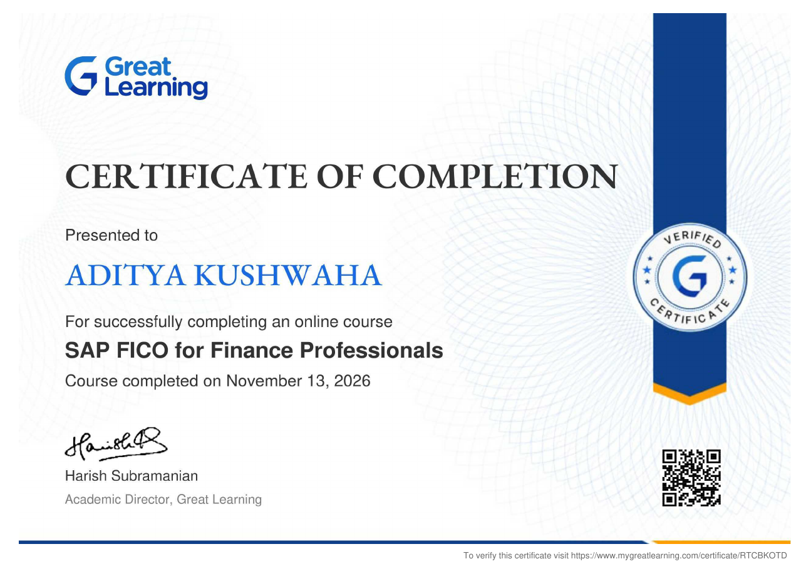
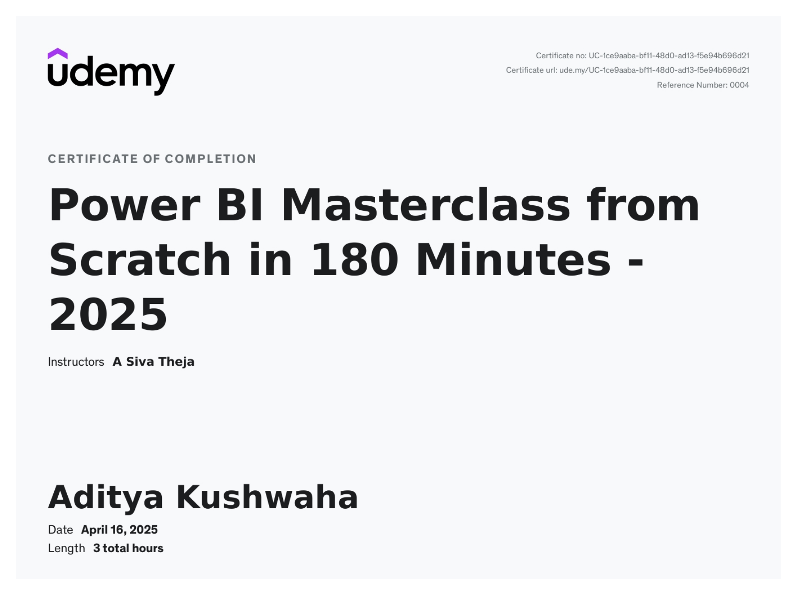

# Hi, I'm Aditya Kushwaha 👋

**MBA (Finance), Christ University, Bengaluru** · B.Com, University of Lucknow 
Financial analysis · Equity research · Financial modelling · MIS reporting · Data analytics

---

## 📈 Equity Research & Valuation
| Project | Highlights | Tools |
|---|---|---|
| [Tata Motors PV – Equity Research](https://github.com/adityakushwahagzpa-design/tata-motors-equity-research) | FY22–FY26 financials, valuation ratios, EV bridge; EBITDA margin 13.3% → 5.6% | Excel, PDF |
| [Starbucks – 3-Statement Model & DCF](https://github.com/adityakushwahagzpa-design/starbucks-3-statement-dcf) | Linked statements to FY2031, WACC 8.5%; value $62 vs $94 share price | Excel, PDF |
| [Amazon – Segment DCF](https://github.com/adityakushwahagzpa-design/amazon-dcf-model) | DCFs for North America, International and AWS; WACC build | Excel |
| [Burger King – LBO with DCF](https://github.com/adityakushwahagzpa-design/burger-king-lbo-model) | 2010 buyout: 5.9x debt/EBITDA, sources & uses, returns, charts | Excel, PDF |
| [Comparable Company Analysis](https://github.com/adityakushwahagzpa-design/comparable-company-analysis) | Apple vs 8 tech peers; implied $103–132 vs $154 price; football field | Excel, PDF |
| [Precedent Transaction Analysis](https://github.com/adityakushwahagzpa-design/precedent-transaction-analysis) | 7 deals; implied offer $104–139 vs $100 unaffected; football field | Excel, PDF |
| [Infosys – Financial Statements & Ratios](https://github.com/adityakushwahagzpa-design/infosys-financial-statements) | FY2026 statements from formulas; ROE 31.2%, FCF ₹31,259 cr | Excel |
| [ITC Ltd – 10-Year Financial Statement Analysis](https://github.com/adityakushwahagzpa-design/itc-financial-statement-analysis) | FY17–FY26 P&L, balance sheet, cash flow; 34–39% margins, 76% dividend payout | Excel, PDF |

## 🏦 Credit Analysis
| Project | Highlights | Tools |
|---|---|---|
| [Standard Chartered Credit Analyst Project – Credit Appraisal](https://github.com/adityakushwahagzpa-design/credit-appraisal-model) | ₹20 cr term loan: ratios, DSCR 2.39x, 5 Cs scorecard → Approve, CR-2 | Excel |

## 💼 Investment & Market Research
| Project | Highlights | Tools |
|---|---|---|
| [Indian IPO Market Research](https://github.com/adityakushwahagzpa-design/ipo-market-analysis-india) | 2,020 IPOs (2007–Sep 2026); subscription vs listing gains, fintech brokers | Excel, PDF |
| [HDFC Flexi Cap Fund Analysis](https://github.com/adityakushwahagzpa-design/hdfc-flexi-cap-fund-analysis) | CAGR, SIP XIRR, Sharpe/Sortino/beta vs 37 peers; 15.5% 5-yr CAGR | Excel, PDF |
| [Correlation Matrix & Diversification](https://github.com/adityakushwahagzpa-design/correlation-matrix-diversification) | 6 assets, 60 months; low-correlation mix cuts volatility from 24.7% to 12.3% | Excel, PDF |

## 📊 Dashboards
| Project | Highlights | Tools |
|---|---|---|
| [Bajaj Sales & Profit Dashboard](https://github.com/adityakushwahagzpa-design/bajaj-sales-profit-dashboard) | 9 KPIs, 14 charts; discounts above 20% lost $135K; live dashboard link | Excel, Claude AI |
| [European Sales Dashboard](https://github.com/adityakushwahagzpa-design/european-sales-dashboard) | 10,000 lines, 15 countries; discounts over 40% run at –59.6% margin | Excel |
| [Financial Performance Dashboard](https://github.com/adityakushwahagzpa-design/financial-performance-dashboard-tableau) | 27,909-line GL, 7 countries; revenue +119%, margin 22.9% → 16.5% | Tableau |

## 📋 MIS Reporting
| Project | Highlights | Tools |
|---|---|---|
| [Customer Sales MIS Report](https://github.com/adityakushwahagzpa-design/customer-sales-mis-report) | Data cleaning + dashboard; 12 orders drive 61.5% of sales | Excel, PDF |

## 📍 Trackers
| Project | Highlights | Tools |
|---|---|---|
| [Client Retention & Churn Dashboard](https://github.com/adityakushwahagzpa-design/client-churn-dashboard) | 14,606 energy clients; churn 9.7%, early-tenure clients churn at 13.6% | Excel |
| [Security Cost & ROI Analysis](https://github.com/adityakushwahagzpa-design/security-cost-roi-analysis) | Guard vs AI monitoring: 54% cheaper, 5-year NPV $351K | Excel |
| [Training Deployment Tracker](https://github.com/adityakushwahagzpa-design/training-deployment-tracker) | 5,000 L&D offerings, 8 regions; 79% fill rate, 13.6% no-shows | Excel |
| [Investment Portfolio Tracker](https://github.com/adityakushwahagzpa-design/investment-portfolio-tracker) | Stocks, ETFs, gold, bitcoin ETF; gain/loss, weights, allocation | Excel |

## 🧾 Accounting & Finance Operations
| Project | Highlights | Tools |
|---|---|---|
| [AP Three-Way Match Model](https://github.com/adityakushwahagzpa-design/ap-three-way-match) | 200 invoices vs POs and GRNs; 37 on hold, ₹11.4 lakh duplicates stopped | Excel, PDF |
| [Cash Application & AR Ageing](https://github.com/adityakushwahagzpa-design/cash-application-ar-ageing) | 9,362 receipts vs 10,000 invoices (₹131.9 cr); 21% of open AR 90+ days | Excel |
| [Bank Reconciliation Statement](https://github.com/adityakushwahagzpa-design/bank-reconciliation-excel) | Cash book vs bank statement; balances agree at 36,200 | Excel |
| [AR & AP Ledger](https://github.com/adityakushwahagzpa-design/ar-ap-ledger-excel) | Status tracking; $8,900 overdue receivable flagged | Excel |

## 🤖 SQL & AI in Finance
| Project | Highlights | Tools |
|---|---|---|
| [AI-Powered FP&A Agent](https://github.com/adityakushwahagzpa-design/ai-fpa-agent-claude) | Budget vs actual on 24 months; caught all 3 planted anomalies | Claude, Excel |
| [Zepto Product Inventory Analysis](https://github.com/adityakushwahagzpa-design/zepto-sql-analysis) | 3,732 products; 12.1% out of stock, discounts by category | SQL, PDF |

## 🐍 Python
| Project | Highlights | Tools |
|---|---|---|
| [Netflix Content Analysis](https://github.com/adityakushwahagzpa-design/netflix-content-analysis) | 6,202 titles; content mix, genres, ratings, growth | Python, Pandas |

---

### 🛠 Skills
Excel (financial modelling, XIRR, SUMIFS, INDEX/MATCH, dashboards) · Tableau · SQL · Python (Pandas) · Power BI · SAP FICO · DCF & LBO valuation · Credit analysis · FP&A · AR/AP · Bank reconciliation

### 🎓 Certifications

| Certification | Issuer | Issued | Valid until |
|---|---|---|---|
| Oracle Cloud Infrastructure 2025 Certified Generative AI Professional | Oracle | Sep 2025 | Sep 2027 |
| Oracle Cloud Infrastructure 2025 Certified Data Science Professional | Oracle | Sep 2025 | Sep 2027 |
| Oracle Cloud Infrastructure 2025 Certified AI Foundations Associate | Oracle | Sep 2025 | Sep 2027 |
| [SAP FICO for Finance Professionals](https://www.mygreatlearning.com/certificate/RTCBKOTD) | Great Learning | Nov 2026 | No expiry |
| [Power BI Masterclass from Scratch in 180 Minutes – 2025](https://ude.my/UC-1ce9aaba-bf11-48d0-ad13-f5e94b696d21) | Udemy | Apr 2025 | No expiry |

**SAP FICO for Finance Professionals** – Great Learning, Nov 2026 · [Verify](https://www.mygreatlearning.com/certificate/RTCBKOTD) · [PDF](certificates/SAP_FICO_Great_Learning.pdf) 
Introductory course covering SAP ERP and S/4HANA, Financial Accounting (General Ledger, Accounts Payable, Accounts Receivable, Asset Accounting) and Controlling (cost centres, profit centres, internal orders), with core processes such as procure-to-pay, order-to-cash, period-end closing and Fiori reporting.

**Power BI Masterclass from Scratch in 180 Minutes – 2025** – Udemy (instructor: A Siva Theja), Apr 2025 · [Verify](https://ude.my/UC-1ce9aaba-bf11-48d0-ad13-f5e94b696d21) · [PDF](certificates/Power_BI_Masterclass_Udemy.pdf) 
A 3-hour introductory course on Power BI, taught from scratch. Certificate no. UC-1ce9aaba-bf11-48d0-ad13-f5e94b696d21.

Also: Investment Risk Management. Credentials can be checked on my [LinkedIn certifications page](https://www.linkedin.com/in/aditya-kushwaha16/details/certifications/).

### 💼 Experience
**Summer Intern – Finance**, NTPC Ltd., Noida · Apr–Jun 2024 
**Summer Intern – Operations**, NTPC Ltd., Rihand Nagar · Mar–May 2023 
**Head, Arthashastra – Finance Club**, Christ University · 2024–2025
