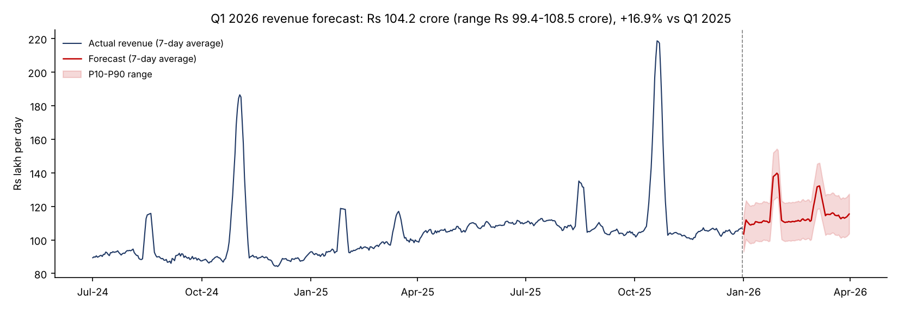
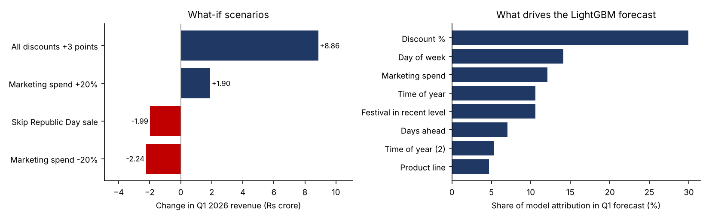

# AI-Powered Revenue Forecasting Engine | Python, LightGBM, Claude

A forecasting engine for a retail business with two layers of AI: a LightGBM machine-learning model that forecasts revenue from festivals, discounts and marketing spend, and a Claude-powered AI analyst that answers questions in plain English ("what if we cut marketing by 10%?") by running the forecast model through tool calls, so every number it quotes comes from the model. It also backtests three models, gives a P10–P90 range and produces an Excel forecast pack, the output an FP&A team would take into a planning meeting.

| | |
|:--|:--|
| **What was analysed** | Three years (2023–2025) of daily revenue for a fictional Indian D2C retailer across Apparel, Electronics and Home (₹1,022 crore in total), with the drivers behind it: Diwali, Holi, Republic Day and Independence Day sales, planned discounts and daily marketing spend. Revenue is simulated, including an 8% Electronics price rise in April 2025 |
| **What was done** | Three models (seasonal naive, Holt-Winters and a LightGBM machine-learning model trained on calendar, festival, discount and marketing features); a rolling backtest forecasting Q2, Q3 and Q4 2025 from the end of each prior quarter; a weighted ensemble chosen on that backtest; P10–P90 ranges from backtest errors (split conformal); what-if scenarios; SHAP-style driver attribution; a Claude AI analyst with four tools (forecast, backtest, drivers, scenario runner); an Excel pack |
| **Key finding** | Q1 2026 revenue is forecast at **₹104.2 crore**, up 16.9% on Q1 2025, with a likely range of ₹99.4–108.6 crore. In the backtest, LightGBM was off by 6.6% a day and 2.5% on quarterly totals, against 11.0% and 6.4% for Holt-Winters, which missed the Diwali quarter by ₹14 crore because it cannot see festivals. Discounts drive the model most (30% of attribution); 3 extra points of discount would add ₹8.9 crore of revenue (+8.5%), but that is revenue, not profit |






## Backtest (Q2–Q4 2025, 90 days ahead from each quarter end)

| Model | Daily error (WAPE) | Quarterly total error | Bias | Ensemble weight |
|:--|--:|--:|--:|--:|
| Seasonal naive (last year × growth) | 14.5% | 2.1% | −0.4% | 0.00 |
| Holt-Winters (damped trend, weekly season) | 11.0% | 6.4% | −6.8% | 0.05 |
| **LightGBM** (calendar, festivals, discounts, marketing) | **6.6%** | 2.5% | +0.1% | 0.95 |
| Ensemble | 6.6% | 2.5% | −0.3% | – |

The seasonal naive model gets quarterly totals right but individual days wrong, because festivals fall on different dates each year. The ensemble weights were chosen on the same three backtest quarters, so its score is slightly optimistic.

## Q1 2026 Forecast

| Month | Forecast (₹ crore) | Same month 2025 | Growth |
|:--|--:|--:|--:|
| January 2026 | 36.2 | 30.3 | +19.6% |
| February 2026 | 31.5 | 26.7 | +17.8% |
| March 2026 | 36.5 | 32.1 | +13.7% |
| **Q1 2026** | **104.2** | **89.1** | **+16.9%** |

Electronics grows fastest (+18.8%), helped by the April 2025 price rise that was not yet in Q1 2025; Apparel is slowest (+14.2%). March grows least because Holi falls 10 days earlier in 2026, so some Holi sales move into late February. The full commentary is in [outputs/COMMENTARY.md](outputs/COMMENTARY.md).

## What-if Scenarios (Q1 2026 revenue, ₹104.2 crore base)

| Scenario | Change |
|:--|--:|
| All discounts +3 points | +₹8.86 crore (+8.5%) |
| Marketing spend +20% | +₹1.90 crore (+1.8%) |
| Skip the Republic Day sale | −₹1.99 crore (−1.9%) |
| Marketing spend −20% | −₹2.24 crore (−2.1%) |

Marketing has diminishing returns: cutting 20% loses more than adding 20% gains.

## The AI Analyst (Claude)

`ai_analyst.py` puts Claude in front of the forecast. Claude gets four tools and a rule that every number must come from a tool:

| Tool | What it returns |
|:--|:--|
| `get_forecast_summary` | Q1 2026 total, P10–P90 range, growth, forecast by month and product line |
| `get_backtest` | Accuracy of each model on Q2–Q4 2025 and the ensemble weights |
| `get_driver_importance` | What the LightGBM forecast depends on |
| `run_scenario` | Re-runs the LightGBM model with changed marketing, discounts, Republic Day sale or Holi promo, for all or chosen product lines |

```
python ai_analyst.py --ask "What if we cut marketing by 10% and skip the Holi promo?"
python ai_analyst.py --commentary      # Claude writes outputs/AI_COMMENTARY.md
python ai_analyst.py                   # chat
```

For the question above, Claude calls `run_scenario(marketing_change_pct=-10, skip_holi_promo=true)`, which returns Q1 revenue of ₹101.99 crore against ₹104.23 crore in the base case (−₹2.24 crore, −2.1%), and explains it. It needs an `ANTHROPIC_API_KEY`; without one, `--commentary` falls back to the rule-based [COMMENTARY.md](outputs/COMMENTARY.md). `test_ai_analyst.py` checks the tools against the engine's numbers and runs the full tool-use loop with a scripted stand-in for Claude, so it passes without a key.

## How the ML Model Works

- **One model for all product lines**, with the product line as a feature, trained on log revenue relative to the recent level (trailing 28-day average), so it can forecast growth that trees cannot extrapolate on their own.
- **Direct multi-step forecasting:** in training, the recent level is measured 1–90 days before each day (chosen at random), with that gap as a feature, so the model learns to forecast up to 90 days ahead without feeding its own forecasts back in.
- **Features:** day of week, month, time of year, Diwali window, Holi, Republic Day and Independence Day sales, planned discount, log marketing spend, festival share of the recent level, days ahead.
- **Ranges:** the 10th and 90th percentiles of actual ÷ forecast in the backtest, for days (0.90–1.10) and for monthly totals (0.95–1.04).
- **Commentary:** `report.py` writes a rule-based version from the numbers; the AI analyst writes a fuller one with Claude.

## Files

| File | Purpose |
|:--|:--|
| `generate_data.py` | Simulates 2023–2025 daily revenue and the Q1 2026 marketing and promotion plan |
| `forecast_engine.py` | Models, backtest, ensemble, ranges, scenarios and driver attribution |
| `report.py` | Charts, `COMMENTARY.md` and `forecast_pack_q1_2026.xlsx` (monthly P10/P50/P90 with formula totals, daily forecast, backtest, scenarios) |
| `ai_analyst.py` | Claude AI analyst: tool definitions, the tool-use loop, `--ask`, `--commentary` and chat |
| `test_forecast.py` | Checks that LightGBM beats both baselines, the ensemble is close to unbiased, the range contains the forecast and the Excel totals tie |
| `test_ai_analyst.py` | Checks the AI analyst's tools and tool-use loop without an API key |

## Run It

```
pip install pandas numpy scipy matplotlib lightgbm statsmodels openpyxl anthropic
python generate_data.py
python forecast_engine.py
python report.py
python test_forecast.py
python test_ai_analyst.py
export ANTHROPIC_API_KEY=...   # then: python ai_analyst.py
```

## Limitations

- Simulated data: real revenue has stock-outs, competitor moves and one-off events that a model trained on three years may not have seen.
- The forecast is only as good as the marketing and promotion plan fed into it; a festival date shift or an unplanned sale changes the answer.
- Scenario results come from the ML model's learned response to discounts and marketing, not from a controlled experiment.

*Fictional company and synthetic data, built for learning.*
