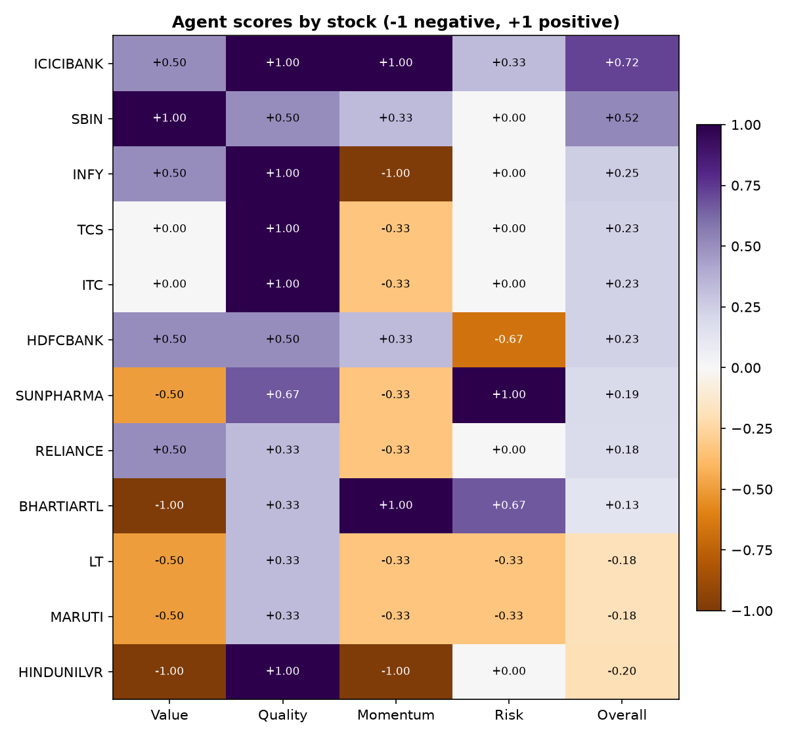

# Stock Analyst Agents

Four rule-based "analyst agents" each review a stock from a different angle and explain their reasoning; a portfolio manager combines their scores into one overall view.

| | |
|:--|:--|
| **What was analysed** | Valuation, profitability, price trend and risk for 12 Nifty 50 stocks, using one year of prices and the latest company ratios |
| **What was done** | Four agents (Value, Quality, Momentum, Risk) that each give a score from -1 to +1 with written reasons, and a portfolio manager that weights them into a Positive, Neutral or Negative view |
| **Key finding** | In the 20 Nov 2026 run, ICICI Bank (+0.72) and SBI (+0.52) were the only Positive views; 10 stocks were Neutral, often because strong quality scores were offset by weak momentum, as with Infosys and Hindustan Unilever |

**Full scorecard with every agent's reasoning:** [outputs/SCORECARD.md](outputs/SCORECARD.md), refreshed every Monday by GitHub Actions.



## The Agents

| Agent | Weight | What it checks |
|:--|:--|:--|
| **Value** | 30% | P/E and P/B against the median of the 12 stocks (more than 20% cheaper = +1, more than 20% dearer = -1) |
| **Quality** | 30% | ROE above 15%, net margin above 15%, Debt/Equity below 0.5x (Debt/Equity is skipped for banks) |
| **Momentum** | 20% | Price above its 200-day average, 50-day above 200-day average, 6-month return above the Nifty |
| **Risk** | 20% | Annual volatility, worst fall from peak and beta against the Nifty |
| **Portfolio manager** | — | Weighted score of 0.25 or more = Positive, -0.25 or less = Negative, otherwise Neutral |

The agents follow fixed, transparent rules rather than machine learning, so every view can be traced back to the numbers behind it. Each agent is a small Python class, which makes it easy to change a rule or add a new agent.

## Run It Yourself

```bash
pip install -r requirements.txt
python agents.py
```

Change the stock list in `UNIVERSE` or the weights in `WEIGHTS` at the top of `agents.py`.

**Tools:** Python (classes), pandas, NumPy, Matplotlib, yfinance

_Rule-based screening for learning purposes only. Not investment advice._
