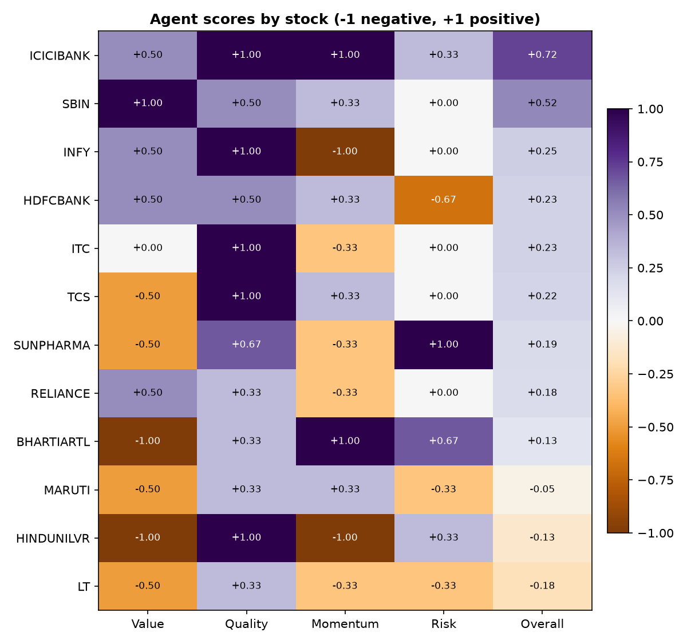

# Analyst Agents Scorecard

Generated 23 Nov 2026. Universe: 12 Nifty 50 stocks. Weights: Value 30%, Quality 30%, Momentum 20%, Risk 20%.

**Positive:** 2  |  **Neutral:** 10  |  **Negative:** 0

| Symbol     | Company                  |   Value |   Quality |   Momentum |   Risk |   Overall | View     |
|:-----------|:-------------------------|--------:|----------:|-----------:|-------:|----------:|:---------|
| ICICIBANK  | ICICI BANK LTD.          |     0.5 |      1    |       1    |   0.33 |      0.72 | Positive |
| SBIN       | STATE BANK OF INDIA      |     1   |      0.5  |       0.33 |   0    |      0.52 | Positive |
| INFY       | INFOSYS LIMITED          |     0.5 |      1    |      -1    |   0    |      0.25 | Neutral  |
| HDFCBANK   | HDFC BANK LTD            |     0.5 |      0.5  |       0.33 |  -0.67 |      0.23 | Neutral  |
| ITC        | ITC LTD                  |     0   |      1    |      -0.33 |   0    |      0.23 | Neutral  |
| TCS        | TATA CONSULTANCY SERV LT |    -0.5 |      1    |       0.33 |   0    |      0.22 | Neutral  |
| SUNPHARMA  | SUN PHARMACEUTICAL IND L |    -0.5 |      0.67 |      -0.33 |   1    |      0.19 | Neutral  |
| RELIANCE   | RELIANCE INDUSTRIES LTD  |     0.5 |      0.33 |      -0.33 |   0    |      0.18 | Neutral  |
| BHARTIARTL | BHARTI AIRTEL LIMITED    |    -1   |      0.33 |       1    |   0.67 |      0.13 | Neutral  |
| MARUTI     | MARUTI SUZUKI INDIA LTD. |    -0.5 |      0.33 |       0.33 |  -0.33 |     -0.05 | Neutral  |
| HINDUNILVR | HINDUSTAN UNILEVER LTD.  |    -1   |      1    |      -1    |   0.33 |     -0.13 | Neutral  |
| LT         | LARSEN & TOUBRO LTD.     |    -0.5 |      0.33 |      -0.33 |  -0.33 |     -0.18 | Neutral  |

## Agent Reasoning

### RELIANCE INDUSTRIES LTD (RELIANCE)

- **Value agent (+0.50):** P/E 22.3 is close to peer median 21.1; P/B 1.9 is 60% below peer median 4.8
- **Quality agent (+0.33):** ROE 8.8% (moderate); Net margin 6.8% (average); Debt/Equity 0.44x (low)
- **Momentum agent (-0.33):** Price above its 200-day average; 50-day average below 200-day average; 6M return +0.2% vs Nifty +6.9%
- **Risk agent (+0.00):** Annual volatility 24.4%; Worst fall from peak -26.9%; Beta vs Nifty 0.96
- **Portfolio manager:** weighted score +0.18 → **Neutral**

### TATA CONSULTANCY SERV LT (TCS)

- **Value agent (-0.50):** P/E 17.2 is close to peer median 21.1; P/B 7.5 is 56% above peer median 4.8
- **Quality agent (+1.00):** ROE 45.6% (strong); Net margin 18.2% (high); Debt/Equity 0.10x (low)
- **Momentum agent (+0.33):** Price above its 200-day average; 50-day average below 200-day average; 6M return +8.8% vs Nifty +6.9%
- **Risk agent (+0.00):** Annual volatility 30.4%; Worst fall from peak -38.5%; Beta vs Nifty 0.73
- **Portfolio manager:** weighted score +0.22 → **Neutral**

### HDFC BANK LTD (HDFCBANK)

- **Value agent (+0.50):** P/E 17.9 is close to peer median 21.1; P/B 2.1 is 57% below peer median 4.8
- **Quality agent (+0.50):** ROE 11.0% (moderate); Net margin 26.5% (high); Debt/Equity skipped: borrowing is the raw material of a bank or lender
- **Momentum agent (+0.33):** Price above its 200-day average; 50-day average below 200-day average; 6M return +8.4% vs Nifty +6.9%
- **Risk agent (-0.67):** Annual volatility 23.8%; Worst fall from peak -31.5%; Beta vs Nifty 1.27
- **Portfolio manager:** weighted score +0.23 → **Neutral**

### ICICI BANK LTD. (ICICIBANK)

- **Value agent (+0.50):** P/E 19.5 is close to peer median 21.1; P/B 2.9 is 39% below peer median 4.8
- **Quality agent (+1.00):** ROE 16.5% (strong); Net margin 27.8% (high); Debt/Equity skipped: borrowing is the raw material of a bank or lender
- **Momentum agent (+1.00):** Price above its 200-day average; 50-day average above 200-day average; 6M return +26.5% vs Nifty +6.9%
- **Risk agent (+0.33):** Annual volatility 21.5%; Worst fall from peak -16.1%; Beta vs Nifty 1.00
- **Portfolio manager:** weighted score +0.72 → **Positive**

### INFOSYS LIMITED (INFY)

- **Value agent (+0.50):** P/E 14.7 is 30% below peer median 21.1; P/B 4.6 is close to peer median 4.8
- **Quality agent (+1.00):** ROE 30.0% (strong); Net margin 16.2% (high); Debt/Equity 0.09x (low)
- **Momentum agent (-1.00):** Price below its 200-day average; 50-day average below 200-day average; 6M return -1.8% vs Nifty +6.9%
- **Risk agent (+0.00):** Annual volatility 31.7%; Worst fall from peak -40.4%; Beta vs Nifty 0.70
- **Portfolio manager:** weighted score +0.25 → **Neutral**

### ITC LTD (ITC)

- **Value agent (+0.00):** P/E 20.0 is close to peer median 21.1; P/B 5.3 is close to peer median 4.8
- **Quality agent (+1.00):** ROE 26.8% (strong); Net margin 24.4% (high); Debt/Equity 0.01x (low)
- **Momentum agent (-0.33):** Price above its 200-day average; 50-day average below 200-day average; 6M return +2.5% vs Nifty +6.9%
- **Risk agent (+0.00):** Annual volatility 23.3%; Worst fall from peak -34.3%; Beta vs Nifty 0.72
- **Portfolio manager:** weighted score +0.23 → **Neutral**

### LARSEN & TOUBRO LTD. (LT)

- **Value agent (-0.50):** P/E 31.6 is 50% above peer median 21.1; P/B 5.0 is close to peer median 4.8
- **Quality agent (+0.33):** ROE 17.9% (strong); Net margin 5.8% (average); Debt/Equity 1.05x (manageable)
- **Momentum agent (-0.33):** Price above its 200-day average; 50-day average below 200-day average; 6M return +4.4% vs Nifty +6.9%
- **Risk agent (-0.33):** Annual volatility 26.1%; Worst fall from peak -24.3%; Beta vs Nifty 1.36
- **Portfolio manager:** weighted score -0.18 → **Neutral**

### HINDUSTAN UNILEVER LTD. (HINDUNILVR)

- **Value agent (-1.00):** P/E 44.8 is 112% above peer median 21.1; P/B 9.7 is 103% above peer median 4.8
- **Quality agent (+1.00):** ROE 21.6% (strong); Net margin 22.0% (high); Debt/Equity 0.03x (low)
- **Momentum agent (-1.00):** Price below its 200-day average; 50-day average below 200-day average; 6M return -6.6% vs Nifty +6.9%
- **Risk agent (+0.33):** Annual volatility 23.2%; Worst fall from peak -26.0%; Beta vs Nifty 0.80
- **Portfolio manager:** weighted score -0.13 → **Neutral**

### STATE BANK OF INDIA (SBIN)

- **Value agent (+1.00):** P/E 11.6 is 45% below peer median 21.1; P/B 1.6 is 67% below peer median 4.8
- **Quality agent (+0.50):** ROE 14.7% (moderate); Net margin 23.0% (high); Debt/Equity skipped: borrowing is the raw material of a bank or lender
- **Momentum agent (+0.33):** Price above its 200-day average; 50-day average below 200-day average; 6M return +19.3% vs Nifty +6.9%
- **Risk agent (+0.00):** Annual volatility 24.8%; Worst fall from peak -22.1%; Beta vs Nifty 1.05
- **Portfolio manager:** weighted score +0.52 → **Positive**

### BHARTI AIRTEL LIMITED (BHARTIARTL)

- **Value agent (-1.00):** P/E 41.9 is 98% above peer median 21.1; P/B 8.4 is 75% above peer median 4.8
- **Quality agent (+0.33):** ROE 21.4% (strong); Net margin 13.6% (average); Debt/Equity 1.00x (manageable)
- **Momentum agent (+1.00):** Price above its 200-day average; 50-day average above 200-day average; 6M return +15.2% vs Nifty +6.9%
- **Risk agent (+0.67):** Annual volatility 21.6%; Worst fall from peak -18.7%; Beta vs Nifty 0.69
- **Portfolio manager:** weighted score +0.13 → **Neutral**

### MARUTI SUZUKI INDIA LTD. (MARUTI)

- **Value agent (-0.50):** P/E 32.7 is 55% above peer median 21.1; P/B 4.0 is close to peer median 4.8
- **Quality agent (+0.33):** ROE 12.9% (moderate); Net margin 6.5% (average); Debt/Equity 0.00x (low)
- **Momentum agent (+0.33):** Price above its 200-day average; 50-day average below 200-day average; 6M return +9.0% vs Nifty +6.9%
- **Risk agent (-0.33):** Annual volatility 26.4%; Worst fall from peak -34.8%; Beta vs Nifty 1.15
- **Portfolio manager:** weighted score -0.05 → **Neutral**

### SUN PHARMACEUTICAL IND L (SUNPHARMA)

- **Value agent (-0.50):** P/E 40.7 is 93% above peer median 21.1; P/B 5.0 is close to peer median 4.8
- **Quality agent (+0.67):** ROE 13.1% (moderate); Net margin 17.8% (high); Debt/Equity 0.04x (low)
- **Momentum agent (-0.33):** Price above its 200-day average; 50-day average below 200-day average; 6M return +1.1% vs Nifty +6.9%
- **Risk agent (+1.00):** Annual volatility 19.9%; Worst fall from peak -13.2%; Beta vs Nifty 0.45
- **Portfolio manager:** weighted score +0.19 → **Neutral**

_Rule-based screening for learning purposes only. Not investment advice._