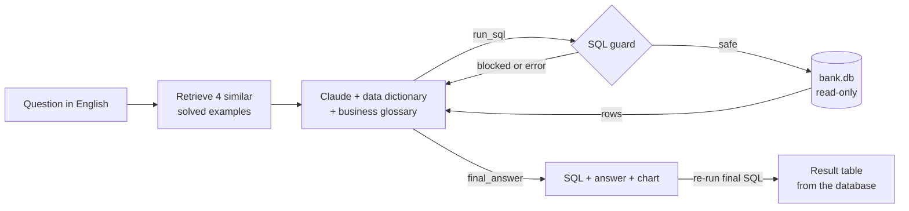
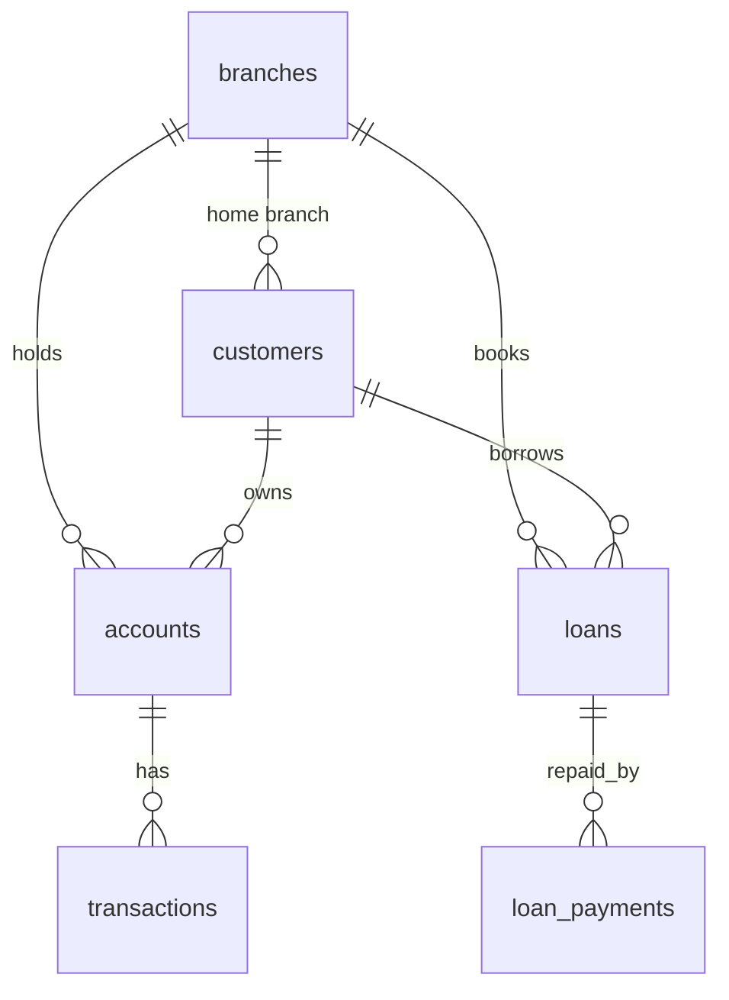

# AI-Powered Text-to-SQL Analytics Assistant

**[Interactive demo](https://adityakushwahagzpa-design.github.io/adityakushwahagzpa-design/text-to-sql.html)** · explore the results in your browser

Ask a business question in plain English, such as "What is the gross NPA ratio by region?", and get back the SQL, the result table from the database, a short explanation and a chart. Claude writes the SQL, tests it, fixes its own errors, and can never change the data: every query passes a two-layer safety guard.

| | |
|:--|:--|
| **What was analysed** | A synthetic database for a fictional Indian retail bank: 6 tables, 20 branches, 6,000 customers, 8,693 accounts, 144,169 transactions, 1,800 loans and 27,929 EMI payments (Apr 2024–Sep 2026) |
| **What was done** | A Claude agent with tools to inspect tables and run SQL, a data dictionary and business glossary (NPA, SMA, CASA, fiscal year, active customer), retrieval of similar solved examples, a read-only SQL guard, a 30-question benchmark with verified answers, and a red-team test of the guard |
| **Key finding** | The guard blocked all 25 attacks (DROP, DELETE, stacked queries, writes hidden in a CTE, ATTACH, PRAGMA, `load_extension`) at both layers, and the database was unchanged. Reusing the nearest solved example's SQL answers 0 of 30 benchmark questions, so every question needs SQL written fresh, which is what the AI does |

## How It Works



1. **Context:** Claude gets the schema with a description of every column, and a glossary that turns bank terms into exact rules. For example, NPA means an active loan more than 90 days past due, and FY2025-26 runs from 1 April 2025 to 31 March 2026.
2. **Examples:** the 4 most similar of 20 solved question-and-SQL pairs are added (TF-IDF retrieval). They never overlap with the benchmark questions.
3. **Tools:** `describe_table` (columns with example values, to get category spellings right), `run_sql` (returns rows or the error) and `final_answer`.
4. **Self-correction:** if a query fails, is blocked, or returns something implausible, Claude sees the error and tries again (up to 8 turns).
5. **No invented numbers:** the final SQL is run again by the code, so the table the user sees comes from the database, not from the model's text.

## Database



| Table | Rows | Key columns |
|:--|--:|:--|
| branches | 20 | region, city |
| customers | 6,000 | segment (Retail, Salaried, Premium, SME), KYC risk, date of birth |
| accounts | 8,693 | Savings / Current / Fixed Deposit, status, balance |
| transactions | 144,169 | date, amount, Credit/Debit, channel (UPI, NEFT, IMPS, Card, ATM, Cheque), merchant category |
| loans | 1,800 | type, principal, outstanding, days past due, status |
| loan_payments | 27,929 | EMI date, amount, paid on time |

## Safety Guard

| Layer | How it works |
|:--|:--|
| **1. Static check** (`sqlglot`) | Exactly one statement, which must be a read-only query; no INSERT/UPDATE/DELETE/DROP/CREATE/ALTER/ATTACH/PRAGMA anywhere, including inside CTEs; only the 6 bank tables (no `sqlite_master`); banned functions such as `load_extension`; a 1,000-row limit added if missing |
| **2. Runtime** (SQLite) | Database opened read-only; an authorizer denies everything except reading, plus reads of system tables and banned functions; queries stop after 10 seconds |

Each layer is tested on its own against 25 attacks: [outputs/security_report.md](outputs/security_report.md). Layer 1 blocked 25 of 25. Layer 2 alone, with layer 1 switched off, blocked 24 of 24 (the empty query sends nothing to the database).

## Benchmark

30 questions with hand-written gold SQL, all checked against the database:

| Level | Examples |
|:--|:--|
| Easy (10) | Active loans, high-risk KYC customers, accounts by type, written-off loans |
| Medium (10) | CASA ratio, gross NPA ratio, SMA buckets, UPI volume by fiscal quarter, top branches by outstanding |
| Hard (10) | NPA borrowers holding over ₹5 lakh in deposits, % active customers, month-on-month spend growth (window function), on-time EMI share by KYC risk, customers with no loan |

A prediction is correct if running it returns the same result as the gold SQL. Row order, column order, extra columns and rounding to 2 decimals are ignored. Results are written to `outputs/eval_<mode>.csv`.

| Mode | Score | Notes |
|:--|--:|:--|
| Gold SQL (sanity check) | 30/30 | Confirms the benchmark and the matching rules |
| Nearest-example baseline (no AI) | 0/30 | Every question needs new SQL |
| Claude agent | run `python evaluate.py --mode claude` | Needs an Anthropic API key; reports accuracy by level and how many questions needed self-correction |

## Run It Yourself

```bash
pip install -r requirements.txt
python build_db.py                     # rebuild data/bank.db (already included)
export ANTHROPIC_API_KEY=your_key
python assistant.py --ask "Which loan type has the highest share of past-due loans?"
python assistant.py                    # interactive
python evaluate.py --mode claude       # benchmark the agent
python assistant.py --baseline --ask "Total deposits by region"   # no-AI baseline
python security_check.py               # red-team the guard
pytest -q                              # 10 tests
```

The tests use a scripted stand-in for Claude to check the full agent loop: a failed query, then `describe_table`, then a fixed query and the final answer. They also check that a DELETE from the agent is blocked and the data is untouched, and that the evaluation harness scores correctly. The model defaults to `claude-sonnet-5-5` (change with `CLAUDE_MODEL`).

*All data is synthetic and the bank is fictional.*

**Tools:** Python · Claude API (tool use) · SQLite · sqlglot · scikit-learn (TF-IDF retrieval) · pandas · matplotlib · pytest
