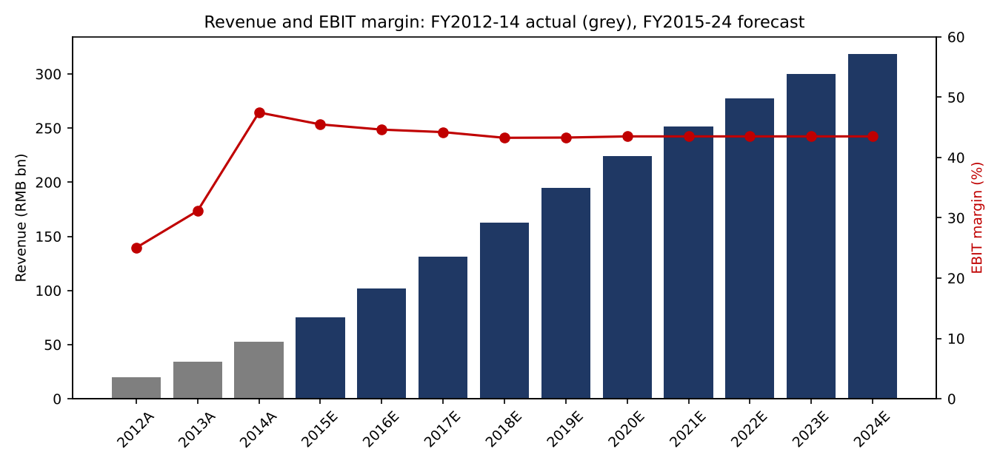
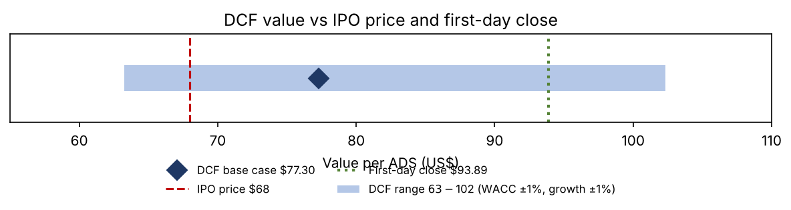

# Alibaba Group IPO Financial Model and DCF Valuation (Excel)

A three-statement model and DCF valuation of Alibaba Group, built from its September 2014 IPO prospectus, testing whether the US$68 IPO price was fair.

| | |
|:--|:--|
| **What was analysed** | Alibaba's FY2012–FY2014 income statements, balance sheets and cash flows, segment revenue, China retail GMV and offering terms, all taken from the F-1/A prospectus (Amendment No. 7, 15 September 2014) |
| **What was done** | A GMV × take-rate revenue build; a linked income statement, balance sheet and cash flow statement for FY2015–FY2024; PP&E, intangibles and debt schedules; a CAPM WACC; an unlevered DCF with mid-year discounting from the IPO pricing date; a WACC × terminal-growth sensitivity table; and the multiples implied by the IPO price |
| **Key finding** | The DCF gives **US$77.30 per ADS**, 13.7% above the US$68 IPO price, on a 10.0% WACC and 3.0% terminal growth. At US$68 the stock was priced at 27.7x FY2015E EV/EBITDA and 35.9x FY2015E earnings. The shares closed their first day at US$93.89, 21% above the DCF value. The DCF range across the sensitivity table is US$63–102 |

**Workbook:** [Alibaba_IPO_Financial_Model.xlsx](Alibaba_IPO_Financial_Model.xlsx), 11 sheets and about 1,500 formulas, with no hardcoded numbers in the forecast.

## Workbook Structure

| Sheet | Contents |
|:--|:--|
| **Cover** | Key outputs, contents with links, colour code, data source |
| **Assumptions** | Every input in one place: GMV growth, take rate, segment growth, cost ratios, tax, capex, depreciation, working capital, deal terms. Historical ratios sit beside the forecast inputs |
| **Revenue** | China commerce = GMV × take rate; international, cloud and other revenue grown separately |
| **IS** | Income statement, FY2012A–FY2024E, with EBITDA and diluted EPS |
| **BS** | Balance sheet with an equity roll-forward and a balance check that is zero in every year |
| **CF** | Cash flow statement; FY2012–14 ties to the reported operating, investing and financing totals, and forecast closing cash feeds the balance sheet |
| **Schedules** | PP&E and depreciation, intangible amortization, bank borrowings and interest |
| **WACC** | CAPM cost of equity (10.2%) and market-value weights at the IPO price |
| **DCF** | Unlevered free cash flow, stub-period handling from 18 September 2014, Gordon-growth terminal value, equity bridge to value per ADS |
| **Sensitivity** | Value per ADS for WACC ±1% and terminal growth ±1%, each cell recalculated with SUMPRODUCT |
| **IPO Analysis** | Deal size (US$21.8bn base deal), primary proceeds, EV/Revenue, EV/EBITDA and P/E at US$68, comparison with the DCF and the first-day close |

## Key Assumptions

| Driver | Assumption | History |
|:--|:--|:--|
| China retail GMV growth | 45% in FY2015, slowing to 6% by FY2024 | 62% (FY2013), 56% (FY2014) |
| Take rate (China commerce revenue / GMV) | 2.70% rising to 2.90% | 2.36%, 2.71%, 2.69% |
| Cost of revenue | 27% of revenue, rising to 30% | 25.5% in FY2014 |
| Effective tax rate | 15% | 15.2%, 14.4%, 11.9% |
| Capex | 9% of revenue, easing to 7% | 9.1% in FY2014 |
| WACC / terminal growth | 10.0% / 3.0% | |

Share-based compensation is treated as a real cost in the DCF (not added back). Options are counted in full with no exercise proceeds, and the Alipay profit share is set to zero in the base case, so the valuation leans conservative.

## Checks

- Balance sheet balances in every forecast year.
- FY2012–FY2014 cash flow totals match the reported figures (operating 9,275 / 14,476 / 26,379; closing cash 16,857 / 30,396 / 33,045).
- The centre of the sensitivity table equals the DCF base case.
- Recalculated with LibreOffice: zero formula errors.

## Data Source

Alibaba Group Holding Limited, [Form F-1/A, Amendment No. 7](https://www.sec.gov/Archives/edgar/data/0001577552/000119312514341794/d709111df1a.htm), filed with the SEC on 15 September 2014. Forecasts are my own assumptions as of September 2014. Educational project, not investment advice.

`build.py` generates the workbook with openpyxl, so every formula and assumption can be reviewed in code.
