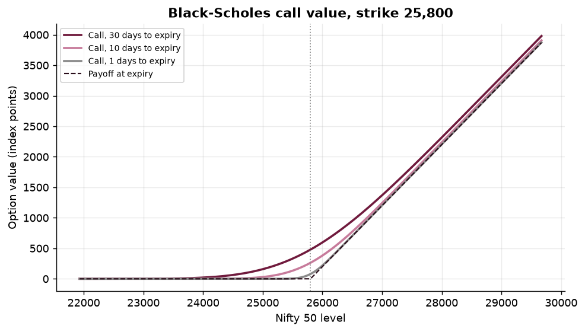
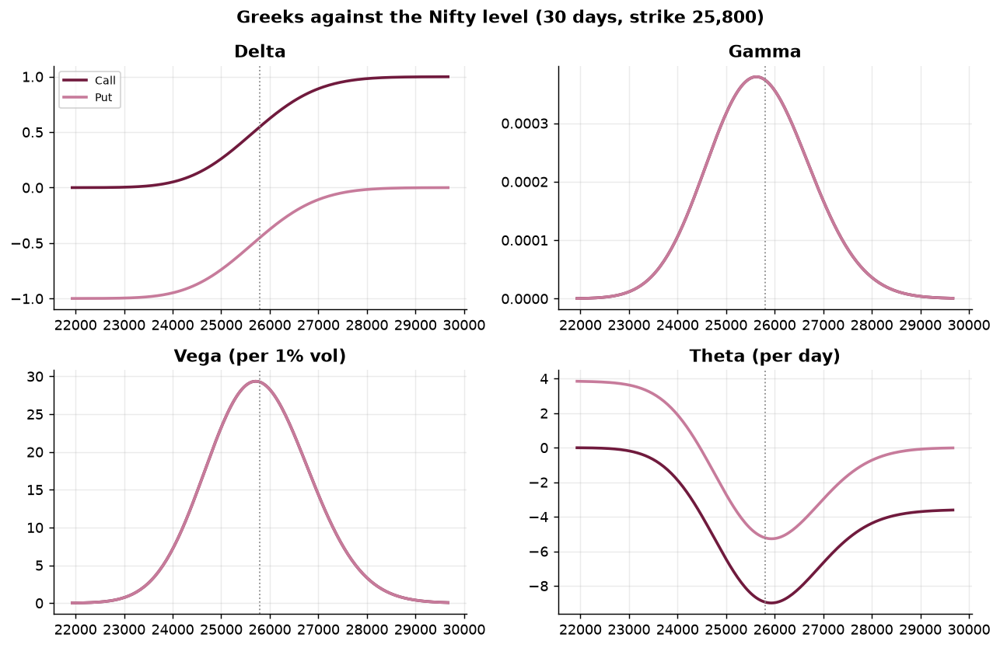
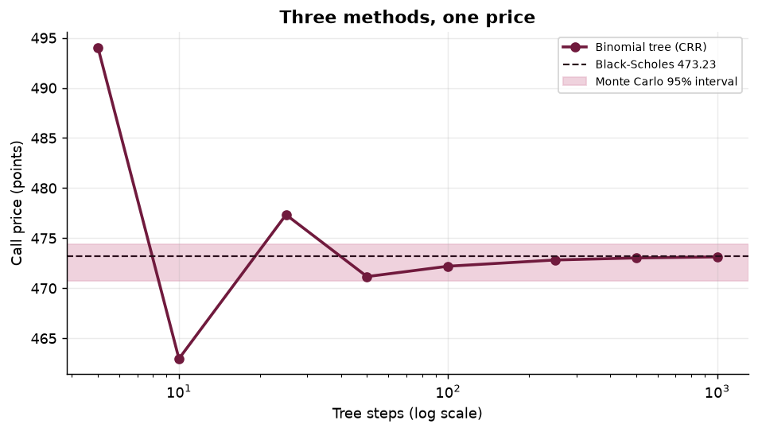
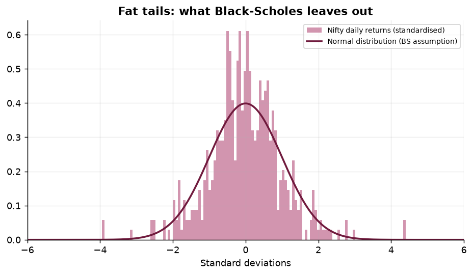

# Black-Scholes Option Pricing on the Nifty 50

Implements Fischer Black and Myron Scholes's *The Pricing of Options and Corporate Liabilities* (Journal of Political Economy, 1973) for Nifty 50 index options: prices, Greeks, three independent checks of the formula, an implied-volatility solver, and a test of the model's normality assumption.

| | |
|:--|:--|
| **What was analysed** | Nifty 50 spot price and one-year historical volatility from two years of daily data to 20 November 2026 (Yahoo Finance); a 30-day at-the-money call and put, plus a strike ladder ±1,500 points |
| **What was done** | Black-Scholes-Merton prices and Greeks (delta, gamma, vega, theta, rho) with a dividend yield; put-call parity check; Cox-Ross-Rubinstein binomial tree up to 1,000 steps; 500,000-path Monte Carlo simulation; Brent's-method implied-volatility solver; skewness, kurtosis and Jarque-Bera test on daily returns |
| **Key finding** | With the Nifty at 25,800.60 and volatility at 14.3%, the 30-day 25,800 call is worth 479.0 points and the put 366.4. All three checks agree: put-call parity holds exactly, the binomial tree lands within 0.1 point, and Monte Carlo gives 478.3 ± 1.9. The weak point is the assumption itself: Nifty returns had excess kurtosis of 2.1 (Jarque-Bera p < 0.001) and 5 days beyond ±3 standard deviations against 1.3 expected, which is why market prices show a volatility smile that Black-Scholes cannot produce |

**Live report:** [outputs/REPORT.md](outputs/REPORT.md), refreshed every Monday by GitHub Actions.









## How It Works

1. **Pricing:** C = S e^(−qT) N(d1) − K e^(−rT) N(d2), with the put from the matching formula; strikes rounded to Nifty's 50-point steps.
2. **Greeks:** closed-form, reported as vega per 1% volatility, theta per calendar day and rho per 1% rate.
3. **Checks:** parity (C − P = S e^(−qT) − K e^(−rT)); a binomial tree that should converge to the formula; Monte Carlo with antithetic variates and a 95% interval.
4. **Implied volatility:** solves for the σ that reproduces a given price; here it recovers the input exactly, and it would turn real option quotes into implied volatilities.

## Limitations

- Uses historical, not implied, volatility; NSE option quotes are not freely downloadable, so no smile is fitted.
- Risk-free rate (6.5%) and dividend yield (1.2%) are assumptions.
- European exercise only, which matches NSE index options.

## Run It Yourself

```bash
pip install -r requirements.txt
python black_scholes.py
```

**Tools:** Python, pandas, NumPy, SciPy, Matplotlib, yfinance

_For learning purposes only. Not investment advice._
