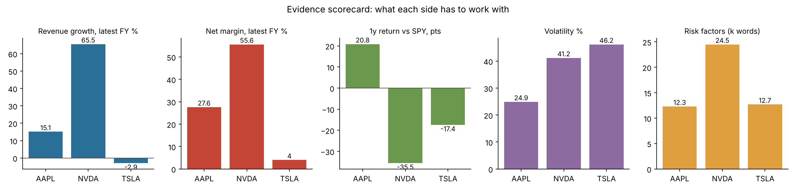

# Bull vs Bear AI Debate

Three Claude AI agents debate whether to own a stock. A Bull agent and a Bear agent argue using only evidence from the company's latest 10-K and market data, each answers the other's case, and a Judge agent scores both sides on evidence quality. Every citation is then checked in code.

| | |
|:--|:--|
| **What was analysed** | Latest 10-K risk factors (Item 1A) and management discussion (Item 7), four years of SEC XBRL financials and one year of market data for NVIDIA, Tesla and Apple |
| **What was done** | Evidence packs of 39 numbered facts per stock ([R#] risk, [M#] MD&A, [F#] financials, [P#] market), Bull, Bear and Judge agents on the Claude API, a rebuttal round, and a code check that flags invented evidence IDs and uncited paragraphs |
| **Key finding** | The numbers split the three stocks clearly: Apple has 5 bull signals and 0 bear, Tesla 1 bull and 5 bear, and NVIDIA is mixed (3 and 3): 65.5% revenue growth and a 7.6x forward P/E against a 35.5-point lag behind the S&P 500 and 41.2% volatility |



## How the Debate Works

| Step | Agent | Rule |
|:--|:--|:--|
| 1 | **Bull** | Makes the buy case in up to 250 words, with an evidence ID after every claim |
| 2 | **Bear** | Makes the avoid/sell case under the same rule |
| 3 | **Rebuttal** | Each side sees the other's case and rebuts its two strongest points |
| 4 | **Code check** | Every [ID] is matched against the evidence pack; invented IDs and paragraphs without a citation are flagged |
| 5 | **Judge** | Scores both sides 0–10 on evidence quality and returns JSON: verdict, confidence, strongest point on each side, unsupported claims, and what would change the verdict |
| 6 | **Penalty** | Each invented ID costs that side 1 point after the Judge's score |

The agents cannot use outside facts, so a claim either traces back to a line in the 10-K or the financials, or it is caught.

## Rule-Based Referee

Alongside the AI verdict, a simple referee scores six signals from the same numbers, so the AI result can be compared with a transparent baseline:

| Signal | Bull if | Bear if | AAPL | NVDA | TSLA |
|:--|:--|:--|--:|--:|--:|
| Revenue growth, latest FY | above 10% | below 0% | 15.1% | 65.5% | -2.9% |
| Net margin | above 20% | below 8% | 27.6% | 55.6% | 4.0% |
| Cash from operations / net income | 0.9x or more | below 0.9x | 1.10x | 0.86x | 3.89x |
| Forward P/E | below 25 | above 50 | 32.4 | 7.6 | 160.2 |
| 1-year return vs S&P 500 | positive | negative | +20.8 pts | -35.5 pts | -17.4 pts |
| Volatility | below 30% | above 40% | 24.9% | 41.2% | 46.2% |
| **Referee view** | | | **Leans bull** | **Mixed** | **Leans bear** |

Market data as of 20 Nov 2026.

## Outputs

| File | Contents |
|:--|:--|
| `outputs/<TICKER>_evidence.json` | Evidence pack with the 10-K link and filing date |
| `outputs/<TICKER>_debate_prompts.md` | Exact prompts every agent receives, plus the referee view |
| `outputs/<TICKER>_debate.md` | Full debate, Judge verdict and citation check (written on a live run) |
| `outputs/debate_summary.json` | Verdict for every stock |
| `outputs/evidence_scorecard.csv/.png` | Key numbers each side has to work with |

## Run It Yourself

```bash
pip install -r requirements.txt
export ANTHROPIC_API_KEY=your_key      # optional
python debate.py                       # all three stocks
python debate.py --tickers NVDA        # one stock
python debate.py --dry-run             # no API calls
pytest -q                              # 7 tests
```

Without an API key the script runs in dry-run mode: it writes the prompts and the referee view, and records the verdict as "dry run". The tests use a scripted stand-in for Claude to check the full five-call debate, the citation check, the invented-ID penalty and the Judge's JSON. The model defaults to `claude-sonnet-5-5` and can be changed with `CLAUDE_MODEL`.

*For learning and portfolio purposes only; not investment advice.*

**Tools:** Python · Claude API (Anthropic SDK) · SEC EDGAR 10-K and XBRL data · matplotlib · pytest
