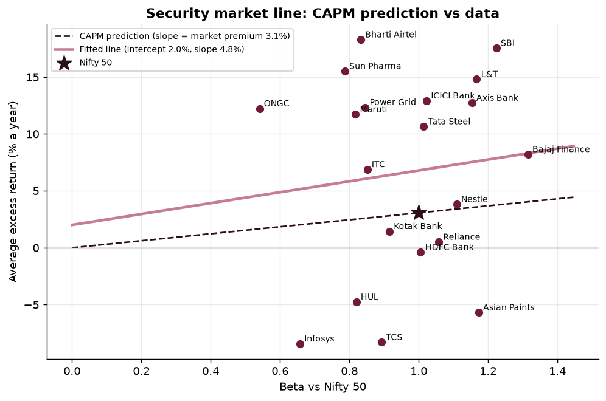
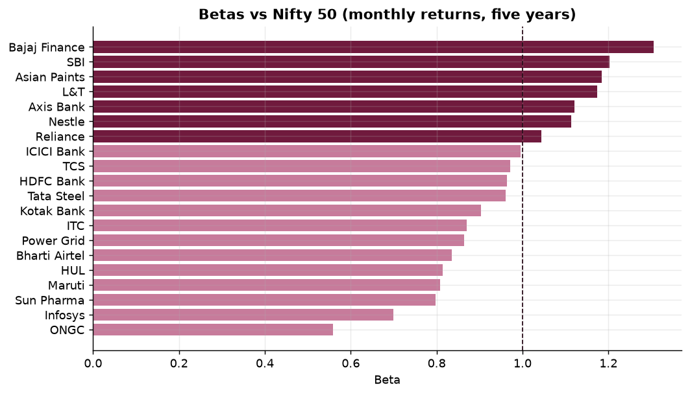

# CAPM Test: Betas and the Security Market Line for Nifty 50 Stocks

Tests William Sharpe's *Capital Asset Prices: A Theory of Market Equilibrium under Conditions of Risk* (Journal of Finance, 1964) on 20 Nifty 50 stocks: estimates each stock's beta and alpha, then checks whether higher-beta stocks actually earned higher returns.

| | |
|:--|:--|
| **What was analysed** | Monthly returns for 20 Nifty 50 stocks across banking, IT, FMCG, energy, autos, pharma and metals against the Nifty 50 index, December 2021 to November 2026 (Yahoo Finance) |
| **What was done** | Time-series regression of each stock's excess return on the market's (beta, Jensen's alpha, R², t-statistics); cross-sectional regression of average return on beta (the security market line); cost of equity for each stock at a 6.5% risk-free rate and 7% equity risk premium (both assumed) |
| **Key finding** | Betas ranged from 0.54 (ONGC) to 1.31 (Bajaj Finance), and the market explained a median 36% of a stock's monthly moves. Only 1 of 20 stocks had a statistically significant alpha (Bharti Airtel, +15.7% a year, t = 2.16). But across stocks, beta did not explain who earned more: the fitted security market line was almost flat (slope 4.8%, t = 0.47, R² 0.01). Over five years, risk as CAPM measures it was not rewarded, in line with the long-standing finding that the SML is flatter than the model predicts |

**Live report:** [outputs/REPORT.md](outputs/REPORT.md), refreshed every Monday by GitHub Actions.





## How It Works

1. **Excess returns:** monthly stock and index returns minus a monthly risk-free rate.
2. **Time series:** for each stock, (R_i − R_f) = α + β(R_m − R_f) + ε by ordinary least squares, with standard errors and t-statistics.
3. **Cross-section:** average excess return regressed on beta. CAPM predicts an intercept of zero and a slope equal to the market premium.
4. **Cost of equity:** R_e = R_f + β × ERP, the input used in DCF valuations.

## Limitations

- Five years and 20 stocks is a small sample; Fama-MacBeth tests use many more stocks and decades.
- Betas are measured with error, which biases the SML slope towards zero.
- The Nifty 50 price index excludes dividends; the risk-free rate and ERP are assumptions.

## Run It Yourself

```bash
pip install -r requirements.txt
python capm.py
```

**Tools:** Python, pandas, NumPy, Matplotlib, yfinance

_For learning purposes only. Not investment advice._
