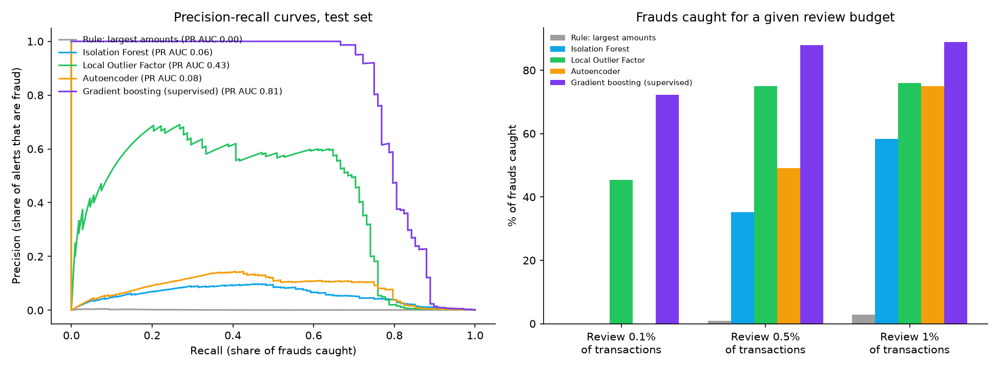

# Card Fraud Detection: Anomaly Detection vs Machine Learning

Compares unsupervised anomaly detection with supervised machine learning for finding fraudulent card transactions, measured the way a fraud team works: how many frauds are caught for a fixed number of reviews.

| | |
|:--|:--|
| **What was analysed** | 284,807 real card transactions by European cardholders over two days (September 2013), of which 492 (0.17%) were fraud; features are anonymised PCA components plus the amount (OpenML data set 1597) |
| **What was done** | A time-based split (first 70% of transactions for training, last 30% for testing); a rule baseline (largest amounts); three unsupervised methods that need no fraud labels (Isolation Forest, Local Outlier Factor, an autoencoder neural network); a supervised gradient boosting model; a hybrid of the supervised model and Isolation Forest; scoring by PR AUC and by recall for review budgets of 0.1%, 0.5% and 1% of transactions |
| **Key finding** | With labelled history, gradient boosting caught 73% of test-period frauds by reviewing just 0.1% of transactions (85 alerts, 93% of them real fraud). The best label-free method, Local Outlier Factor, caught 45% with the same budget, and flagging large amounts caught almost none. Supervised models win when labels exist; anomaly detection is the fallback for new fraud patterns with no history |

**Full results:** [outputs/REPORT.md](outputs/REPORT.md)



## How It Works

1. **Split by time:** the model never sees future transactions, as in a live system.
2. **Unsupervised:** Isolation Forest isolates unusual points with random splits; Local Outlier Factor compares each transaction's density with its neighbours; the autoencoder learns to rebuild normal transactions, so a high rebuild error is suspicious. LOF and the autoencoder learn from normal transactions only.
3. **Supervised:** gradient boosting with extra weight on the rare fraud class.
4. **Evaluation:** with 0.17% fraud, accuracy and ROC AUC look good for almost any model, so the focus is PR AUC and recall at a fixed review budget.

| Model (test set: 85,443 transactions, 108 frauds) | PR AUC | Caught, top 0.1% | Caught, top 0.5% | Caught, top 1% |
|:--|--:|--:|--:|--:|
| Rule: largest amounts | 0.00 | 0% | 1% | 3% |
| Isolation Forest | 0.06 | 0% | 35% | 57% |
| Local Outlier Factor | 0.44 | 45% | 77% | 79% |
| Autoencoder | 0.08 | 0% | 46% | 72% |
| Gradient boosting (supervised) | 0.81 | 73% | 87% | 89% |

## Limitations

- Two days of data from 2013; fraud patterns change quickly.
- PCA features cannot be explained in business terms (merchant, location, device), which a real fraud team would need.
- This copy of the data has no timestamps, so the split uses the file's original time order.

## Run It Yourself

```bash
pip install -r requirements.txt
python detect.py
streamlit run app.py
```

**Tools:** Python, scikit-learn (Isolation Forest, Local Outlier Factor, MLP autoencoder, gradient boosting), pandas, Matplotlib, Streamlit

_For learning purposes only. Links to KYC and AML coursework from the MBA._
