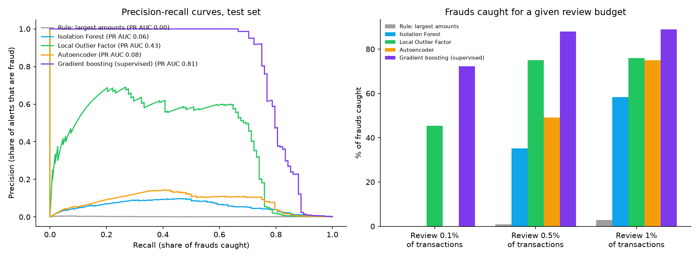

# Card Fraud Detection — Results

284,807 card transactions, 492 frauds (0.173%), OpenML 1597.

Test set: last 30% of the timeline, 85,443 transactions with 108 frauds.

| model                          | type         |   roc_auc |   pr_auc |   recall@top 0.1% |   recall@top 0.5% |   recall@top 1% |
|:-------------------------------|:-------------|----------:|---------:|------------------:|------------------:|----------------:|
| Rule: largest amounts          | rule         |     0.411 |    0.002 |               0   |               0.9 |             2.8 |
| Isolation Forest               | unsupervised |     0.947 |    0.057 |               0   |              35.2 |            58.3 |
| Local Outlier Factor           | unsupervised |     0.929 |    0.427 |              45.4 |              75   |            75.9 |
| Autoencoder                    | unsupervised |     0.942 |    0.082 |               0   |              49.1 |            75   |
| Gradient boosting (supervised) | supervised   |     0.976 |    0.806 |              72.2 |              88   |            88.9 |

_recall@top 0.5% = share of frauds caught when analysts review the 0.5% highest-scored transactions._