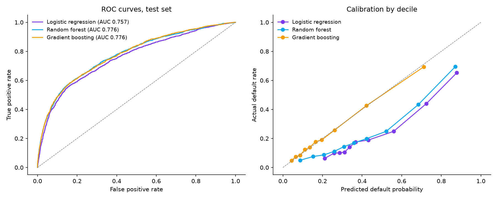
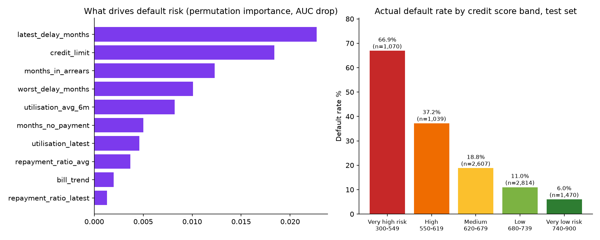

# Credit Default Prediction (Machine Learning)

Predicts which credit card borrowers will default next month and turns the model into a 300–900 credit score with an approval cut-off.

| | |
|:--|:--|
| **What was analysed** | 30,000 credit card borrowers from the public "Default of Credit Card Clients" data set (UCI Machine Learning Repository): credit limit, age, education, six months of repayment status, bills and payments; 22.1% defaulted |
| **What was done** | Feature building (credit utilisation, repayment ratio, months in arrears, worst delay, bill trend); comparison of logistic regression, random forest and gradient boosting on a 30% test set; credit-risk metrics (ROC AUC, Gini, KS, Brier score); a 300–900 scorecard with five risk bands; a cost-based approval cut-off; permutation importance to explain the drivers |
| **Key finding** | Gradient boosting and random forest reached a Gini of 0.55 (AUC 0.78, KS 0.42) against 0.51 for logistic regression. The score separates risk clearly: 66.9% of borrowers in the lowest band defaulted against 6.0% in the highest. At the cost-based cut-off, approving 56.7% of applicants cuts the default rate from 22.1% to 10.3% while stopping 73.7% of defaulters. Recent payment delay was the strongest driver |

**Full results:** [outputs/REPORT.md](outputs/REPORT.md)





## How It Works

1. **Data:** downloaded from UCI (OpenML as a fallback). Sex and marital status are left out of the model on fairness grounds.
2. **Features:** 13 borrower-level measures that a credit analyst would read, such as utilisation (bill ÷ limit) and the share of last month's bill that was repaid.
3. **Models:** logistic regression (the classic scorecard approach), random forest and gradient boosting, all trained on 70% of borrowers and tested on the other 30%.
4. **Credit score:** gradient boosting probabilities (trained without class weights, so they match real default rates) are scaled to 650 points at 4:1 good-to-bad odds, with every 50 points doubling the odds.
5. **Cut-off:** the probability threshold that minimises total cost, assuming a missed defaulter costs five times a wrongly declined good customer.

| Model | ROC AUC | Gini | KS | Brier |
|:--|--:|--:|--:|--:|
| Logistic regression | 0.757 | 0.514 | 0.402 | 0.189 |
| Random forest | 0.776 | 0.552 | 0.419 | 0.168 |
| Gradient boosting | 0.776 | 0.553 | 0.420 | 0.135 |

| Score band | Borrowers (test) | Actual default rate |
|:--|--:|--:|
| Very high risk, 300–549 | 1,070 | 66.9% |
| High, 550–619 | 1,039 | 37.2% |
| Medium, 620–679 | 2,607 | 18.8% |
| Low, 680–739 | 2,814 | 11.0% |
| Very low risk, 740–900 | 1,470 | 6.0% |

## Limitations

- The data comes from one Taiwanese bank in 2005; behaviour and regulation differ from Indian lending today.
- The 5:1 cost ratio is an assumption; a lender would use its own loss and margin figures.
- Education is still in the model; a full fairness review would test outcomes across groups.

## Run It Yourself

```bash
pip install -r requirements.txt
python model.py
streamlit run app.py
```

**Tools:** Python, scikit-learn, pandas, NumPy, Matplotlib, Streamlit

_For learning purposes only. Links to Financial Risk Management coursework from the MBA._
