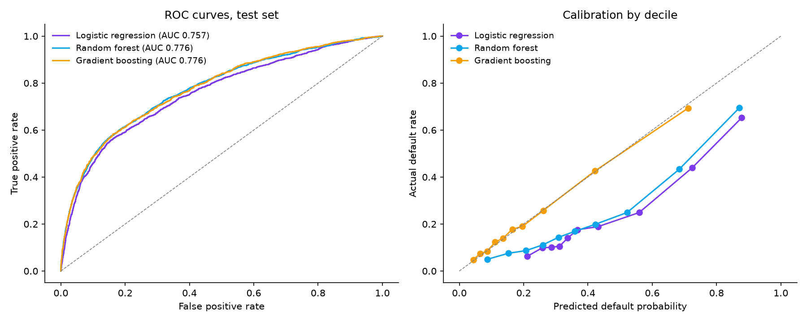
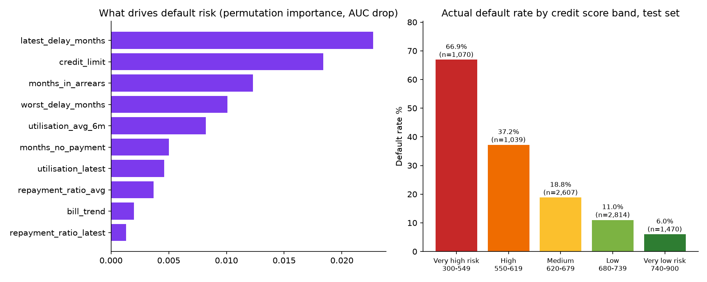

# Credit Default Prediction — Results

Default of Credit Card Clients (UCI Machine Learning Repository, data set 350), 30,000 borrowers, default rate 22.1%.

## Model comparison (30% test set)

| model               |   roc_auc |   gini |    ks |   brier |
|:--------------------|----------:|-------:|------:|--------:|
| Logistic regression |     0.757 |  0.514 | 0.402 |  0.1888 |
| Random forest       |     0.776 |  0.552 | 0.419 |  0.1682 |
| Gradient boosting   |     0.776 |  0.553 | 0.42  |  0.1354 |

## Credit score bands

| band                   |   borrowers |   default_rate_% |
|:-----------------------|------------:|-----------------:|
| Very high risk 300-549 |        1070 |             66.9 |
| High 550-619           |        1039 |             37.2 |
| Medium 620-679         |        2607 |             18.8 |
| Low 680-739            |        2814 |             11   |
| Very low risk 740-900  |        1470 |              6   |

## Cost-based approval cut-off

|                           |   value |
|:--------------------------|--------:|
| cutoff_pd                 |    0.17 |
| approval_rate_%           |   56.7  |
| defaulters_caught_%       |   73.7  |
| good_customers_declined_% |   34.7  |
| default_rate_approved_%   |   10.25 |
| default_rate_all_%        |   22.12 |

_For learning purposes only._