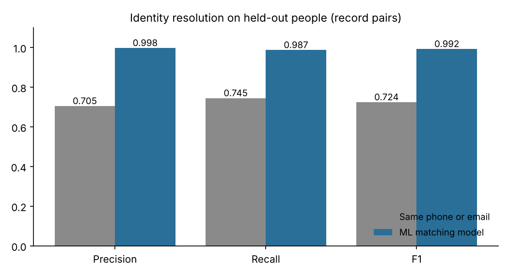
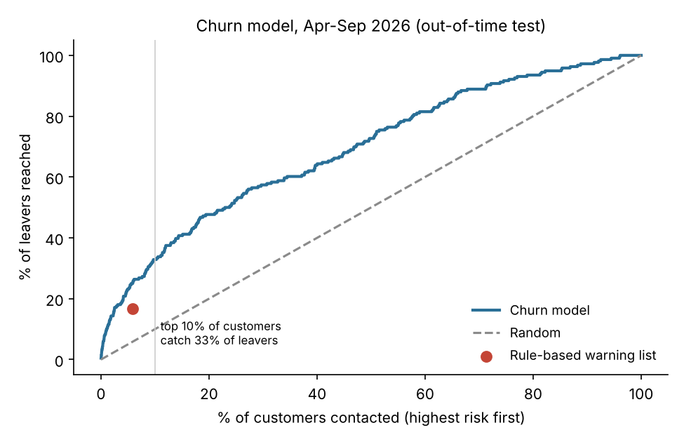
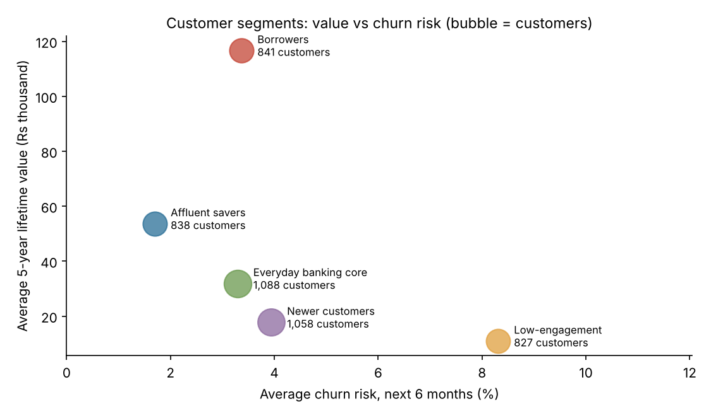
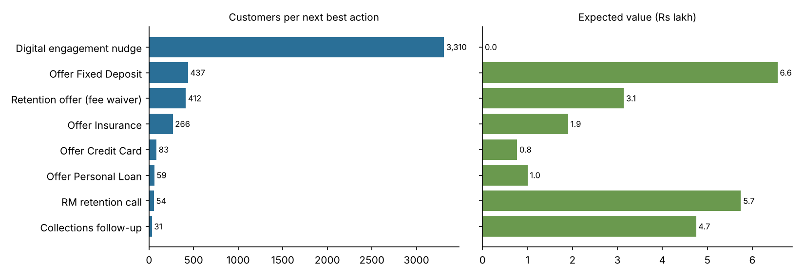

# Customer 360 Intelligence Platform (AI-Powered)

**[Interactive demo](https://adityakushwahagzpa-design.github.io/adityakushwahagzpa-design/customer-360.html)** · explore the results in your browser

One trusted view of every customer, and what to do next with each one. The platform resolves duplicate customer records across three bank systems, builds a single 360 table, scores churn risk, product propensity and lifetime value, picks a next best action for each customer within credit and KYC guardrails, and gives relationship managers (RMs) a Claude assistant that writes meeting briefs from the data.

| | |
|:--|:--|
| **What was analysed** | 14,410 records from core banking, CRM and the card system, 30 months of activity (Apr 2024–Sep 2026), 19,298 CRM interactions and 2,831 product take-ups for a fictional bank's 6,000 customers (same bank as the [text-to-SQL project](../ai-text-to-sql-assistant)). All data is synthetic |
| **What was done** | ML identity resolution, a 360 table of 40 features, LightGBM churn and propensity models with out-of-time validation, K-means segments, 5-year lifetime value, a next-best-action engine, and a Claude assistant with 4 tools |
| **Key finding** | Matching records with a model reaches F1 0.992, against 0.724 for matching on the same phone or email. The churn model's top 10% of customers catch 33% of leavers, 3.3 times random. At the same list size it reaches 25.0% of leavers, against 16.7% for a rule-based warning list |

## 1. Identity Resolution: One Golden Record per Customer



The CRM and card system hold the same people as core banking, but messily:
- names with initials ("A. Sharma"), swapped order, typos and odd case
- phone numbers in different formats, or an old number
- missing emails or dates of birth, and dates in DD/MM/YYYY
- duplicate contacts
- 350 prospects and 180 card-only customers who aren't in core banking at all

| Step | Method |
|:--|:--|
| Standardise | Names (case, dots, spacing), phones (last 10 digits), emails, dates |
| Block | Compare only records sharing a phone, email, date of birth or name words: 203,062 comparisons instead of 104 million |
| Match | Logistic regression on 10 field similarities (Jaro-Winkler, token sort, phone/email/DOB match, DOB conflict), trained on 30% of people and tested on the other 70% |
| Cluster | Union-find, strongest matches first; core banking is the system of record, so two core customers are never merged |

| Result (held-out people) | ML matching | Same phone or email |
|:--|--:|--:|
| Precision | 0.998 | 0.705 |
| Recall | 0.987 | 0.745 |
| F1 | **0.992** | 0.724 |

98.9% of CRM and card records were linked to the right customer, and 98.4% of non-customers were correctly left unlinked. The match also found **183 card-only customers** (180 truly), who are candidates for a savings account.

## 2. The 360 Table

One row per active customer, built for any month-end using only data up to that month (a test checks that future data cannot leak in):

| Area | Features |
|:--|:--|
| Profile | Age, tenure, segment, region, KYC risk |
| Products | Savings, current, fixed deposit, loan, credit card, personal loan, insurance; product count |
| Behaviour | Last-3-month transactions, spend, inflows, app logins and balance, and each one's trend vs the 3 months before; digital share; fees |
| Service (CRM, via identity resolution) | Complaints and service requests in 6 months, last NPS score |
| Credit | Loan outstanding, days past due, % of EMIs paid on time |

## 3. Models

Out-of-time validation: trained on the Sep 2025 snapshot, tested on what actually happened in Apr–Sep 2026.

| Model | Test customers | Base rate | AUC | Top-10% lift |
|:--|--:|--:|--:|--:|
| Churn (next 6 months) | 4,806 | 4.5% | 0.700 | 3.3x |
| Takes a Fixed Deposit | 3,194 | 4.7% | 0.755 | 2.9x |
| Takes a Credit Card | 2,477 | 3.3% | 0.746 | 3.3x |
| Takes Insurance | 4,396 | 2.9% | 0.738 | 3.1x |
| Takes a Personal Loan | 4,393 | 2.2% | 0.599 | 1.8x |



The strongest churn signals are falling transactions, inflows, spend and balances, plus short tenure. The personal-loan model is weak and should not be used to target customers yet.

## 4. Segments, Lifetime Value and Next Best Action



| Segment | Customers | Avg 5-year value | Churn risk |
|:--|--:|--:|--:|
| Borrowers | 841 | ₹1,16,643 | 3.4% |
| Affluent savers | 838 | ₹53,633 | 1.7% |
| Everyday banking core | 1,088 | ₹31,871 | 3.3% |
| Newer customers | 1,058 | ₹17,757 | 3.9% |
| Low-engagement | 827 | ₹10,923 | 8.3% |

- **Lifetime value:** yearly margin is deposit spread plus spend fees, service fees and lending margin. It's projected over 5 years, discounted at 12% and reduced by each customer's churn risk. Total: ₹20.6 crore across 4,652 active customers.
- **Next best action:**
  - High value and high churn risk: RM retention call.
  - High churn risk only: retention offer.
  - More than 30 days past due: collections.
  - Otherwise, the product with the highest expected value (propensity × yearly margin).
  - Guardrail: no loans or credit cards for customers more than 30 days past due or with High KYC risk. A test enforces it.



## 5. AI Relationship-Manager Assistant (Claude)

| Tool | Returns |
|:--|:--|
| `get_customer_360` | Full profile, trends, service history, loan health, scores, value, action and guardrail flag |
| `find_customers` | Customers by segment, city, region, minimum churn risk or value, or action, sorted and limited |
| `get_segment_profile` | Size, value and risk of each segment |
| `get_portfolio_summary` | Totals, value at risk, planned actions and model accuracy |

```bash
python rm_assistant.py --brief 3110
python rm_assistant.py --ask "Which high-value customers in Pune are most likely to leave?"
```

Claude must take every fact from a tool and follow the guardrails. Without an API key, `--brief` writes a rule-based brief from the same tool output. Samples are in [outputs/briefs](outputs/briefs): a retention case, a fixed-deposit offer, and a collections case with a "Do not offer credit" warning.

## Run It Yourself

```bash
pip install -r requirements.txt
python generate_sources.py      # source systems and activity (synthetic)
python identity_resolution.py   # golden customer ids and matching accuracy
python models.py                # 360 table, models, segments, value, actions
python report.py                # charts, Excel pack, sample briefs
pytest -q                       # 13 tests
```

## Outputs

| File | Contents |
|:--|:--|
| `outputs/customer_360.csv` | The 360 table for 4,652 active customers with all scores and actions |
| `outputs/customer_360_pack.xlsx` | Summary, segments, model accuracy, and the top 300 actions with a total |
| `outputs/identity_crosswalk.csv` | Every source record mapped to its golden customer id |
| `outputs/identity_metrics.json` · `platform_summary.json` | All metrics behind this README |

*All data is synthetic; the bank and its customers are fictional.*

**Tools:** Python · pandas · scikit-learn · LightGBM · rapidfuzz · SQLite · Claude API (tool use) · matplotlib · openpyxl · pytest
