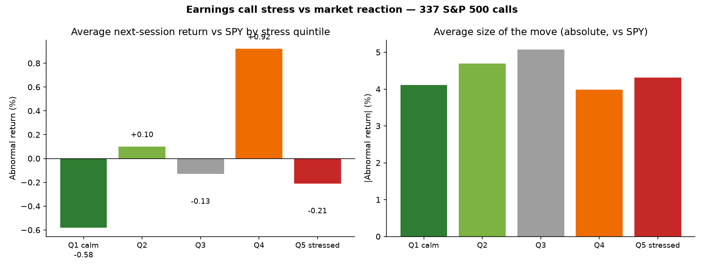

# Earnings Call Stress Detector

Measures how much management's tone weakens once analysts start asking questions on S&P 500 earnings calls, and tests whether "stressed" calls lead to worse stock reactions.

| | |
|:--|:--|
| **What was analysed** | 338 S&P 500 earnings call transcripts with speaker tags (246 companies, January 2023 to May 2025) from the kurry/sp500_earnings_transcripts data set, matched to next-session stock returns versus SPY |
| **What was done** | Separation of each call into prepared remarks and executive answers in the Q&A; FinBERT tone scoring on both parts; counts of uncertainty words (Loughran-McDonald subset) and evasive phrases ("too early to say", "we don't disclose"); a combined stress index; quintile and Spearman tests against the market reaction |
| **Key finding** | In 82% of calls the Q&A was less positive than the scripted remarks (average FinBERT tone 0.22 vs 0.38). But the stress index did not predict the next-day move (Spearman 0.07, p = 0.21), and the most stressed fifth of calls did no worse than the calmest fifth. Text stress alone is not a trading signal; the reaction depends mostly on the numbers and guidance |

**Full results:** [outputs/REPORT.md](outputs/REPORT.md)



## How It Works

1. **Split the call:** the first operator line that introduces a question marks the start of Q&A. Speakers in the prepared remarks count as executives; the speaker right after each operator introduction counts as the analyst.
2. **Score tone:** up to 25 prepared sentences and 40 answer sentences per call go through ProsusAI/FinBERT (positive minus negative probability, -1 to +1).
3. **Count words:** uncertainty words and evasive phrases per 1,000 words of executive answers.
4. **Stress index:** average z-score of low Q&A tone, the prepared-to-Q&A tone drop, uncertainty and evasion.
5. **Market test:** stock return minus SPY on the first session that reflects the call (next day for after-close calls).

| Signal vs next-day abnormal return | Spearman | p-value |
|:--|--:|--:|
| Stress index | 0.07 | 0.21 |
| Q&A tone | 0.04 | 0.43 |
| Tone drop, prepared to Q&A | 0.16 | 0.003 |
| Uncertainty words | -0.01 | 0.83 |
| Evasive phrases | 0.05 | 0.34 |

The only significant link runs the opposite way to the stress idea: a bigger tone drop came with slightly better reactions, possibly because cautious answers lower expectations.

## Optional audio module

`audio_features.py` takes a call recording you supply, transcribes it with Whisper and measures voice signals with librosa: pitch variability, speaking rate, pause share and loudness variability. It is not part of the automated run because no free, licence-clean set of call recordings is available.

## Limitations

- The transcript data set ends in May 2025, and 400 calls were sampled to keep FinBERT runtime on a CPU manageable.
- One-day reactions are noisy; earnings surprises versus consensus are not controlled for.
- Executive and analyst roles come from turn order, so a few lines may be misassigned.

## Run It Yourself

```bash
pip install -r requirements.txt
N_CALLS=400 python stress.py
streamlit run app.py
```

**Tools:** Python, Hugging Face Transformers (FinBERT), pandas, SciPy, yfinance, Matplotlib, Streamlit; Whisper and librosa for audio

_For learning purposes only. Not investment advice._
