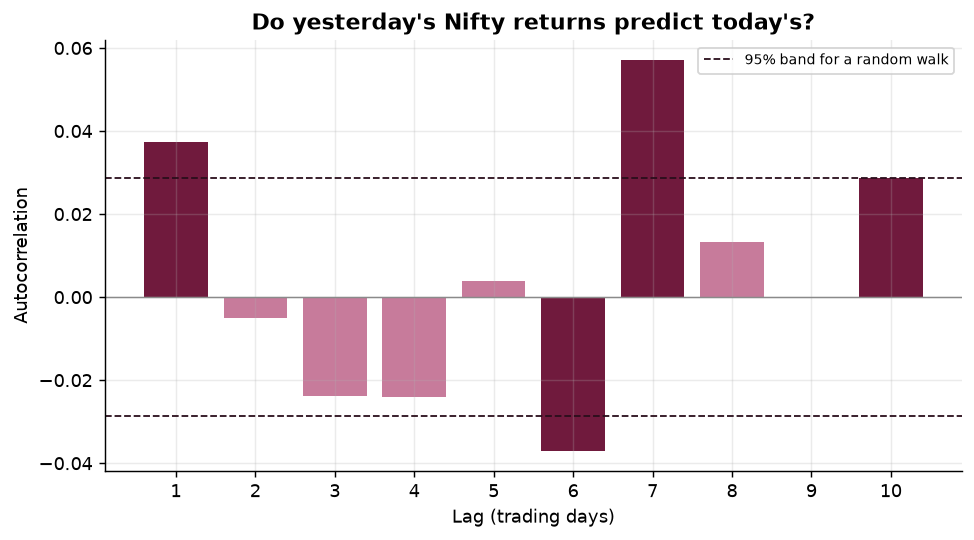
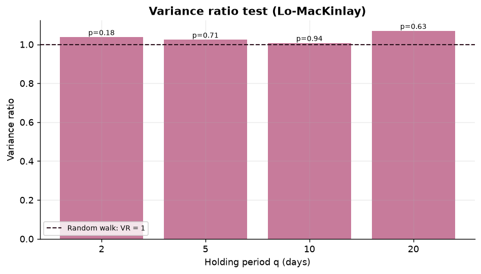
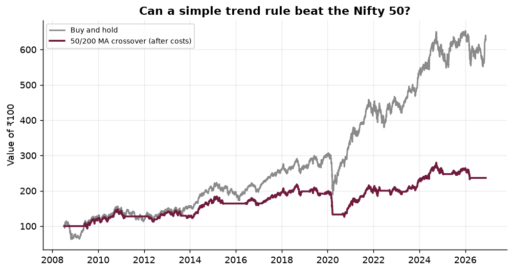

# Efficient Market Hypothesis: Weak-Form Tests on the Nifty 50

Tests Eugene Fama's *Efficient Capital Markets: A Review of Theory and Empirical Work* (Journal of Finance, 1970) on 19 years of Nifty 50 data: can past prices predict future returns?

| | |
|:--|:--|
| **What was analysed** | 4,704 daily returns of the Nifty 50 index, September 2007 to November 2026 (Yahoo Finance), in full and in three sub-periods |
| **What was done** | Autocorrelation at lags 1 to 10 with the Ljung-Box test; Lo-MacKinlay variance ratio test (2 to 20 days, robust to changing volatility); runs test on the signs of returns; a 50/200-day moving-average crossover rule against buy-and-hold after 0.10% cost per trade |
| **Key finding** | Small patterns exist but are not exploitable. Daily returns showed slight momentum (lag-1 autocorrelation 0.038; Ljung-Box and runs tests reject a pure random walk), mostly in 2007–2014 (0.075) and close to zero in 2020–2026 (0.005). Variance ratios were not significant at any horizon once volatility clustering is allowed for. The trend rule cut volatility (12.7% vs 19.5%) but earned 4.9% a year against 10.9% for buy-and-hold: the weak form of efficiency holds in the sense that matters for investors |

**Live report:** [outputs/REPORT.md](outputs/REPORT.md), refreshed every Monday by GitHub Actions.







## How It Works

1. **Autocorrelation:** correlation of each day's return with returns 1 to 10 days earlier; a random walk stays inside ±1.96/√n.
2. **Variance ratio:** under a random walk, the variance of q-day returns is q times the 1-day variance (VR = 1). The heteroskedasticity-robust z statistic of Lo and MacKinlay (1988) is used; it was checked by simulation to reject 5% of the time on random data.
3. **Runs test:** counts streaks of up and down days against the number expected by chance.
4. **Trading rule:** long the index when the 50-day average is above the 200-day average, in cash otherwise, trading the day after each signal.

## Limitations

- Uses the price index: dividends (about 1–1.5% a year) would add to buy-and-hold, and interest on the cash leg would add a little to the rule. Neither changes the conclusion.
- Index-level tests cannot see stock-level anomalies; daily index data can show slight autocorrelation from stale prices of less-traded stocks.
- Weak form only: semi-strong (public news) and strong form (private information) are not tested.

## Run It Yourself

```bash
pip install -r requirements.txt
python emh_tests.py
```

**Tools:** Python, pandas, NumPy, SciPy, Matplotlib, yfinance

_For learning purposes only. Not investment advice._
