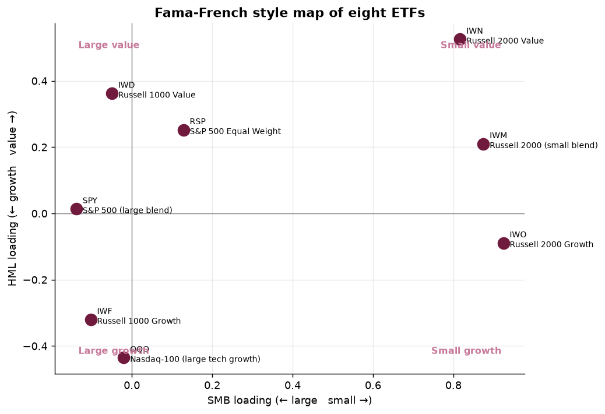
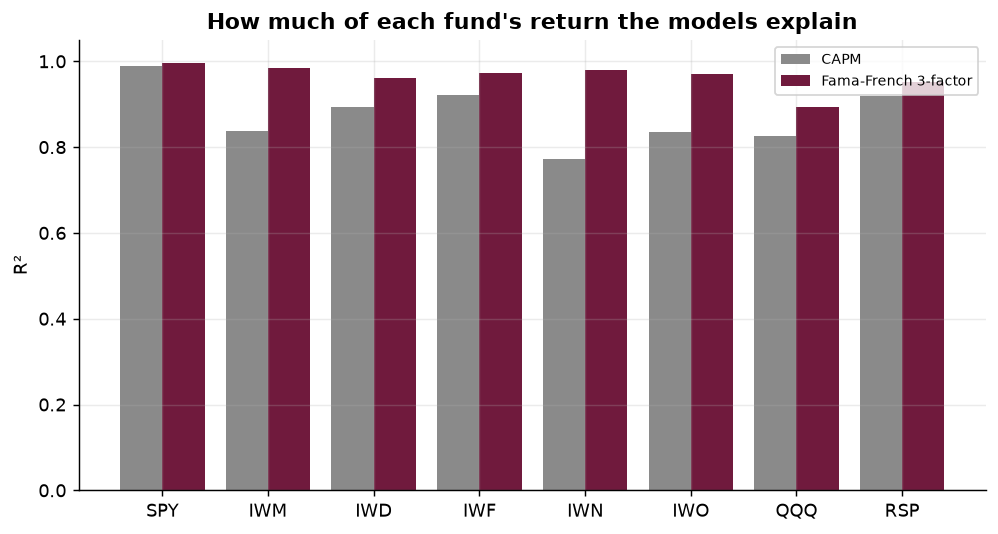
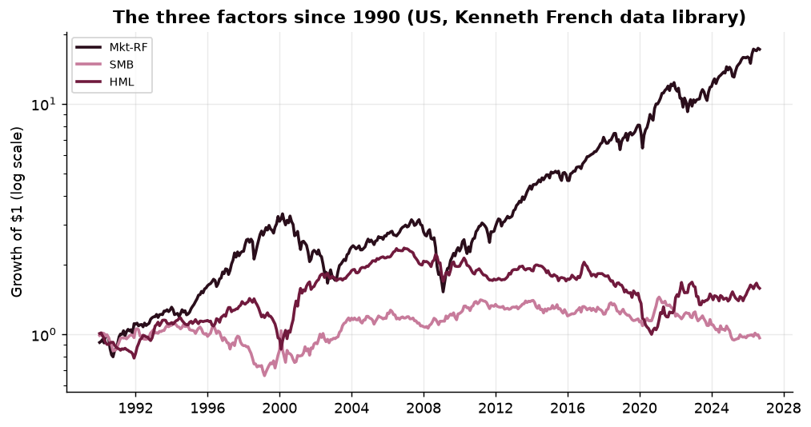

# Fama-French Three-Factor Model on US Equity ETFs

Applies Eugene Fama and Kenneth French's *Common Risk Factors in the Returns on Stocks and Bonds* (Journal of Financial Economics, 1993) to eight US ETFs with known styles: does the three-factor model identify each fund's size and value tilt, and does it explain more than the CAPM?

| | |
|:--|:--|
| **What was analysed** | Monthly returns of eight ETFs (S&P 500, Russell 2000, Russell 1000 Value and Growth, Russell 2000 Value and Growth, Nasdaq-100, S&P 500 Equal Weight), February 2004 to September 2026, against the Fama-French market, size (SMB) and value (HML) factors from Kenneth French's data library |
| **What was done** | CAPM and three-factor regressions for every fund (loadings, t-statistics, alpha, R²); a style map of SMB against HML loadings; factor premia before and after 2007 |
| **Key finding** | The loadings matched every fund's style: the small-cap value fund loaded +0.82 on size and +0.53 on value, Nasdaq-100 −0.44 on value, the S&P 500 near zero on both. Adding size and value raised average R² from 0.87 (CAPM) to 0.96, and only one fund kept a significant alpha (Nasdaq-100, +2.7% a year, t = 2.05). The premia themselves faded: value (HML) paid 5.2% a year in 1990–2006 but −2.0% a year since 2007, and size went from +1.0% to −1.0% |

**Live report:** [outputs/REPORT.md](outputs/REPORT.md), refreshed every Monday by GitHub Actions.







## How It Works

1. **Factors:** monthly Mkt−RF, SMB, HML and RF downloaded and parsed from the Kenneth French data library.
2. **Fund returns:** dividend-adjusted monthly ETF returns minus the risk-free rate.
3. **Regressions:** CAPM (market only) and three-factor (market, SMB, HML) by ordinary least squares.
4. **Premia:** compounded annual factor returns for 1990–2006 and 2007 onwards.

## Limitations

- US data, because Kenneth French's library is the standard public source; Indian factor data would need a separate dataset.
- ETF returns include fees, which pull alphas slightly negative.
- Later models (five factors, momentum) are not included.

## Run It Yourself

```bash
pip install -r requirements.txt
python fama_french.py
```

**Tools:** Python, pandas, NumPy, Matplotlib, yfinance

_For learning purposes only. Not investment advice._
