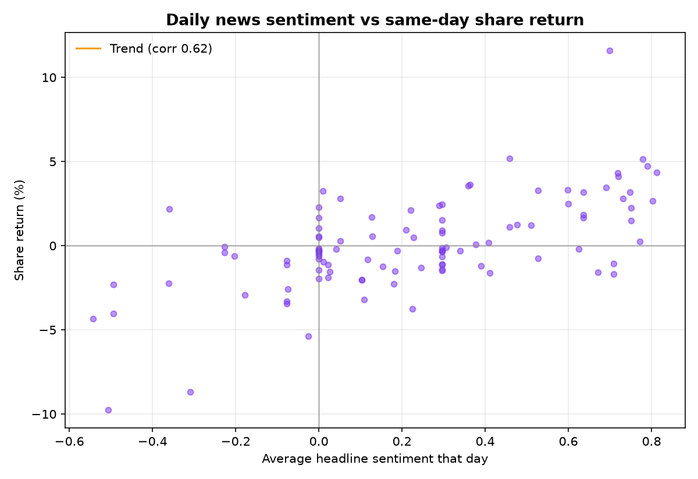
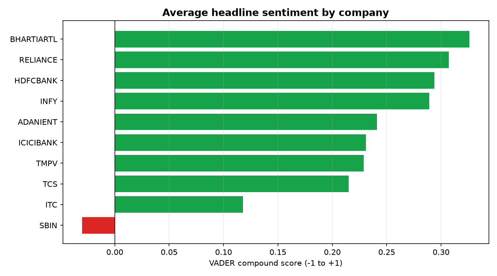

# Financial News Sentiment Analysis

Scores recent news headlines for 10 large Indian companies as positive, neutral or negative, and tests whether the tone of the news lines up with share-price moves.

| | |
|:--|:--|
| **What was analysed** | About 250 Google News headlines from the last three months for Reliance, TCS, Infosys, HDFC Bank, ICICI Bank, ITC, SBI, Bharti Airtel, Tata Motors PV and Adani Enterprises, matched to daily NSE returns |
| **What was done** | Sentiment scoring with VADER plus a custom finance word list (e.g. "surges", "downgrade", "penalty"), then a comparison of daily average sentiment with same-day and next-day returns |
| **Key finding** | In the 20 Nov 2026 run, daily sentiment had a 0.59 correlation with same-day returns but almost none with next-day returns (0.06): headlines mostly describe price moves that already happened rather than predict them |

**Live report:** [outputs/REPORT.md](outputs/REPORT.md), refreshed every Monday by GitHub Actions.





## How It Works

1. **Collect:** `fetch_headlines()` reads the Google News RSS feed for each company and removes near-duplicate stories.
2. **Score:** each headline gets a VADER compound score from -1 to +1. About 60 finance words are added to VADER's dictionary so that market language like "slumps" or "upgrade" is read correctly.
3. **Match:** headline scores are averaged per company per day and joined to that day's and the next day's share return.
4. **Report:** sentiment by company, the most positive and negative headlines, correlations and average returns on good-news and bad-news days.

## Limitations

- The RSS feed returns only recent headlines, so the sample is small.
- A same-day link does not mean news caused the move; headlines are often written after the price has moved.
- VADER is a general-purpose model and can misread context even with the finance word list.

## Run It Yourself

```bash
pip install -r requirements.txt
python sentiment.py
```

**Tools:** Python, pandas, NumPy, Matplotlib, VADER sentiment, feedparser, yfinance

_For learning purposes only. Not investment advice._
