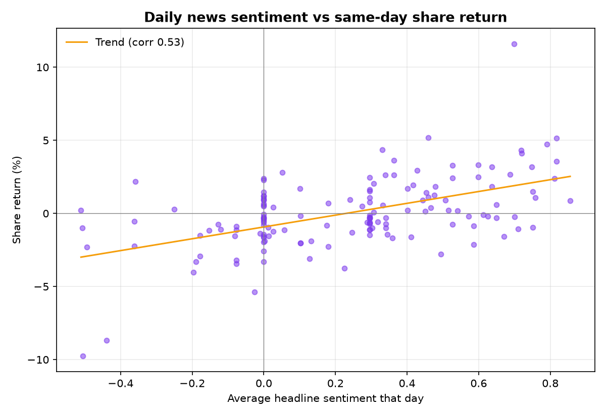

# News Sentiment Report

Generated 21 Nov 2026. 314 headlines for 10 companies, 23 Aug 2026 to 21 Nov 2026.

## Key Results

- **Headline mix:** 200 positive, 58 neutral, 56 negative.
- **Most positive coverage:** RELIANCE (avg +0.35); **most negative:** TMPV (avg +0.04).
- **Same-day link:** correlation between daily sentiment and that day's return = **0.53** across 146 company-days.
- **Next-day link:** correlation with the following day's return = **0.09**.
- **Average return on positive-news days:** +0.72%; on negative-news days: -2.23%.

## Sentiment by Company

| Symbol     |   Headlines |   Avg_Sentiment |   Positive_pct |   Negative_pct |
|:-----------|------------:|----------------:|---------------:|---------------:|
| RELIANCE   |          26 |           0.351 |         76.923 |         15.385 |
| HDFCBANK   |          44 |           0.35  |         70.455 |         11.364 |
| ICICIBANK  |          22 |           0.341 |         68.182 |          4.545 |
| SBIN       |          65 |           0.288 |         67.692 |         13.846 |
| TCS        |          19 |           0.268 |         68.421 |         10.526 |
| BHARTIARTL |          17 |           0.266 |         58.824 |          0     |
| INFY       |          27 |           0.262 |         70.37  |         22.222 |
| ITC        |          12 |           0.227 |         66.667 |         25     |
| ADANIENT   |          15 |           0.135 |         53.333 |         26.667 |
| TMPV       |          67 |           0.037 |         47.761 |         32.836 |

## Most Positive Headlines

| Symbol   | Date        | Headline                                                                                                                 |   Sentiment |
|:---------|:------------|:-------------------------------------------------------------------------------------------------------------------------|------------:|
| SBIN     | 12 Nov 2026 | SBI shares gain 1%, among top Nifty gainers, as brokerages bullish on loan growth, profitability outlook                 |        0.93 |
| TMPV     | 19 Nov 2026 | Maruti Suzuki shares jump 5%, M&M, Tata Motors, Eicher Motors rally as Nifty Auto surges 2.6%                            |        0.92 |
| HDFCBANK | 05 Nov 2026 | HDFC Bank shares witness strong buying, rise 7% in 1 month. Can new CEO, improving fundamentals drive next leg of rally? |        0.91 |
| SBIN     | 04 Nov 2026 | SBI shares: Strong NII, improving margins drive analysts' optimism after Q2                                              |        0.9  |
| HDFCBANK | 20 Nov 2026 | HDFC Bank shares surges 1.6% as banking stocks rally to fresh highs                                                      |        0.88 |

## Most Negative Headlines

| Symbol   | Date        | Headline                                                                                                                |   Sentiment |
|:---------|:------------|:------------------------------------------------------------------------------------------------------------------------|------------:|
| TMPV     | 16 Nov 2026 | Tata Motors Passenger Vehicles shares crash over 9% after Rs 5,531 crore quarterly loss, Jaguar Land Rover cuts outlook |       -0.78 |
| TMPV     | 16 Nov 2026 | India's Tata Motors PV falls on JLR outlook cut, weak Chinese demand                                                    |       -0.76 |
| TMPV     | 16 Nov 2026 | Tata Motors PV shares plunge over 9% after ₹5,531 crore Q2 loss, JLR guidance cut                                       |       -0.76 |
| TMPV     | 16 Nov 2026 | Tata Motors PV shares plunge 7%, top Nifty loser as weak JLR margins, guidance cut weigh on outlook                     |       -0.73 |
| TMPV     | 16 Nov 2026 | Tata Motors PV Shares Crash 9% on Q2 Loss, JLR Outlook                                                                  |       -0.68 |

## Limitations

- Google News RSS returns only recent headlines (about 100 per search), so the sample is small.
- Headlines are often written after the price has moved, so a same-day link does not mean news caused the move.
- VADER is a general-purpose model; the finance word list improves it but it can still misread context.

_For learning purposes only. Not investment advice._