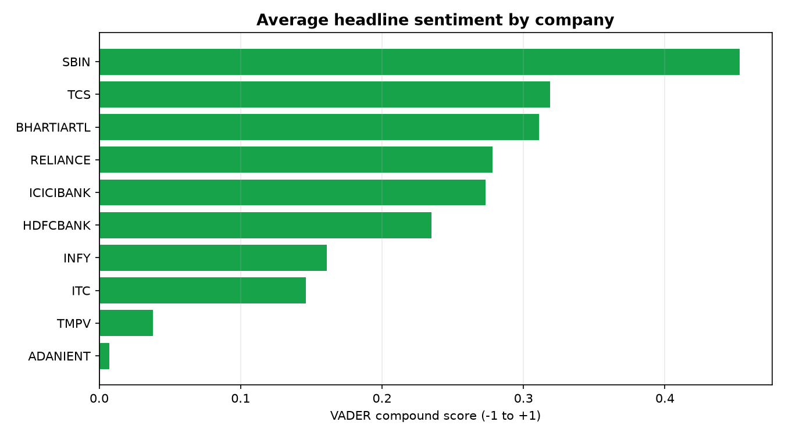

# News Sentiment Report

Generated 20 Nov 2026. 249 headlines for 10 companies, 24 Aug 2026 to 20 Nov 2026.

## Key Results

- **Headline mix:** 136 positive, 58 neutral, 55 negative.
- **Most positive coverage:** SBIN (avg +0.45); **most negative:** ADANIENT (avg +0.01).
- **Same-day link:** correlation between daily sentiment and that day's return = **0.59** across 117 company-days.
- **Next-day link:** correlation with the following day's return = **0.06**.
- **Average return on positive-news days:** +0.78%; on negative-news days: -3.00%.

## Sentiment by Company

| Symbol     |   Headlines |   Avg_Sentiment |   Positive_pct |   Negative_pct |
|:-----------|------------:|----------------:|---------------:|---------------:|
| SBIN       |           8 |           0.453 |         87.5   |          0     |
| TCS        |          17 |           0.319 |         64.706 |         11.765 |
| BHARTIARTL |          17 |           0.311 |         64.706 |          0     |
| RELIANCE   |          27 |           0.278 |         70.37  |         22.222 |
| ICICIBANK  |          21 |           0.273 |         52.381 |          4.762 |
| HDFCBANK   |          30 |           0.235 |         56.667 |         20     |
| INFY       |          30 |           0.161 |         53.333 |         26.667 |
| ITC        |          10 |           0.146 |         50     |         30     |
| TMPV       |          74 |           0.038 |         44.595 |         32.432 |
| ADANIENT   |          15 |           0.007 |         40     |         33.333 |

## Most Positive Headlines

| Symbol    | Date        | Headline                                                                                                                 |   Sentiment |
|:----------|:------------|:-------------------------------------------------------------------------------------------------------------------------|------------:|
| TMPV      | 19 Nov 2026 | Maruti Suzuki shares jump 5%, M&M, Tata Motors, Eicher Motors rally as Nifty Auto surges 2.6%                            |        0.92 |
| HDFCBANK  | 05 Nov 2026 | HDFC Bank shares witness strong buying, rise 7% in 1 month. Can new CEO, improving fundamentals drive next leg of rally? |        0.91 |
| TMPV      | 19 Nov 2026 | Auto stocks hit the accelerator! Nifty Auto jumps 4%; Maruti, M&M, Hyundai lead the rally / What's behind the surge?     |        0.91 |
| ICICIBANK | 18 Nov 2026 | Nifty Bank crosses 62,000, jumps 20% from 52-week low: What's driving rally? Check performance; best bank stock to buy?  |        0.9  |
| RELIANCE  | 02 Nov 2026 | Reliance Industries shares jump nearly 12% after record Q2 results; top Nifty gainer, biggest index...                   |        0.87 |

## Most Negative Headlines

| Symbol   | Date        | Headline                                                                                                                |   Sentiment |
|:---------|:------------|:------------------------------------------------------------------------------------------------------------------------|------------:|
| TMPV     | 16 Nov 2026 | Tata Motors Passenger Vehicles shares crash over 9% after Rs 5,531 crore quarterly loss, Jaguar Land Rover cuts outlook |       -0.78 |
| TMPV     | 16 Nov 2026 | India's Tata Motors PV falls on JLR outlook cut, weak Chinese demand                                                    |       -0.76 |
| TMPV     | 16 Nov 2026 | India’s Tata Motors PV Falls on JLR Outlook Cut, Weak Chinese Demand - The China-Global South Project                   |       -0.76 |
| TMPV     | 16 Nov 2026 | Tata Motors PV shares plunge over 9% after ₹5,531 crore Q2 loss, JLR guidance cut                                       |       -0.76 |
| TMPV     | 16 Nov 2026 | Tata Motors PV shares plunge 7%, top Nifty loser as weak JLR margins, guidance cut weigh on outlook                     |       -0.73 |

## Limitations

- Google News RSS returns only recent headlines (about 100 per search), so the sample is small.
- Headlines are often written after the price has moved, so a same-day link does not mean news caused the move.
- VADER is a general-purpose model; the finance word list improves it but it can still misread context.

_For learning purposes only. Not investment advice._