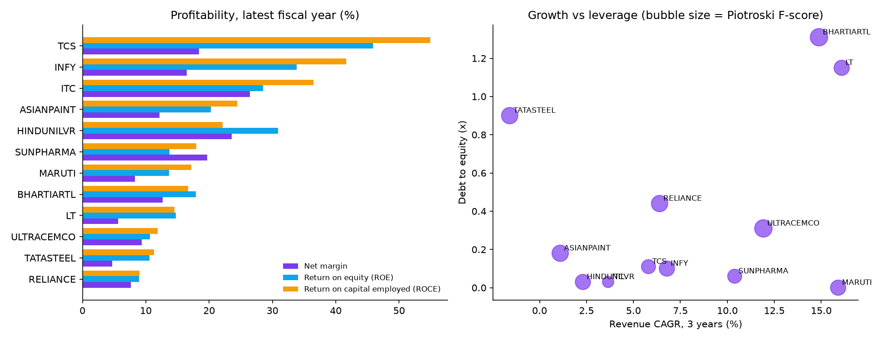

# Financial Statement Analyzer

Extracts four years of financial statements for 12 large Indian companies and calculates growth, profitability, liquidity, leverage, cash quality and two financial health scores, with an Excel workbook where every ratio is a live formula.

| | |
|:--|:--|
| **What was analysed** | Annual income statements, balance sheets and cash flow statements for FY2023 to FY2026 of 12 Nifty 50 non-financial companies across energy, IT, FMCG, capital goods, autos, pharma, paints, steel, telecom and cement (Yahoo Finance, consolidated, ₹ crore) |
| **What was done** | Automatic extraction of 18 line items per company and year, with conversion of USD reporters (Infosys) to rupees; 17 ratios including margins, ROE, ROA, ROCE, DuPont parts, current and quick ratios, debt to equity, interest coverage, cash conversion and free cash flow margin; Piotroski F-score (0–9) and Altman Z''-score for emerging markets; an Excel workbook with input cells and formula-driven ratios |
| **Key finding** | Return on capital varies sixfold within the Nifty 50: TCS (54.9%) and Infosys (41.7%) earn far more on each rupee employed than capital-heavy Reliance (9.0%) and Tata Steel (11.3%). The fastest growers, L&T (16.1% revenue CAGR) and Bharti Airtel (14.9%), are also the most indebted (debt to equity 1.1x and 1.3x), and Bharti lands in the Altman "distress" zone despite an F-score of 8 because telecom carries large current liabilities. A single score is never enough |

**Full results:** [outputs/REPORT.md](outputs/REPORT.md) · **Workbook:** [outputs/Financial_Statement_Analysis.xlsx](outputs/Financial_Statement_Analysis.xlsx)



## Latest fiscal year (FY2026)

| Company    |   Revenue ₹ cr|   Rev. CAGR 3y % |   Net margin % |   ROE % |   ROCE % |   Debt/equity |   CFO/NI |   F-score |   Z'' score | Zone     |
|:-----------|---------------:|-----------------:|---------------:|--------:|---------:|--------------:|---------:|----------:|------------:|:---------|
| RELIANCE   |    1,057,219.0 |              6.4 |            7.6 |     8.9 |      9.0 |           0.4 |      2.4 |         7 |         5.4 | grey     |
| TCS        |      267,021.0 |              5.8 |           18.4 |    45.9 |     54.9 |           0.1 |      1.1 |         5 |        11.7 | safe     |
| INFY       |      178,067.0 |              6.8 |           16.4 |    33.9 |     41.7 |           0.1 |      1.2 |         6 |        11.5 | safe     |
| HINDUNILVR |       63,763.0 |              2.3 |           23.6 |    30.9 |     22.1 |           0.0 |      0.7 |         6 |         6.7 | safe     |
| ITC        |       78,213.3 |              3.6 |           26.4 |    28.5 |     36.5 |           0.0 |      0.9 |         3 |        13.1 | safe     |
| LT         |      284,225.2 |             16.1 |            5.7 |    14.7 |     14.6 |           1.1 |      1.0 |         6 |         5.7 | grey     |
| MARUTI     |      177,094.1 |             15.9 |            8.3 |    13.7 |     17.2 |           0.0 |      1.3 |         6 |         8.8 | safe     |
| SUNPHARMA  |       58,220.1 |             10.4 |           19.7 |    13.7 |     17.9 |           0.1 |      1.1 |         5 |        12.3 | safe     |
| ASIANPAINT |       35,540.9 |              1.1 |           12.2 |    20.2 |     24.4 |           0.2 |      1.6 |         7 |        10.0 | safe     |
| TATASTEEL  |      230,293.5 |             -1.6 |            4.7 |    10.6 |     11.3 |           0.9 |      3.2 |         7 |         4.2 | grey     |
| BHARTIARTL |      210,972.8 |             14.9 |           12.7 |    17.9 |     16.7 |           1.3 |      4.6 |         8 |         3.8 | distress |
| ULTRACEMCO |       87,383.5 |             11.9 |            9.3 |    10.7 |     11.8 |           0.3 |      1.9 |         8 |         5.2 | grey     |

## How It Works

1. **Extract:** `analyzer.py` reads each company's statements from Yahoo Finance, maps different row names to 18 standard line items, keeps complete fiscal years and converts amounts to ₹ crore. Infosys reports in US dollars, so each year is converted at that fiscal year's average USD/INR rate.
2. **Ratios:** 17 ratios per year, from margins and returns to liquidity, leverage and cash conversion.
3. **Scores:** the Piotroski F-score awards a point for each of nine signs of improving strength (profitability, cash flow, leverage, liquidity, dilution, margins, efficiency). The Altman Z''-score for emerging markets combines working capital, retained earnings, EBIT and book equity relative to assets and liabilities: above 5.85 safe, 4.15 to 5.85 grey, below 4.15 distress.
4. **Excel:** one sheet per company with extracted figures in blue and every ratio as a formula in black, plus a comparison sheet linked to each company sheet.

## Limitations

- Yahoo Finance condenses statements, so some items (for example gross profit for some companies) can be missing or defined differently from the annual report.
- Banks and insurers are excluded because these ratios do not fit their balance sheets.
- The Altman model was built for manufacturers; it reads telecom and capital-heavy companies harshly.

## Run It Yourself

```bash
pip install -r requirements.txt
python analyzer.py
streamlit run app.py
```

**Tools:** Python, pandas, NumPy, openpyxl (Excel formulas), yfinance, Matplotlib, Streamlit

_For learning purposes only. Not investment advice._
