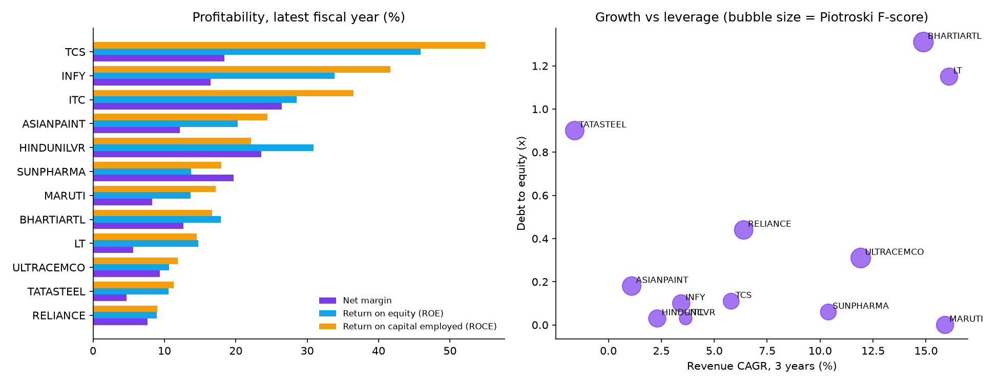

# Financial Statement Analysis — 12 Indian companies

Annual statements from Yahoo Finance (₹ crore, consolidated). Every ratio in the Excel workbook is a live formula.

| symbol     | company                   | latest FY   |     Revenue ₹ cr |   Revenue CAGR 3y % |   Net margin % |   Return on equity (ROE) % |   Return on capital employed (ROCE) % |   Debt to equity (x) |   Interest coverage (x) |   Operating cash flow / net income (x) |   Piotroski F-score |   Altman Z'' (EM) | Altman zone   |
|:-----------|:--------------------------|:------------|-----------------:|--------------------:|---------------:|---------------------------:|--------------------------------------:|---------------------:|------------------------:|---------------------------------------:|--------------------:|------------------:|:--------------|
| RELIANCE   | Reliance Industries       | FY2026      |      1.05722e+06 |                6.39 |           7.64 |                       8.93 |                                  8.99 |                 0.44 |                    6.12 |                                   2.38 |                   7 |              5.43 | grey          |
| TCS        | Tata Consultancy Services | FY2026      | 267021           |                5.8  |          18.43 |                      45.89 |                                 54.93 |                 0.11 |                   54.37 |                                   1.06 |                   5 |             11.71 | safe          |
| INFY       | Infosys                   | FY2026      |   2015.8         |                3.44 |          16.44 |                      33.85 |                                 41.66 |                 0.1  |                   96.87 |                                   1.22 |                   6 |             11.49 | safe          |
| HINDUNILVR | Hindustan Unilever        | FY2026      |  63763           |                2.31 |          23.59 |                      30.86 |                                 22.15 |                 0.03 |                   34.69 |                                   0.73 |                   6 |              6.71 | safe          |
| ITC        | ITC                       | FY2026      |  78213.3         |                3.65 |          26.45 |                      28.53 |                                 36.47 |                 0.03 |                  330.15 |                                   0.89 |                   3 |             13.08 | safe          |
| LT         | Larsen & Toubro           | FY2026      | 284225           |               16.09 |           5.66 |                      14.72 |                                 14.55 |                 1.15 |                   10.12 |                                   1.04 |                   6 |              5.68 | grey          |
| MARUTI     | Maruti Suzuki             | FY2026      | 177094           |               15.9  |           8.29 |                      13.7  |                                 17.22 |                 0    |                   81.09 |                                   1.3  |                   6 |              8.84 | safe          |
| SUNPHARMA  | Sun Pharmaceutical        | FY2026      |  58220.1         |               10.39 |          19.72 |                      13.74 |                                 17.94 |                 0.06 |                   45.61 |                                   1.08 |                   5 |             12.3  | safe          |
| ASIANPAINT | Asian Paints              | FY2026      |  35540.9         |                1.1  |          12.17 |                      20.24 |                                 24.41 |                 0.18 |                   31.72 |                                   1.64 |                   7 |              9.96 | safe          |
| TATASTEEL  | Tata Steel                | FY2026      | 230293           |               -1.59 |           4.69 |                      10.56 |                                 11.32 |                 0.9  |                    3.23 |                                   3.25 |                   7 |              4.21 | grey          |
| BHARTIARTL | Bharti Airtel             | FY2026      | 210973           |               14.88 |          12.65 |                      17.91 |                                 16.69 |                 1.31 |                    3.53 |                                   4.58 |                   8 |              3.8  | distress      |
| ULTRACEMCO | UltraTech Cement          | FY2026      |  87383.5         |               11.92 |           9.34 |                      10.66 |                                 11.84 |                 0.31 |                    7.03 |                                   1.88 |                   8 |              5.17 | grey          |

## Piotroski F-score detail

|                              | RELIANCE   | TCS   | INFY   | HINDUNILVR   | ITC   | LT   | MARUTI   | SUNPHARMA   | ASIANPAINT   | TATASTEEL   | BHARTIARTL   | ULTRACEMCO   |
|:-----------------------------|:-----------|:------|:-------|:-------------|:------|:-----|:---------|:------------|:-------------|:------------|:-------------|:-------------|
| positive ROA                 | ✓          | ✓     | ✓      | ✓            | ✓     | ✓    | ✓        | ✓           | ✓            | ✓           | ✓            | ✓            |
| positive operating cash flow | ✓          | ✓     | ✓      | ✓            | ✓     | ✓    | ✓        | ✓           | ✓            | ✓           | ✓            | ✓            |
| ROA improving                | ✓          | ✗     | ✓      | ✓            | ✗     | ✗    | ✗        | ✗           | ✓            | ✓           | ✗            | ✓            |
| cash flow above net income   | ✓          | ✓     | ✓      | ✗            | ✗     | ✓    | ✓        | ✓           | ✓            | ✓           | ✓            | ✓            |
| leverage falling             | ✓          | ✗     | ✗      | ✓            | ✗     | ✓    | ✗        | ✗           | ✗            | ✓           | ✓            | ✓            |
| current ratio improving      | ✗          | ✗     | ✗      | ✗            | ✗     | ✓    | ✓        | ✗           | ✓            | ✗           | ✓            | ✓            |
| no share dilution            | ✓          | ✓     | ✓      | ✓            | ✗     | ✓    | ✓        | ✓           | ✓            | ✓           | ✓            | ✓            |
| gross margin improving       | ✓          | ✓     | ✗      | ✗            | ✓     | ✗    | ✗        | ✓           | ✓            | ✓           | ✓            | ✗            |
| asset turnover improving     | ✗          | ✗     | ✓      | ✓            | ✗     | ✗    | ✓        | ✗           | ✗            | ✗           | ✓            | ✓            |

_Altman Z''-score (emerging markets): above 5.85 safe, 4.15–5.85 grey zone, below 4.15 distress. For learning purposes only._