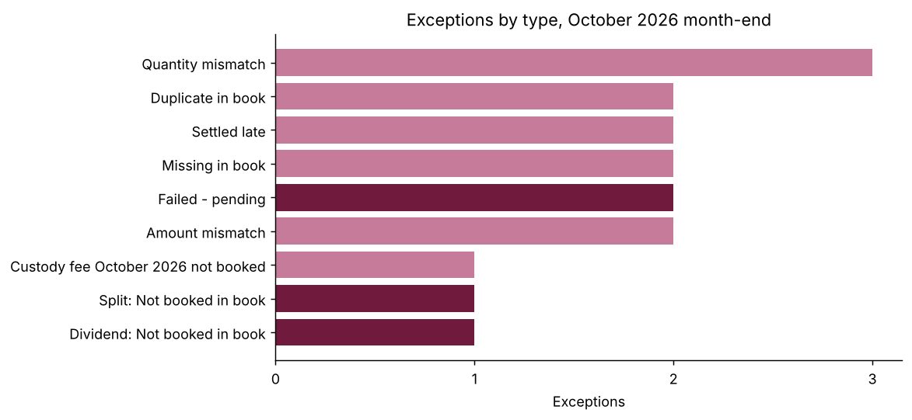
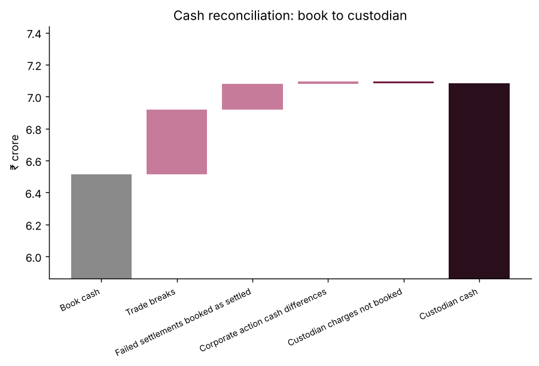
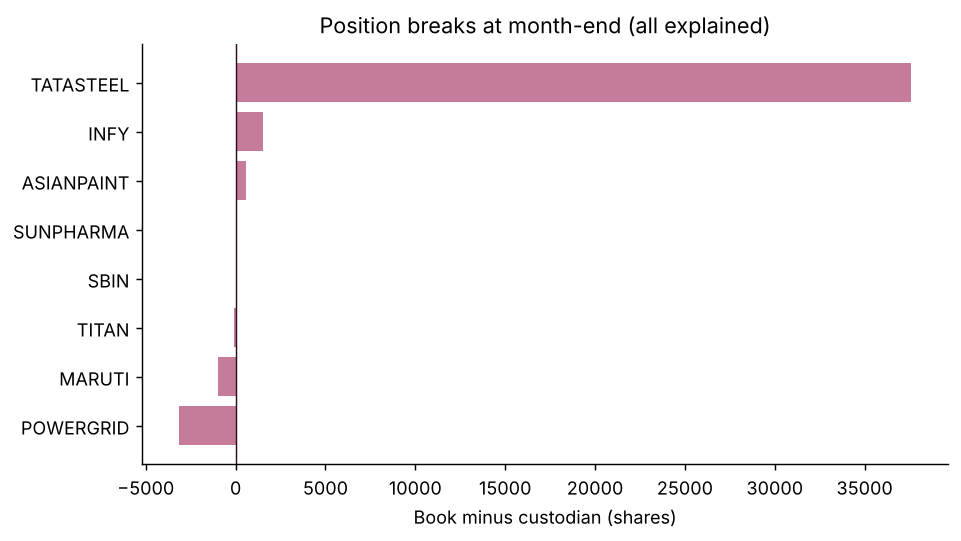

# Fund Operations Month-End Reconciliation | Python

An automated month-end reconciliation for a mutual fund, built the way a fund services team checks the fund accounting book against the broker and the custodian: trade matching, settlement monitoring, corporate actions, positions, cash and NAV impact, with every break explained and logged for action.

| | |
|:--|:--|
| **What was analysed** | One month (October 2026) of records for a fictional ₹38 crore Indian large-cap fund holding 20 NSE stocks: 320 trades, 7 corporate actions (5 dividends, a 1:1 bonus, a 1:2 split), subscriptions and redemptions, and month-end position and cash statements from the book, the broker and the custodian |
| **What was done** | Trade matching (quantity, net amount within ₹1, duplicates, missing trades); settlement monitoring against T+1; dividend, bonus and split entitlements; position and cash reconciliation with each difference traced to its cause; a negative-holdings control; NAV misstatement in basis points; an exception log with owner, age and next action; a test that confirms every planted break is found |
| **Key finding** | 652 of 668 records cleared automatically (97.6%), leaving 16 exceptions for review. The ₹56.9 lakh cash difference between book and custodian was explained to the rupee (trade breaks ₹40.2 lakh, two failed settlements ₹16.5 lakh, an unbooked Hindustan Unilever dividend ₹1.1 lakh, an unbooked custody fee ₹0.8 lakh). The most serious break was a 1:2 Maruti split never applied in the book: later sales in post-split quantities left the book showing −90 shares, and together with the other open breaks the book NAV was understated by 154 bps (₹58 lakh) |

**Full report:** [outputs/REPORT.md](outputs/REPORT.md) · **Workbook:** [outputs/reconciliation_workbook.xlsx](outputs/reconciliation_workbook.xlsx) (summary, exception log, trade matching, settlements, corporate actions, position and cash recon)







## The Checks

| # | Check | Compares | Breaks it catches |
|:--|:--|:--|:--|
| 1 | Trade matching | Book trades vs broker confirmations | Quantity keyed wrongly, commission at the wrong rate, duplicate bookings, trades missing from the book |
| 2 | Settlement monitoring | Custodian settlement date vs T+1 | Late settlements, failed settlements still pending (aged for follow-up) |
| 3 | Corporate actions | Book vs custodian entitlements on the record date | Dividends not booked, splits and bonuses not applied, entitlement differences caused by trade breaks |
| 4 | Position reconciliation | Month-end holdings by stock | Each share difference traced to a trade, settlement or corporate action break; anything left over is flagged as unexplained |
| 5 | Cash reconciliation | Month-end cash | Each rupee of difference traced to its cause, including custodian charges not in the book |
| 6 | NAV impact | Book NAV vs NAV after correcting book errors | Size of the misstatement in basis points, so the most urgent fixes come first |

## Exception Log (extract)

| Area | Reference | Stock | Issue | Age (days) | Action |
|:--|:--|:--|:--|--:|:--|
| Corporate action | CA07 | MARUTI | Split not applied in book | 4 | Book entitlement per custodian |
| Settlement | T0270 | TATASTEEL | Failed, pending | 11 | Chase counterparty; monitor for buy-in |
| Trade | T0125 | INFY | Missing in book | 1 | Book trade from broker confirmation |
| Trade | T0190 | TATASTEEL | Duplicate in book | 16 | Reverse duplicate booking |
| Corporate action | CA03 | HINDUNILVR | Dividend not booked | 1 | Book entitlement per custodian |
| Cash | FEE-OCT | CASH | Custody fee not booked | 0 | Book fee and accrue going forward |

All 16 exceptions are in the workbook.

## How It Works

1. `generate_data.py` simulates the month's true activity, then derives three views of it (book, broker, custodian) with 16 known errors planted. The data is synthetic; stock names are real NSE companies, prices are simulated and halve after the bonus and split.
2. `reconcile.py` runs the six checks, writes the exception log and builds the workbook, report and charts.
3. `test_reconciliation.py` confirms that every planted break is found, that anything else raised is a knock-on effect of a planted break, and that positions and cash are fully explained.

## Limitations

- Synthetic data for one month and one fund; real reconciliations also handle FX, accrued income on bonds, tax withholding, and partial fills.
- Trades are matched on trade reference; production systems also match on economic details when references differ.
- Prices are simulated, so the NAV figures illustrate the method, not a real fund.

## Run It Yourself

```bash
pip install -r requirements.txt
python generate_data.py
python reconcile.py
python test_reconciliation.py
```

**Tools:** Python (pandas, NumPy, Matplotlib, openpyxl)

_Fictional fund and synthetic data, for learning purposes._
