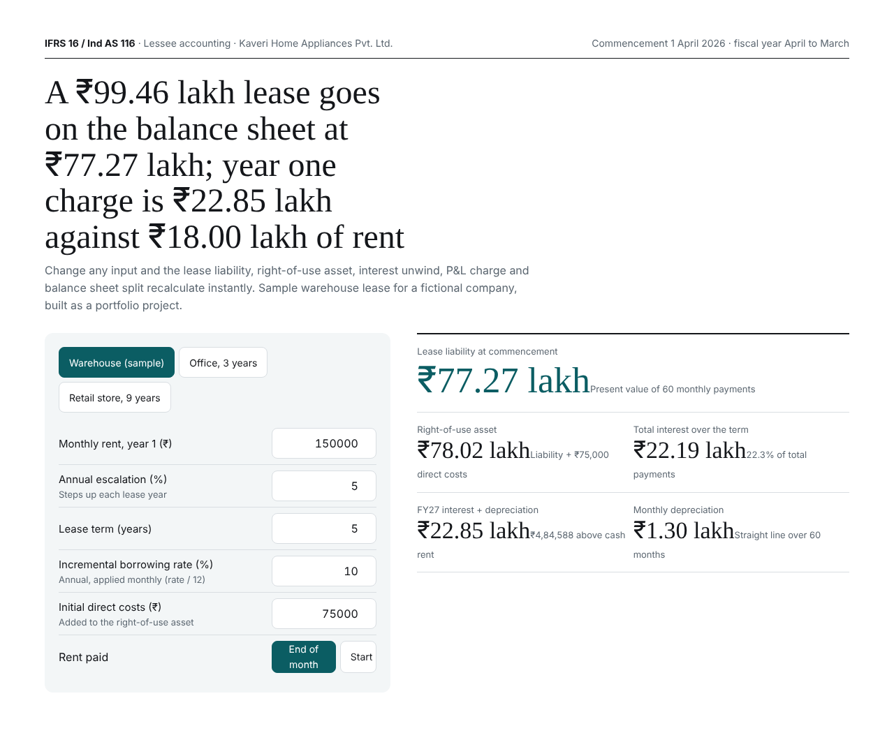

# IFRS 16 / Ind AS 116 Lease Accounting | Excel

Lessee accounting for a five-year warehouse lease taken by a fictional company, Kaveri Home Appliances Pvt. Ltd.: initial measurement of the lease liability and right-of-use asset, a 60-month schedule, the profit and loss effect by fiscal year, the current and non-current split, journal entries and the maturity analysis disclosure.

**Live website:** [IFRS 16 Lease Calculator](https://claude.ai/artifact/Niy3TrAqhL8FQEzQTpoMLu) (change any input and every figure recalculates) · **Workbook:** [IFRS16_Lease_Accounting.xlsx](IFRS16_Lease_Accounting.xlsx)

| | |
|:--|:--|
| **What was analysed** | A warehouse lease starting 1 April 2026: ₹1,50,000 a month payable at month end, 5% escalation each lease year, 5-year term, 10% incremental borrowing rate, ₹75,000 broker fee as an initial direct cost |
| **What was done** | Present value of the 60 payments; right-of-use asset including direct costs; a monthly schedule of interest unwind and straight-line depreciation; interest, depreciation and rent by fiscal year (FY27 to FY31); the current and non-current split at 31 March 2027; day-one and monthly journal entries; an undiscounted maturity analysis |
| **Key finding** | ₹99.46 lakh of rent goes on the balance sheet as a ₹77.27 lakh lease liability and a ₹78.02 lakh right-of-use asset. In FY27 the charge is ₹22.85 lakh (interest ₹7.24 lakh + depreciation ₹15.60 lakh) against ₹18.00 lakh of cash rent, ₹4.85 lakh higher; by FY30 the charge falls below rent. At 31 March 2027, ₹12.83 lakh of the ₹66.51 lakh liability is current |

## Profit and Loss Effect

| Fiscal year | Interest (₹) | Depreciation (₹) | Total charge (₹) | Rent paid (₹) | Charge less rent (₹) | Closing liability (₹) |
|:--|--:|--:|--:|--:|--:|--:|
| FY27 | 7,24,250 | 15,60,338 | 22,84,588 | 18,00,000 | 4,84,588 | 66,50,939 |
| FY28 | 6,07,363 | 15,60,338 | 21,67,701 | 18,90,000 | 2,77,701 | 53,68,303 |
| FY29 | 4,68,601 | 15,60,338 | 20,28,938 | 19,84,500 | 44,438 | 38,52,403 |
| FY30 | 3,05,190 | 15,60,338 | 18,65,527 | 20,83,725 | (2,18,198) | 20,73,868 |
| FY31 | 1,14,043 | 15,60,338 | 16,74,381 | 21,87,911 | (5,13,530) | – |
| **Total** | **22,19,447** | **78,01,689** | **1,00,21,136** | **99,46,136** | **75,000** | |

Over the full term the charge exceeds the rent only by the ₹75,000 of initial direct costs.

## Method

- **Discount rate:** incremental borrowing rate, as the rate implicit in the lease is not readily determinable; applied monthly as 10% / 12.
- **Liability:** opening balance + interest − payment each month; it reaches zero at the end of month 60 (checked in the workbook).
- **Right-of-use asset:** liability + initial direct costs, depreciated straight line over 60 months.
- **Current portion:** the principal that falls due within 12 months of the reporting date.
- **Simplifications:** no extension or termination options, no residual value guarantee, no variable payments or incentives, no remeasurement.

## Workbook

| Sheet | Contents |
|:--|:--|
| Inputs | Yellow input cells: start date, rent, escalation, term, borrowing rate, direct costs |
| Schedule | 60 months: payment, discount factor, PV, liability and ROU asset roll-forward |
| Summary | Initial measurement, annual P&L table, balance sheet split, maturity analysis |
| Journal Entries | Day-one recognition and the first month's entries |

Change any input and every sheet recalculates. `build_lease.py` rebuilds the workbook.

*Sample lease for a fictional company, built as a portfolio project by Aditya Kushwaha.*
