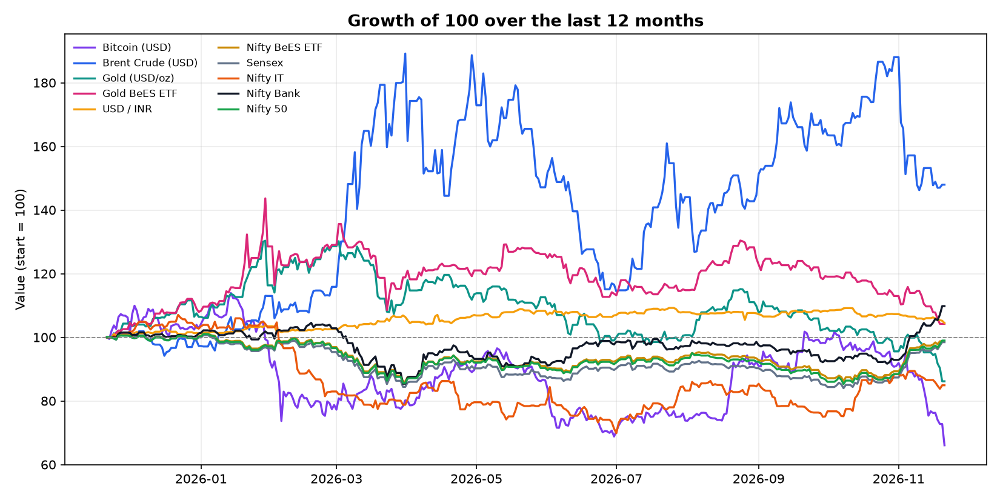
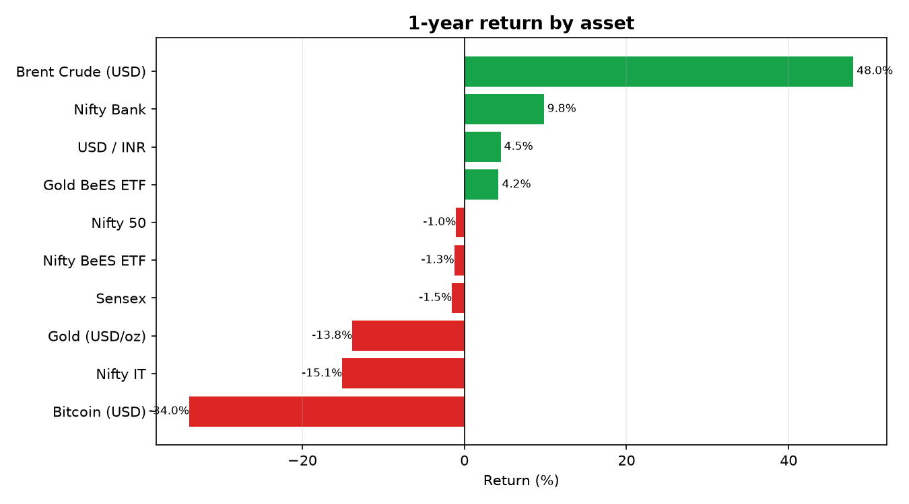
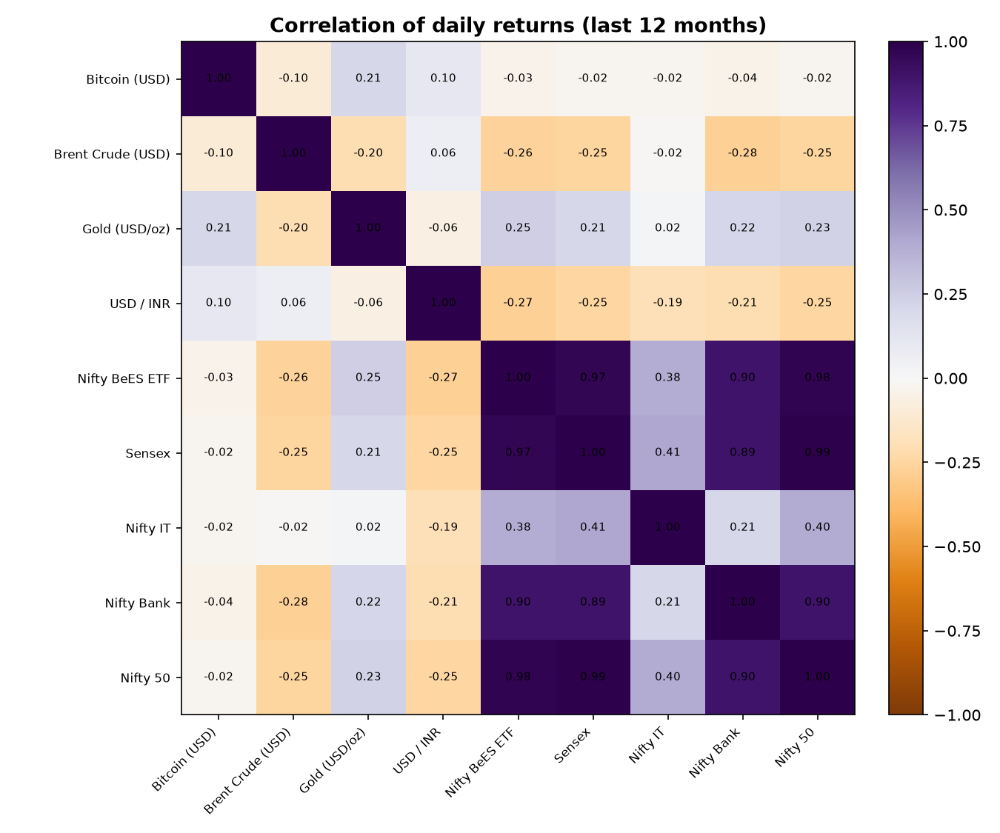

# India Market Data Dashboard

A Python dashboard that brings Indian indices, ETFs, currency, commodities and crypto together in one report: returns, volatility, worst falls and how the assets move against each other.

| | |
|:--|:--|
| **What was analysed** | Two years of daily prices for 10 assets: Nifty 50, Sensex, Nifty Bank, Nifty IT, Nifty BeES and Gold BeES ETFs, USD/INR, gold, Brent crude and Bitcoin |
| **What was done** | Calculation of 1M, 3M, 6M and 1Y returns, annualised volatility, maximum drawdown and a correlation matrix, with four charts and an auto-written report |
| **Key finding** | Over the year to 20 Nov 2026, Brent crude led at +45.1% but with the highest volatility (47.0%); Nifty Bank and Brent moved in opposite directions (correlation -0.28), the best diversification pair in the set |

**Live report:** [outputs/REPORT.md](outputs/REPORT.md), refreshed every Monday by GitHub Actions.

## Charts







## How It Works

1. `download_prices()` pulls daily closing prices from Yahoo Finance with the `yfinance` library.
2. `build_summary()` calculates returns over each period, volatility (standard deviation of daily returns × √252) and the largest fall from a previous peak.
3. Chart functions draw growth of ₹100, 1-year returns, the correlation heatmap and the Nifty 50 drawdown.
4. `write_report()` picks out the best and worst performers, the calmest and most volatile assets, and the lowest-correlation pair.

## Run It Yourself

```bash
pip install -r requirements.txt
python dashboard.py
```

Results are saved in the `outputs/` folder (CSV tables, PNG charts and `REPORT.md`).

**Tools:** Python, pandas, NumPy, Matplotlib, yfinance

_For learning purposes only. Not investment advice._
