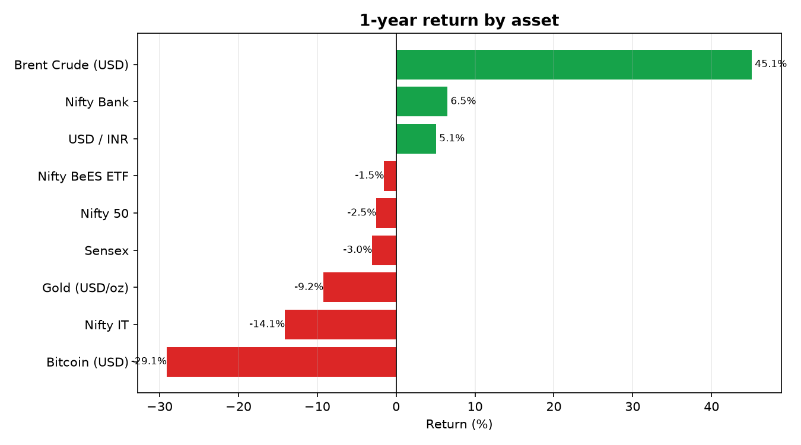

# Market Dashboard Report

Data as of **20 Nov 2026** (daily closing prices, Yahoo Finance). Generated 20 Nov 2026.

## Key Observations

- **Best 1-year performer:** Brent Crude (USD) at +45.1%.
- **Weakest 1-year performer:** Bitcoin (USD) at -29.1%.
- **Lowest volatility:** USD / INR (6.3% annualised); **highest:** Brent Crude (USD) (47.0%).
- **Weakest link between two assets:** Brent Crude (USD) and Nifty Bank (correlation -0.28), the strongest diversification pair in the set.

## Summary Table

| Asset             | Group        |   Last Price |   1M % |   3M % |   6M % |   1Y % |   Volatility 1Y % |   Max Drawdown 1Y % |
|:------------------|:-------------|-------------:|-------:|-------:|-------:|-------:|------------------:|--------------------:|
| Bitcoin (USD)     | Crypto       |     61420.4  | -26.89 | -21.59 | -18.64 | -29.1  |             36.78 |              -39.59 |
| Brent Crude (USD) | Commodity    |        91.98 | -15.48 |  -2.55 | -11.16 |  45.12 |             46.97 |              -39.53 |
| Gold (USD/oz)     | Commodity    |      3685.5  | -11.19 | -21.26 | -18.52 |  -9.22 |             23.38 |              -30.7  |
| USD / INR         | Currency     |        92.98 |  -1.83 |  -2.91 |  -3.32 |   5.08 |              6.31 |               -4.02 |
| Nifty BeES ETF    | ETF          |       291.12 |  12.15 |   5.19 |   8.18 |  -1.53 |             11.13 |              -14.82 |
| Sensex            | Equity Index |     83029.9  |  12.64 |   7.08 |  10.1  |  -3.04 |             12.07 |              -16.52 |
| Nifty IT          | Equity Index |     31815    |  -1.87 |   4.2  |  10.04 | -14.11 |             21.82 |              -34.74 |
| Nifty Bank        | Equity Index |     63225.2  |  15    |   9.46 |  16.96 |   6.53 |             14.72 |              -18.32 |
| Nifty 50          | Equity Index |     25535.3  |  11.94 |   5.29 |   7.66 |  -2.51 |             11.8  |              -15.56 |

## Charts

_For learning and portfolio purposes only. Not investment advice._