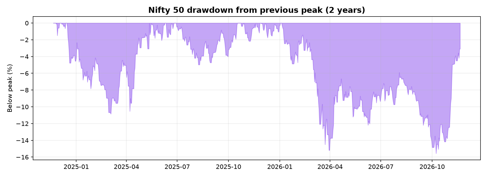

# Market Dashboard Report

Data as of **20 Nov 2026** (daily closing prices, Yahoo Finance). Generated 20 Nov 2026.

## Key Observations

- **Best 1-year performer:** Brent Crude (USD) at +45.1%.
- **Weakest 1-year performer:** Bitcoin (USD) at -29.1%.
- **Lowest volatility:** USD / INR (6.3% annualised); **highest:** Brent Crude (USD) (47.0%).
- **Weakest link between two assets:** Brent Crude (USD) and Nifty Bank (correlation -0.28), the strongest diversification pair in the set.

## Summary Table

| Asset             | Group        |   Last Price |   1M % |   3M % |   6M % |   1Y % |   Volatility 1Y % |   Max Drawdown 1Y % |
|:------------------|:-------------|-------------:|-------:|-------:|-------:|-------:|------------------:|--------------------:|
| Bitcoin (USD)     | Crypto       |     61462.8  | -26.84 | -21.54 | -18.58 | -29.05 |             36.78 |              -39.59 |
| Brent Crude (USD) | Commodity    |        91.98 | -15.48 |  -2.55 | -11.16 |  45.12 |             46.97 |              -39.53 |
| Gold (USD/oz)     | Commodity    |      3685.5  | -11.19 | -21.26 | -18.52 |  -9.22 |             23.38 |              -30.7  |
| Gold BeES ETF     | ETF          |       100.46 | -14.96 | -23.5  | -23.02 |  -1.07 |             26.83 |              -31.44 |
| USD / INR         | Currency     |        92.99 |  -1.83 |  -2.91 |  -3.31 |   5.09 |              6.31 |               -4.01 |
| Nifty BeES ETF    | ETF          |       291.1  |  12.15 |   5.18 |   8.18 |  -1.54 |             11.13 |              -14.82 |
| Sensex            | Equity Index |     83009    |  12.62 |   7.05 |  10.07 |  -3.06 |             12.07 |              -16.52 |
| Nifty IT          | Equity Index |     31758.3  |  -2.05 |   4.02 |   9.84 | -14.27 |             21.8  |              -34.74 |
| Nifty Bank        | Equity Index |     63139.2  |  14.85 |   9.31 |  16.8  |   6.39 |             14.72 |              -18.32 |
| Nifty 50          | Equity Index |     25516.5  |  11.86 |   5.21 |   7.58 |  -2.58 |             11.8  |              -15.56 |

## Charts

_For learning and portfolio purposes only. Not investment advice._