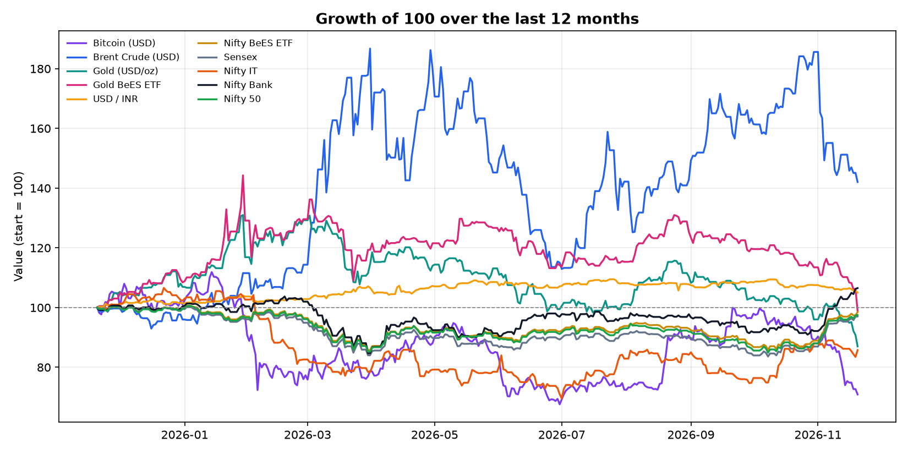

# Market Dashboard Report

Data as of **20 Nov 2026** (daily closing prices, Yahoo Finance). Generated 20 Nov 2026.

## Key Observations

- **Best 1-year performer:** Brent Crude (USD) at +42.0%.
- **Weakest 1-year performer:** Bitcoin (USD) at -29.1%.
- **Lowest volatility:** USD / INR (6.3% annualised); **highest:** Brent Crude (USD) (47.0%).
- **Weakest link between two assets:** Brent Crude (USD) and Nifty Bank (correlation -0.28), the strongest diversification pair in the set.

## Summary Table

| Asset             | Group        |   Last Price |   1M % |   3M % |   6M % |   1Y % |   Volatility 1Y % |   Max Drawdown 1Y % |
|:------------------|:-------------|-------------:|-------:|-------:|-------:|-------:|------------------:|--------------------:|
| Bitcoin (USD)     | Crypto       |     61433.3  | -26.88 | -21.58 | -18.62 | -29.09 |             36.78 |              -39.59 |
| Brent Crude (USD) | Commodity    |        90.03 | -17.27 |  -4.62 | -13.05 |  42.05 |             47.01 |              -39.53 |
| Gold (USD/oz)     | Commodity    |      3532.1  | -14.89 | -24.54 | -21.91 | -13    |             23.64 |              -33.59 |
| Gold BeES ETF     | ETF          |       100.36 | -15.04 | -23.58 | -23.1  |  -1.17 |             26.85 |              -31.51 |
| USD / INR         | Currency     |        92.95 |  -1.86 |  -2.94 |  -3.35 |   5.05 |              6.32 |               -4.05 |
| Nifty BeES ETF    | ETF          |       291.19 |  12.18 |   5.21 |   8.21 |  -1.51 |             11.13 |              -14.82 |
| Sensex            | Equity Index |     83092.7  |  12.73 |   7.16 |  10.18 |  -2.97 |             12.07 |              -16.52 |
| Nifty IT          | Equity Index |     31772.2  |  -2.01 |   4.06 |   9.89 | -14.23 |             21.81 |              -34.74 |
| Nifty Bank        | Equity Index |     63221.3  |  15    |   9.45 |  16.96 |   6.53 |             14.72 |              -18.32 |
| Nifty 50          | Equity Index |     25533    |  11.93 |   5.28 |   7.65 |  -2.52 |             11.8  |              -15.56 |

## Charts

_For learning and portfolio purposes only. Not investment advice._