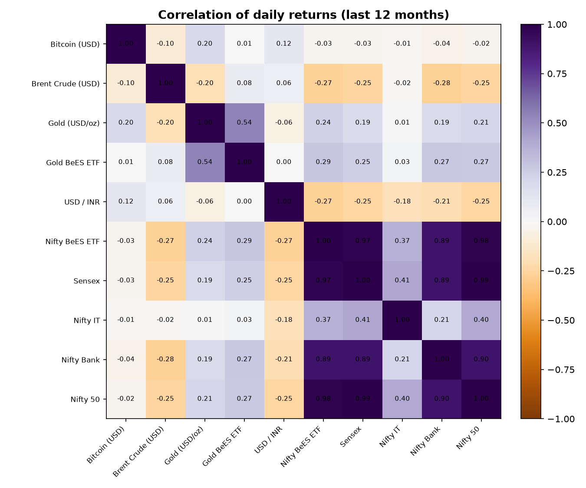

# Market Dashboard Report

Data as of **21 Nov 2026** (daily closing prices, Yahoo Finance). Generated 21 Nov 2026.

## Key Observations

- **Best 1-year performer:** Brent Crude (USD) at +48.0%.
- **Weakest 1-year performer:** Bitcoin (USD) at -34.0%.
- **Lowest volatility:** USD / INR (6.3% annualised); **highest:** Brent Crude (USD) (47.0%).
- **Weakest link between two assets:** Brent Crude (USD) and Nifty Bank (correlation -0.28), the strongest diversification pair in the set.

## Summary Table

| Asset             | Group        |   Last Price |   1M % |   3M % |   6M % |   1Y % |   Volatility 1Y % |   Max Drawdown 1Y % |
|:------------------|:-------------|-------------:|-------:|-------:|-------:|-------:|------------------:|--------------------:|
| Bitcoin (USD)     | Crypto       |     56204.8  | -30.88 | -27.09 | -26.7  | -33.95 |             37.5  |              -42.01 |
| Brent Crude (USD) | Commodity    |        92.57 | -18.2  |  -1.93 | -10.59 |  47.97 |             46.96 |              -39.53 |
| Gold (USD/oz)     | Commodity    |      3515.4  | -13.42 | -24.89 | -22.28 | -13.83 |             23.69 |              -33.9  |
| Gold BeES ETF     | ETF          |       106.3  |  -9.42 | -19.05 | -18.54 |   4.22 |             26.24 |              -27.46 |
| USD / INR         | Currency     |        92.67 |  -1.74 |  -3.24 |  -3.64 |   4.48 |              6.32 |               -4.34 |
| Nifty BeES ETF    | ETF          |       290.61 |  12.23 |   5    |   7.99 |  -1.26 |             11.11 |              -14.82 |
| Sensex            | Equity Index |     83919.7  |  14.57 |   8.23 |  11.28 |  -1.54 |             12.1  |              -16.52 |
| Nifty IT          | Equity Index |     31322.7  |  -2.36 |   2.59 |   8.34 | -15.08 |             21.71 |              -34.74 |
| Nifty Bank        | Equity Index |     64635.2  |  17.68 |  11.9  |  19.57 |   9.8  |             14.84 |              -18.32 |
| Nifty 50          | Equity Index |     25800.6  |  13.72 |   6.39 |   8.77 |  -1.03 |             11.83 |              -15.56 |

## Charts

_For learning and portfolio purposes only. Not investment advice._