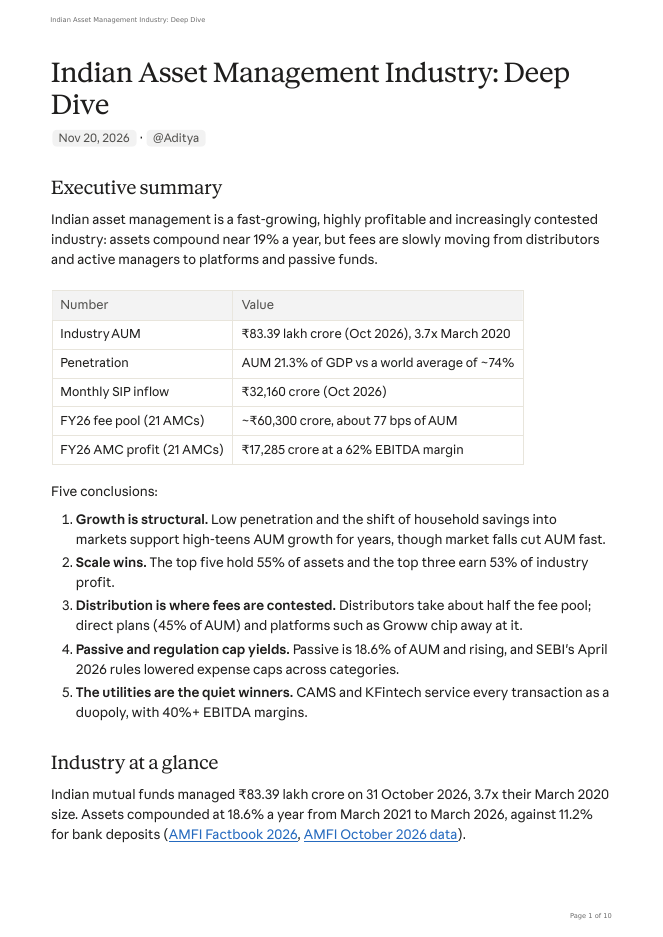

# Indian Asset Management Industry: Deep Dive

A research report on India's mutual fund industry: size, value chain, major players, competition, regulation and where profits are made. It comes with an Excel data book holding every figure. Data as of November 2026.

| | |
|:--|:--|
| **What was analysed** | Industry AUM from 2020 to 2026, the value chain from investor to market, the top 10 AMCs and 7 listed AMCs, the FY26 fee pool of 21 AMCs, and SEBI's 2026 regulations |
| **What was done** | A 9-section report with four charts and a value-chain diagram, plus a 7-sheet data book with live formulas |
| **Key finding** | Assets compound near 19% a year, but fees are moving from distributors and active managers to platforms and passive funds: distributors take 49% of the ₹60,300 crore fee pool, while AMCs turn their 47% into ₹17,285 crore of profit |

## Key Numbers

| Number | Value |
|:--|:--|
| Industry AUM | ₹83.39 lakh crore (Oct 2026), 3.7x March 2020 |
| Penetration | AUM 21.3% of GDP against a world average of about 74% |
| Monthly SIP inflow | ₹32,160 crore (Oct 2026) |
| Top-5 share of AUM | 55.4% (Jul–Sep 2026) |
| FY26 fee pool (21 AMCs) | About ₹60,300 crore, roughly 77 bps of AUM |

## Report Sections

1. Executive summary
2. Industry at a glance: growth, penetration, product mix
3. Value chain: investors, distributors, rails, AMCs, markets and the utilities behind them (RTAs, custodians, KRAs)
4. Major players: market share and listed-AMC comparison
5. Competitive dynamics: passive, direct plans, new entrants, distribution power
6. Regulation: SEBI (Mutual Funds) Regulations 2026, expense caps, SIF and MF Lite
7. Where value is created: the fee pool split and what drives AMC profit
8. Outlook and key debates
9. Sources

## Files

| File | What it holds |
|:--|:--|
| [Indian_AMC_Industry_Deep_Dive.pdf](Indian_AMC_Industry_Deep_Dive.pdf) | The full report |
| [Indian_AMC_Industry_Data_Book.xlsx](Indian_AMC_Industry_Data_Book.xlsx) | AUM history, category mix, AMC market share, listed peers, fee pool, regulation caps, penetration |

**Sources:** AMFI Annual Report FY26, AMFI Factbook 2026, AMFI monthly data, Equirus study of 21 AMCs (via 5paisa), Cafemutual, SEBI regulations coverage, company results, and Yahoo Finance market data.

**Related project:** [Nippon Life India AMC stock pitch](../nam-india-stock-pitch), a company-level view of the same industry.

_For learning purposes only. Not investment advice._
