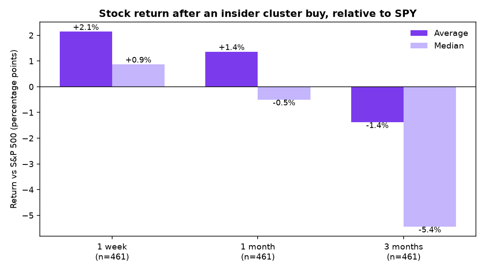

# Latest Insider Cluster Buys

513 clusters found in 2025q1, 2025q2, 2025q3, 2025q4, 2026q1 (8,611 qualifying purchases). Rule: 3+ officers or directors, open-market buys of $25,000+, within 14 days.

| ticker   | company                                         | start      | end        |   insiders |   total_value |
|:---------|:------------------------------------------------|:-----------|:-----------|-----------:|--------------:|
| TSM      | TAIWAN SEMICONDUCTOR MANUFACTURING CO LTD       | 2026-03-22 | 2026-03-30 |          3 |        387130 |
| MLYS     | Mineralys Therapeutics, Inc.                    | 2026-03-27 | 2026-03-30 |          5 |      43813985 |
| SBSW     | Sibanye Stillwater Ltd                          | 2026-03-16 | 2026-03-30 |          4 |       2127920 |
| WVE      | Wave Life Sciences Ltd.                         | 2026-03-26 | 2026-03-30 |          4 |     218497512 |
| NONE     | Blackstone Private Equity Strategies Fund L.P.  | 2026-03-26 | 2026-03-27 |          4 |      13899799 |
| INSE     | Inspired Entertainment, Inc.                    | 2026-03-25 | 2026-03-27 |          3 |        534680 |
| KYN      | Kayne Anderson Energy Infrastructure Fund, Inc. | 2026-03-19 | 2026-03-27 |          3 |        815650 |
| IPX      | IPERIONX Ltd                                    | 2026-03-27 | 2026-03-27 |          4 |       2876821 |
| LENZ     | LENZ Therapeutics, Inc.                         | 2026-03-27 | 2026-03-27 |          3 |        365552 |
| HTGC     | Hercules Capital, Inc.                          | 2026-03-26 | 2026-03-26 |          7 |        618866 |
| PICS     | PicS N.V.                                       | 2026-03-23 | 2026-03-26 |          3 |       2263133 |
| JAN      | Janus Living, Inc.                              | 2026-03-23 | 2026-03-23 |          5 |       3730000 |
| XZO      | Exzeo Group, Inc.                               | 2026-03-09 | 2026-03-23 |          3 |        254395 |
| FMBM     | F&M BANK CORP                                   | 2026-03-19 | 2026-03-19 |          6 |        440741 |
| GO       | Grocery Outlet Holding Corp.                    | 2026-03-06 | 2026-03-19 |          6 |       6311947 |

## Top companies by cluster value (queried from the database)

| ticker   |   clusters |   total_value |
|:---------|-----------:|--------------:|
| ALKT     |          2 |   1.61884e+09 |
| KYMR     |          2 |   1.3476e+09  |
| SNDA     |          2 |   7.08081e+08 |
| LRMR     |          2 |   5.5055e+08  |
| NONE     |         22 |   5.11633e+08 |
| PTN      |          1 |   4.54e+08    |
| CDTX     |          1 |   4e+08       |
| MDGL     |          1 |   3.71447e+08 |
| KOD      |          1 |   3.6e+08     |
| SGP      |          1 |   3.2e+08     |

_Data: SEC EDGAR insider transactions data sets; prices from Yahoo Finance. Not investment advice._