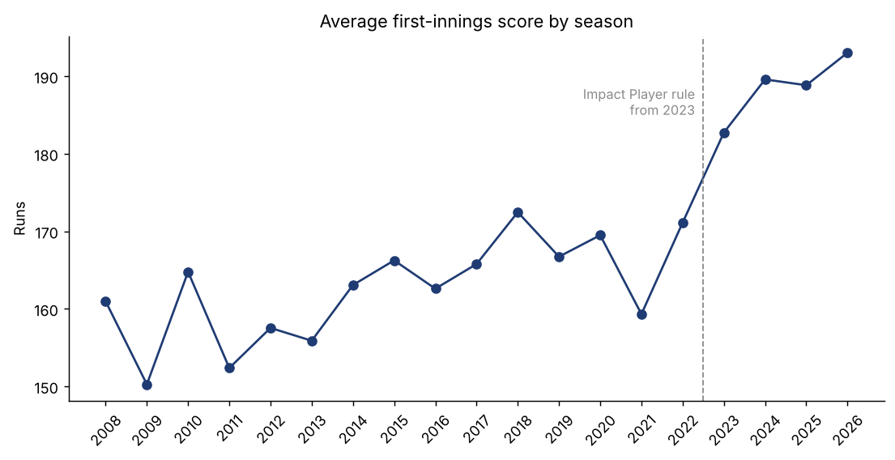
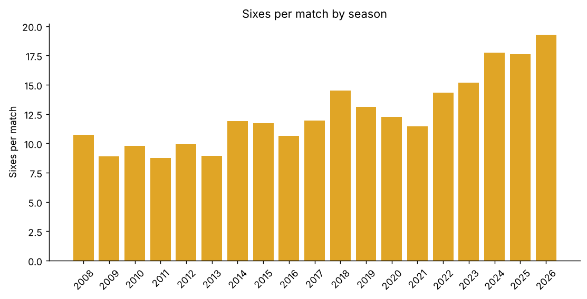
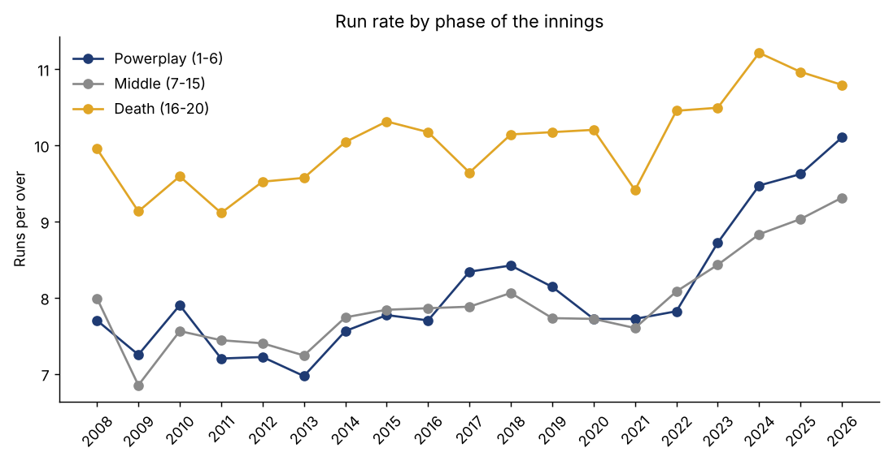
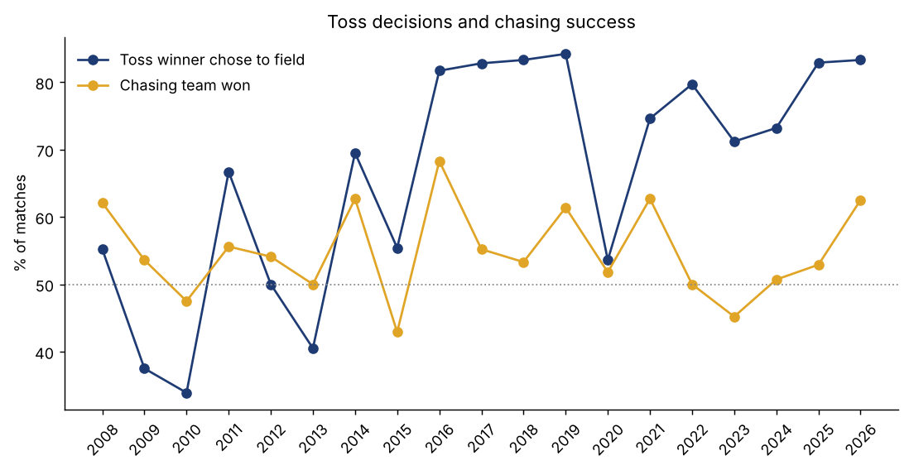
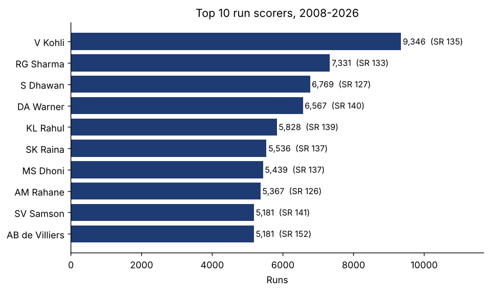

# IPL Data Analysis 2008–2026 | Python (pandas)

Every IPL match from the first season in 2008 to the 2026 final, analysed ball by ball in Python: how scoring has changed, whether the toss matters, which teams and players lead, and how each phase of an innings has sped up.

| | |
|:--|:--|
| **What was analysed** | 1,243 IPL matches across 19 seasons (April 2008 to May 2026) and 295,732 deliveries, with batter, bowler, runs, extras, wickets, toss, venue, result and player of the match |
| **What was done** | Data preparation in pandas (franchise renames merged, venue names standardised, legal balls, balls faced and bowler runs defined by the laws of cricket); season, phase, toss, team, venue, batting and bowling tables built with groupby, merge and apply; five Matplotlib charts |
| **Key finding** | The Impact Player rule changed the game: the average first-innings score rose from 162.6 (2008–2022) to 188.5 (2023–2026), and 2023–2026 produced more 200+ totals (196) than the 15 seasons before it combined (136). Sixes per match almost doubled, from 10.7 in 2008 to 19.3 in 2026. The toss matters less than teams think: toss winners chose to field 66.5% of the time but won only 51.6% of matches, while chasing teams won 54.7% |











## What the Results Show

- **Scoring by phase:** the powerplay run rate climbed from 7.7 an over in 2008 to 10.1 in 2026, and is now almost as fast as the death overs (10.8). Teams no longer wait for the last five overs to attack.
- **Highest totals:** the biggest first-innings total rose from 263 (2013) to 287 (2024); 2026 alone had 65 totals of 200 or more.
- **Teams:** Chennai Super Kings and Mumbai Indians have 5 titles each, Kolkata Knight Riders 3 and Royal Challengers Bengaluru 2 (2025 and 2026). Gujarat Titans have the best win rate of any current team (61.0% in 5 seasons).
- **Batting:** Virat Kohli leads with 9,346 runs over 19 seasons (average 40.5, strike rate 134.9), ahead of Rohit Sharma (7,331) and Shikhar Dhawan (6,769). Among batters with 1,500+ balls faced, Andre Russell scores fastest (strike rate 174.1).
- **Bowling:** Yuzvendra Chahal has the most wickets (233), then Bhuvneshwar Kumar (226) and Sunil Narine (209). Among bowlers with 1,500+ legal balls, only Muttiah Muralitharan (6.70 an over) has a better economy than Narine (6.79).
- **Venues:** Narendra Modi Stadium has the highest average first-innings score (180.7) among grounds with 30+ matches; at Sawai Mansingh Stadium the team batting first won only 35.3% of the time.

## Output Tables

| File | What it holds |
|:--|:--|
| `season_trends.csv` | Matches, average first-innings score, highest total, run rate, fours and sixes per match, 200+ totals per season |
| `phase_run_rate.csv` | Run rate in the powerplay, middle and death overs per season |
| `toss_and_chasing.csv` | Toss winner win %, % choosing to field and chasing-team win % per season |
| `teams.csv` · `finals.csv` | Matches, wins, win % and titles per franchise; every final |
| `top_run_scorers.csv` · `fastest_scorers.csv` | Runs, balls, fours, sixes, average and strike rate |
| `top_wicket_takers.csv` · `most_economical.csv` | Wickets, economy, average and death-over economy |
| `venues.csv` · `player_of_match.csv` | Venue scoring and bat-first win %; most player-of-the-match awards |

## How It Works

`analysis.py` loads the two files in `data/`, then:

1. Merges renamed franchises (Delhi Daredevils → Delhi Capitals, Kings XI Punjab → Punjab Kings, Royal Challengers Bangalore → Bengaluru) and old venue names (Feroz Shah Kotla → Arun Jaitley Stadium).
2. Marks legal balls (not wides or no-balls), balls faced (not wides), runs charged to the bowler (byes and leg byes excluded) and bowler wickets (run outs excluded).
3. Builds each table with pandas groupby and writes the CSV files, five charts and `summary.json`.

## Limitations

- Batting averages count every dismissal, including run outs; player names follow the source's initials format (e.g. "V Kohli").
- 25 matches that ended in a tie or no result are left out of the toss and chasing percentages.
- The Impact Player rule arrived together with other changes (flatter pitches, bigger squads of power hitters), so the jump in scoring is not caused by the rule alone.

## Run It Yourself

```bash
pip install -r requirements.txt
python analysis.py
```

**Tools:** Python (pandas, Matplotlib)

_Data: [IPL-DATASET](https://github.com/ritesh-ojha/IPL-DATASET) by Ritesh Ojha (ball-by-ball IPL data, 2008–2026). Used for learning purposes._
