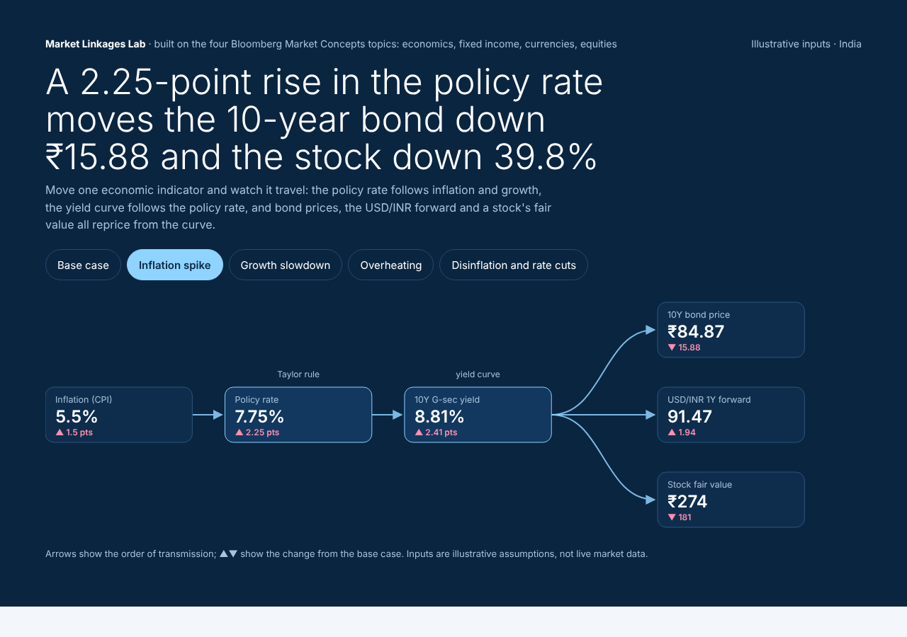

# Market Linkages Lab | Excel + Live Website

How one change in an economic indicator travels through markets, built on the four Bloomberg Market Concepts (BMC) topics: economic indicators, fixed income, currencies and equities. Inflation and growth set the policy rate, the policy rate anchors the government bond yield curve, and bond prices, the USD/INR forward and a stock's fair value all reprice from the curve.

**Live website:** [market-linkages-lab.vercel.app](https://market-linkages-lab.vercel.app) (move the inputs or pick a scenario and every figure recalculates) · **Workbook:** [Market_Linkages_Model.xlsx](Market_Linkages_Model.xlsx)

| | |
|:--|:--|
| **What was analysed** | Illustrative Indian market inputs: CPI inflation against the 4% target, the output gap, a neutral real rate, a term premium, a 10-year G-sec style bond, the USD/INR spot rate with a US rate, and a dividend-paying stock |
| **What was done** | A Taylor-rule policy rate; a Nelson-Siegel yield curve anchored to it; bond price, Macaulay and modified duration and convexity from a 20-period cash flow table; a USD/INR forward by covered interest parity; cost of equity by CAPM and fair value by the Gordon growth model with a sensitivity grid; five linked scenarios |
| **Key finding** | In the base case (4% CPI) the policy rate is 5.50%, the 10-year yield 6.40% and the bond ₹100.75. An inflation spike to 5.5% lifts the policy rate 2.25 points to 7.75% and the 10-year yield to 8.81%: the bond falls to ₹84.87, the USD/INR 1-year forward rises from 89.53 to 91.47 and the stock's fair value falls about 40%, from ₹455 to ₹274. Duration plus convexity estimates a 100bp move to within ₹0.02 of exact repricing |

## Scenarios

| Scenario | CPI | Output gap | Policy rate | 10Y yield | Bond price (₹) | USD/INR 1Y forward | Stock value (₹) |
|:--|--:|--:|--:|--:|--:|--:|--:|
| Base case | 4.0% | 0.0% | 5.50% | 6.40% | 100.75 | 89.53 | 455 |
| Inflation spike | 5.5% | 0.0% | 7.75% | 8.81% | 84.87 | 91.47 | 274 |
| Growth slowdown | 3.5% | −2.0% | 3.75% | 4.33% | 117.49 | 87.97 | 462 |
| Overheating | 5.0% | 1.5% | 7.75% | 8.65% | 85.82 | 91.43 | 325 |
| Disinflation and rate cuts | 3.0% | −0.5% | 3.75% | 4.65% | 114.68 | 88.05 | 755 |

## The Chain

| BMC topic | Model | Formula |
|:--|:--|:--|
| Economic indicators | Taylor rule | i = r* + π + 0.5(π − π*) + 0.5 × output gap |
| Fixed income | Nelson-Siegel curve; bond pricing | y(m) = b0 + b1·f(m) + b2·(f(m) − e^(−m/τ)); price = PV of half-yearly coupons and face value |
| Currencies | Covered interest parity | F = S × ((1 + i INR)/(1 + i USD))^T |
| Equities | CAPM and Gordon growth | ke = 10Y yield + β × ERP; value = D1 / (ke − g) |

Simplifications: no credit spread, a flat dividend path, and illustrative inputs rather than live market data.

## Files

| File | Contents |
|:--|:--|
| Market_Linkages_Model.xlsx | Inputs, Economy, Yield Curve, Bond (cash flows, duration, convexity, shock test), FX, Equity (sensitivity grid), Scenarios; every figure a formula |
| website.html | The live website, a single HTML page |
| model.py | Reference calculations used to check the workbook |
| build_xlsx.py | Rebuilds the workbook |

*Built by Aditya Kushwaha as a portfolio project. Not affiliated with or endorsed by Bloomberg.*
