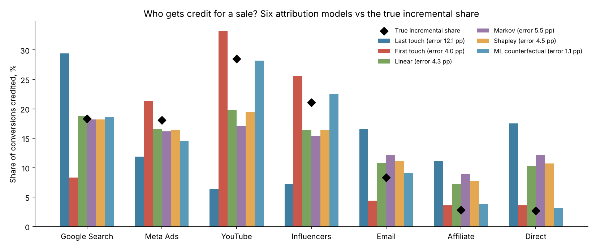
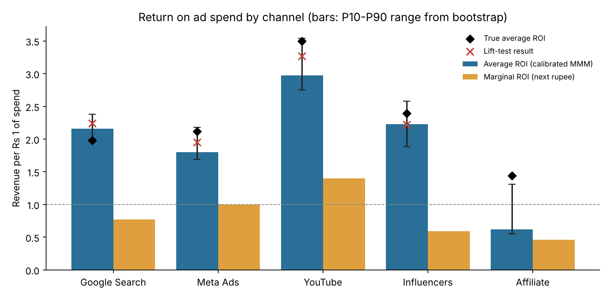
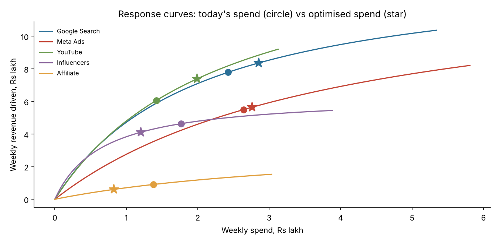

# Marketing Attribution & ROI Intelligence (AI-Powered)

**[Interactive demo](https://claude.ai/artifact/Krw3sHXTRenx1wzDHvvrSL)** · explore the results in your browser

Which marketing channels actually drive sales, what each rupee returns, and where next quarter's budget should go. The project combines multi-touch attribution, a marketing mix model calibrated with lift tests, a budget optimiser, and a Claude AI analyst that answers budget questions by running the models through tool calls.

| | |
|:--|:--|
| **What was analysed** | 60,000 customer journeys (191,749 touchpoints, 7 channels, Jul-Sep 2026) and 156 weeks of spend and revenue (₹19.8 crore of media spend, ₹91.4 crore of revenue) for a fictional D2C skincare brand. The data is synthetic, built so the true answer is known and every model can be checked |
| **What was done** | 8 attribution models (5 rules, Markov chain, Shapley values, LightGBM counterfactual), a marketing mix model with carry-over and saturation calibrated with 4 lift tests, bootstrap ROI ranges, a budget optimiser, and a Claude AI analyst with 5 tools |
| **Key finding** | Last-touch reporting gives Direct 17.5% of the credit against a true 2.7%, and YouTube 6.4% against a true 28.5%. The ML counterfactual model is within 1.1 points of the truth (last touch 12.1 points). Moving budget towards YouTube and Search raises media revenue by 3.5% for the same spend under the true curves (best possible: 4.2%) |



## 1. Attribution: Who Gets Credit for a Sale?

| Model | How credit is shared | Error vs true share |
|:--|:--|--:|
| Last touch | All credit to the final touch | 12.1 pp |
| Markov chain | Fall in conversion probability when a channel is removed from the journey graph | 5.5 pp |
| Time decay | Credit halves every 7 days before purchase | 5.0 pp |
| Shapley values | Each channel's average marginal contribution across channel combinations | 4.5 pp |
| Linear / Position based | Equal split / 40% first, 40% last, 20% middle | 4.3 pp |
| First touch | All credit to the first touch | 4.0 pp |
| **ML counterfactual** | LightGBM predicts purchase from each journey; a channel's credit is the drop in predicted purchases when its touches are removed, across buyers and non-buyers | **1.1 pp** |

Error is the mean absolute gap, in percentage points, between each model's share and the true incremental share. Markov and Shapley only see journeys that contain a channel, so they still over-credit channels that appear near the end of most journeys (Direct, Email, Affiliate). The counterfactual model compares journeys with and without each channel, which is closer to the question that matters: how many sales would be lost without it?

## 2. Marketing Mix Model: What Does Each Rupee Return?



| Channel | Spend (₹ lakh) | Average ROI | P10-P90 | Marginal ROI | Lift test | True ROI |
|:--|--:|--:|:--:|--:|--:|--:|
| YouTube | 427 | 2.97 | 2.75–3.54 | 1.40 | 3.27 | 3.50 |
| Influencers | 321 | 2.23 | 1.88–2.58 | 0.59 | 2.22 | 2.39 |
| Google Search | 608 | 2.16 | 2.00–2.38 | 0.77 | 2.24 | 1.98 |
| Meta Ads | 472 | 1.80 | 1.69–2.18 | 1.00 | 1.95 | 2.12 |
| Affiliate | 154 | 0.62 | 0.55–1.31 | 0.46 | none | 1.44 |

- **Model:** weekly revenue = base (trend, seasonality, festive weeks) + each channel's spend after carry-over (adstock) and diminishing returns (Hill curve). Fit R² 0.971, average weekly error 2.0%. Media drives 46% of revenue.
- **Calibration:** without experiments the model's average ROI error is 0.67 revenue per rupee, and it ranks Influencers above YouTube. Adding 4 lift tests cuts the error to 0.40.
- **Average vs marginal ROI:** average ROI is what spend has returned so far; marginal ROI is what the next rupee returns. Budget moves should follow marginal ROI.
- **Honest limits:** Affiliate has no lift test and the model understates it (0.62 vs a true 1.44). Influencers saturate too early in the fitted curve. Only 3 of 5 true ROIs fall inside the P10-P90 ranges.

## 3. Budget Optimiser



Same total weekly spend (₹9.6 lakh), each channel limited to ±40% of today's level:

| Channel | Today (₹ lakh/week) | Optimised | Change |
|:--|--:|--:|--:|
| YouTube | 1.42 | 1.99 | +40% |
| Google Search | 2.43 | 2.86 | +18% |
| Meta Ads | 2.64 | 2.76 | +4% |
| Influencers | 1.77 | 1.20 | −32% |
| Affiliate | 1.38 | 0.83 | −40% |

The fitted curves expect +4.9% media revenue. Checked against the true curves the gain is **+3.5%**, against a best possible +4.2%, so the plan captures about 84% of the available gain. The cut to Influencers is larger than the true optimum (−6%) because of the saturation error above.

## 4. AI Analyst (Claude)

`ai_analyst.py` gives Claude five tools and a rule that every number must come from a tool:

| Tool | What it does |
|:--|:--|
| `get_attribution_comparison` | Credit shares from all 8 models and their error vs truth |
| `get_channel_roi` | MMM ROI, ranges, marginal ROI, carry-over and saturation per channel |
| `get_lift_tests` | The 4 experiments used for calibration |
| `simulate_spend_change` | Revenue effect of any % change per channel, e.g. Search −20% and YouTube +25% |
| `optimise_budget` | Best split for any total, limits and locked channels |

```bash
python ai_analyst.py --ask "What happens if we move 20% of Search budget to YouTube?"
python ai_analyst.py --memo     # Claude writes outputs/AI_BUDGET_MEMO.md
python ai_analyst.py            # chat
```

Without an API key, `--memo` shows the rule-based memo in [outputs/BUDGET_MEMO.md](outputs/BUDGET_MEMO.md). The model defaults to `claude-sonnet-5-5` (change with `CLAUDE_MODEL`).

## Run It Yourself

```bash
pip install -r requirements.txt
python generate_data.py    # synthetic journeys, weekly data, lift tests and true answers (~1 min)
python attribution.py      # 8 attribution models vs truth
python mmm.py              # calibrated MMM, bootstrap ranges, budget optimiser (~5 min)
python report.py           # charts, Excel pack, budget memo
pytest -q                  # 16 tests, including the AI agent loop with a scripted stand-in for Claude
```

## Outputs

| File | Contents |
|:--|:--|
| `outputs/marketing_roi_pack.xlsx` | Summary, attribution shares with live error formulas, ROI by attribution model, MMM ROI with totals, budget plan |
| `outputs/attribution_comparison.csv` | Conversions and share credited per channel by each model |
| `outputs/attribution_roi.csv` | Revenue per rupee by channel under each model |
| `outputs/mmm_roi.csv` · `mmm_decomposition.csv` | Channel ROI and weekly revenue split into base and each channel |
| `outputs/budget_optimisation.csv` · `BUDGET_MEMO.md` | Optimised weekly split and the budget memo |

*All data is synthetic and the brand is fictional.*

**Tools:** Python · LightGBM · SciPy (differential evolution, bounded least squares, SLSQP) · Claude API (tool use) · pandas · matplotlib · openpyxl · pytest
