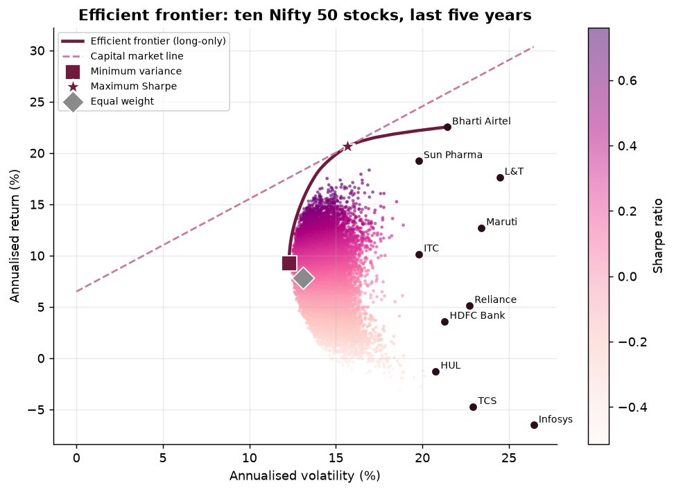
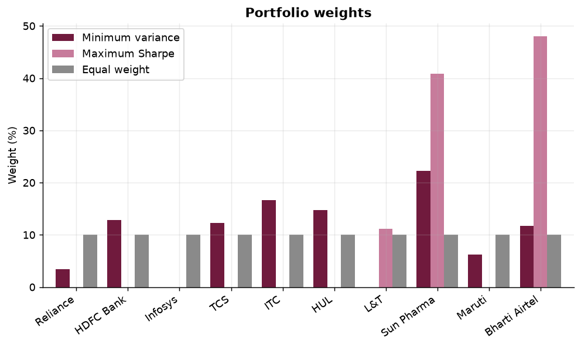
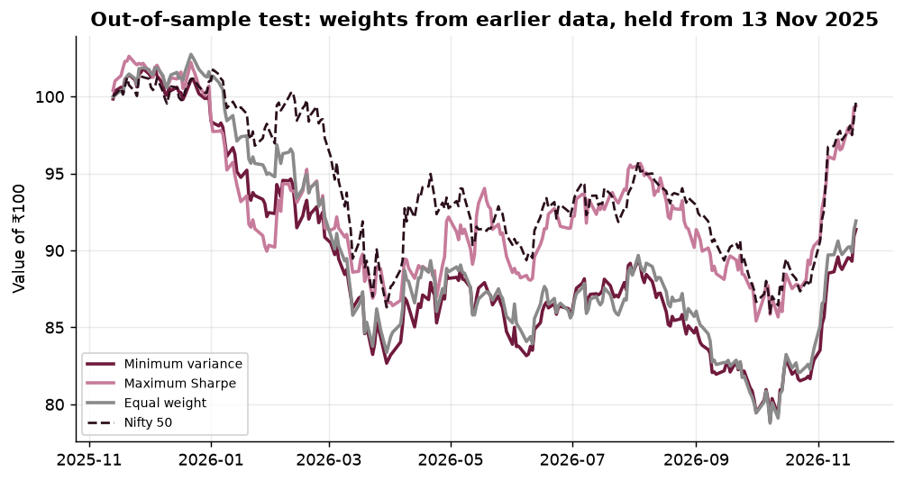

# Markowitz Efficient Frontier: Ten Nifty 50 Stocks

Applies Harry Markowitz's *Portfolio Selection* (Journal of Finance, 1952) to ten large NSE stocks: the efficient frontier, the minimum-variance and maximum-Sharpe portfolios, and a test of how those weights hold up on data they were not built on.

| | |
|:--|:--|
| **What was analysed** | Five years of daily prices for ten Nifty 50 stocks from different sectors (Reliance, HDFC Bank, Infosys, TCS, ITC, HUL, L&T, Sun Pharma, Maruti, Bharti Airtel) and the Nifty 50 index, November 2021 to November 2026 (Yahoo Finance) |
| **What was done** | Annualised returns and covariance matrix; long-only efficient frontier by quadratic optimisation; 20,000 random portfolios; minimum-variance and maximum-Sharpe portfolios (risk-free rate 6.5%, assumed); out-of-sample test with weights set on the first four years and held for the fifth |
| **Key finding** | Diversification worked: a single stock averaged 22.3% volatility, an equal-weight mix of all ten only 13.1%. The maximum-Sharpe portfolio looked excellent in-sample (Sharpe 0.90) but put 89% in two stocks (Bharti Airtel and Sun Pharma). In the following year it returned -0.6%, roughly level with the Nifty 50 (-0.3%), and the minimum-variance portfolio lost 8.6%: optimised weights depend heavily on past returns that do not repeat |

**Live report:** [outputs/REPORT.md](outputs/REPORT.md), refreshed every Monday by GitHub Actions.







## How It Works

1. **Inputs:** daily log returns, annualised (×252) into expected returns and a covariance matrix.
2. **Frontier:** for each target return, `scipy.optimize` finds the lowest-volatility long-only portfolio (weights between 0 and 1, summing to 1).
3. **Special portfolios:** the minimum-variance portfolio, and the maximum-Sharpe (tangency) portfolio where the capital market line touches the frontier.
4. **Out-of-sample:** weights estimated without the final 252 trading days, then held through them and compared with equal weight and the Nifty 50.

## Limitations

- Expected returns estimated from five years of history are noisy; small changes move the optimal weights a lot.
- No transaction costs, taxes or position limits beyond long-only.
- In-sample returns are annualised average log returns; the out-of-sample test uses simple compounded returns.

## Run It Yourself

```bash
pip install -r requirements.txt
python frontier.py
```

**Tools:** Python, pandas, NumPy, SciPy, Matplotlib, yfinance

_For learning purposes only. Not investment advice._
