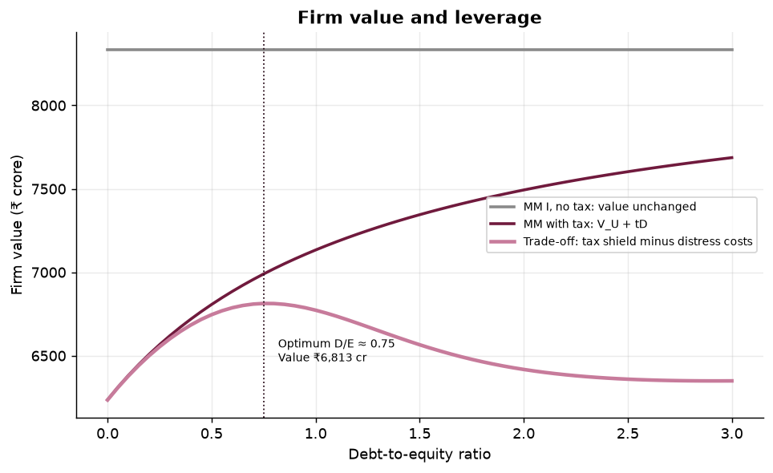
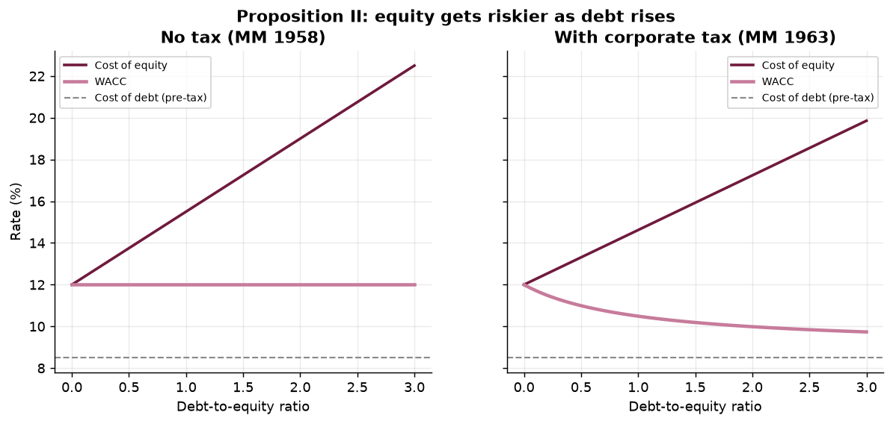
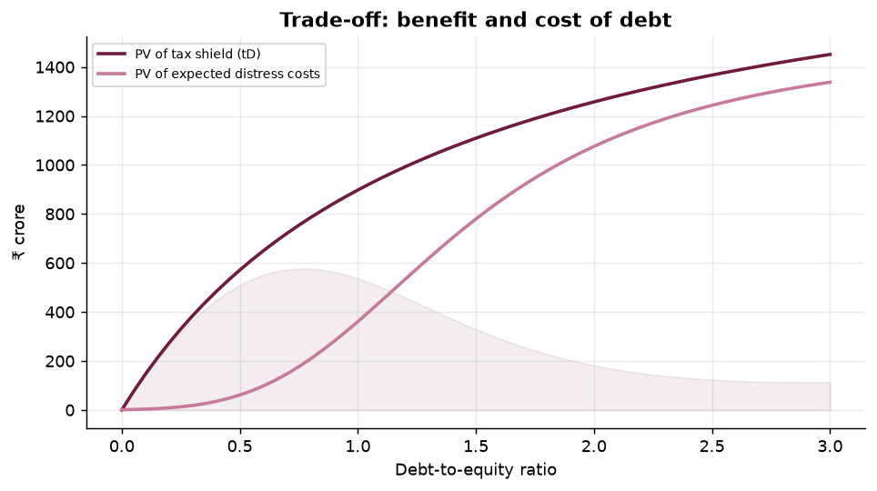

# Modigliani-Miller Capital Structure Model

Works through Modigliani and Miller's *The Cost of Capital, Corporation Finance and the Theory of Investment* (American Economic Review, 1958) and their 1963 tax correction, then adds financial distress costs to find an optimal debt level (the trade-off theory).

| | |
|:--|:--|
| **What was analysed** | One illustrative firm (EBIT ₹1,000 crore a year, unlevered cost of capital 12%, cost of debt 8.5%) at debt-to-equity ratios from 0 to 3, under India's 25.17% corporate tax rate (Section 115BAA) |
| **What was done** | Firm value, cost of equity and WACC under three cases: MM without tax (Propositions I and II), MM with corporate tax (value = V_U + tD), and a trade-off model where the probability of financial distress rises with leverage |
| **Key finding** | Without tax, WACC stays at 12.0% at every debt level and firm value is fixed at ₹8,333 crore: the cheaper cost of debt is exactly offset by riskier equity (cost of equity rises from 12% to 15.5% at D/E = 1). With tax, D/E = 1 lifts value 14.4% through the tax shield and lowers WACC to 10.5%. Once distress costs are added, value peaks at D/E ≈ 0.75 (debt 43% of firm value), 9.3% above the all-equity firm |

**Full results:** [outputs/REPORT.md](outputs/REPORT.md) and [outputs/table.csv](outputs/table.csv)







## How It Works

1. **Proposition I (no tax):** V_L = V_U = EBIT / r_U.
2. **Proposition II (no tax):** r_E = r_U + (r_U − r_D) × D/E; WACC equals r_U at every leverage.
3. **With tax (1963):** V_L = V_U + t × D, and r_E = r_U + (r_U − r_D)(1 − t) × D/E.
4. **Trade-off:** expected distress cost = probability of distress (logistic in D/V) × 25% of firm value, subtracted from the levered value.

## Limitations

- Inputs are illustrative, not a specific company; the distress-cost function is an assumption chosen to show the trade-off.
- Cost of debt is held constant, though lenders charge more as leverage rises.
- Personal taxes (Miller, 1977) are left out.

## Run It Yourself

```bash
pip install -r requirements.txt
python capital_structure.py
```

Change the `INPUTS` block to model a different firm.

**Tools:** Python, pandas, NumPy, Matplotlib

_For learning purposes only. Not investment advice._
