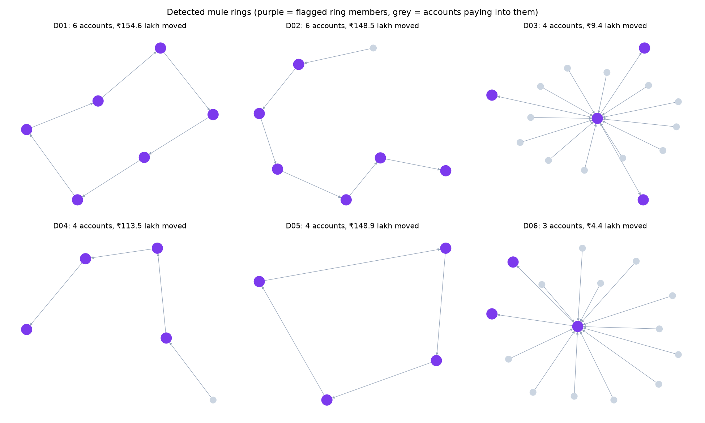

# Money Mule Ring Detector

Finds money mule rings in a bank transaction network: accounts that receive stolen funds and pass them on fast, in groups.

| | |
|:--|:--|
| **What was analysed** | A synthetic bank network of 2,000+ customer accounts and about 64,000 transfers over 90 days, with 8 hidden mule rings (47 mule accounts) in three common patterns: fan-in/fan-out, round-trip cycles and layering chains, plus honest look-alikes such as rent collectors and new students |
| **What was done** | Network features per account (pass-through ratio, share of money out within 24 hours, account age, night activity, PageRank, cycle membership) with NetworkX; a transparent AML rule score; Louvain community search to group flags into rings; a logistic regression and a GraphSAGE graph neural network (PyTorch Geometric) for comparison; export to Neo4j with Cypher queries for cycles and fan-in |
| **Key finding** | All 8 rings found. Rules: precision 1.00, recall 0.84 (no false alarms, some missed mules). Logistic regression: recall 1.00 but precision 0.68. The graph neural network gave the best balance: precision 0.91, recall 1.00, F1 0.95, because it reads each account's neighbours, not only its own behaviour |



## How It Works

1. **Data:** `generate_data.py` builds the network. Mules hide among normal customers: 30% use older bought accounts, add small camouflage spending and wait hours or days before moving money on.
2. **Features and rules:** `detect.py` scores each account out of 100 (pass-through > 90%: 30 points, fast exit: 25, new account: 15, little shop spending: 10, night activity: 10, cycle: 10) and flags 60+.
3. **Rings:** flagged accounts are grouped by Louvain community search and checked against the true rings.
4. **Machine learning:** logistic regression on the same features; `gnn.py` trains GraphSAGE on the full transfer graph with the same 60/40 train/test split.
5. **Graph database:** `export_neo4j.py` writes node and edge files; `neo4j/load_and_query.cypher` loads them and finds cycles, fan-in hubs and 2-hop paths.

| Model (test set) | Precision | Recall | F1 |
|:--|--:|--:|--:|
| AML rules | 1.00 | 0.84 | 0.91 |
| Logistic regression | 0.68 | 1.00 | 0.81 |
| GraphSAGE (GNN) | 0.91 | 1.00 | 0.95 |

## Limitations

- The data is synthetic: real mule networks are larger, noisier and change tactics.
- The test set has only about 19 mules, so one account changes recall by about 5 points.
- Labels are perfect here; real banks learn from confirmed fraud reports that arrive weeks late.

## Run It Yourself

```bash
pip install -r requirements.txt          # add torch and torch_geometric for gnn.py
python generate_data.py && python detect.py && python export_neo4j.py && python gnn.py
streamlit run app.py
```

**Tools:** Python, NetworkX, python-louvain, scikit-learn, PyTorch Geometric, Neo4j (Cypher), Streamlit

_Synthetic data for learning purposes. Links to KYC/AML coursework from the MBA._
