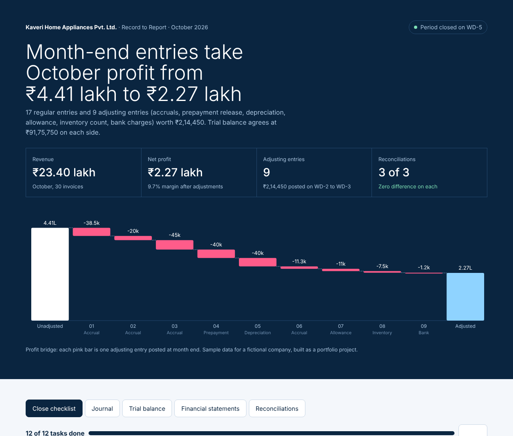

# Month-End Close & Trial Balance | Excel

A full Record to Report month-end close for a fictional consumer durables distributor, Kaveri Home Appliances Pvt. Ltd., for October 2026: opening trial balance, a month of journal entries, month-end adjusting entries, the adjusted trial balance, the financial statements and the closing reconciliations, with a five-day close checklist.

**Live website:** [Month-End Close Console](https://claude.ai/artifact/RYujnqGHE2LEN3378WAsTu) · **Workbook:** [Month_End_Close_Trial_Balance.xlsx](Month_End_Close_Trial_Balance.xlsx) · **Close pack (PowerPoint):** [Month_End_Close_Pack_October_2026.pptx](Month_End_Close_Pack_October_2026.pptx) ([PDF](Month_End_Close_Pack_October_2026.pdf))

| | |
|:--|:--|
| **What was analysed** | An opening trial balance at 30 September 2026 (26 accounts) and 17 regular October entries: 30 credit sales invoices, stock purchases, customer receipts, supplier payments, rent, salaries, marketing, a loan repayment and an equipment purchase |
| **What was done** | 9 adjusting entries (electricity, audit fee, contract wage and interest accruals; insurance prepayment release; depreciation; allowance for doubtful debts at 5% of receivables; inventory count shortfall; bank charges), an unadjusted and adjusted trial balance built with SUMIFS over the journal, profit and loss, balance sheet, bank reconciliation, and AR and AP subledger to GL reconciliations |
| **Key finding** | ₹2,14,450 of month-end adjustments cut October profit from ₹4.41 lakh to ₹2.27 lakh (net margin 9.7% on ₹23.40 lakh revenue). The adjusted trial balance agrees at ₹91,75,750 on each side, the balance sheet balances at ₹63,48,300, and all three reconciliations close at zero difference (the bank gap is one unpresented ₹6,80,000 supplier cheque) |

## Close Pack for the Finance Controller

An 8-slide PowerPoint that presents the close the way an R2R team reports it: executive summary, the five-day close timeline, a profit impact chart of the 9 adjusting entries, the P&L before and after adjustments, the balance sheet with its check, the three reconciliations, and four follow-ups for November (cheque 004512 in transit, contract wages cut-off, cycle counts, receivables ageing). Every figure comes from the workbook; native PowerPoint charts and tables, speaker notes on each slide.

## The Close

| Day | Task | Owner |
|:--|:--|:--|
| WD-1 | Cut-off: all October sales and purchase invoices posted; bank reconciliation | AR / AP team, R2R analyst |
| WD-2 | Accruals, prepayment release, depreciation run | R2R analyst |
| WD-3 | Inventory count result, allowance review, subledger to GL reconciliation | R2R analyst, warehouse |
| WD-4 | Adjusted trial balance; balance sheet account review and sign-off | R2R analyst, finance controller |
| WD-5 | Statements issued; period locked | Finance controller |

## Adjusting Entries

| Entry | Adjustment | ₹ |
|:--|:--|--:|
| ADJ-01 | Accrual: October electricity (bill due 6 Nov) | 38,500 |
| ADJ-02 | Accrual: statutory audit fee, 1/12 of ₹2,40,000 | 20,000 |
| ADJ-03 | Accrual: contract staff wages unpaid at month end | 45,000 |
| ADJ-04 | Prepayment release: insurance, 1/12 of ₹4,80,000 | 40,000 |
| ADJ-05 | Depreciation: equipment ₹24,00,000 over 5 years | 40,000 |
| ADJ-06 | Accrual: October interest on the term loan at 9% | 11,250 |
| ADJ-07 | Allowance top-up to 5% of closing receivables of ₹14,80,000 | 11,000 |
| ADJ-08 | Inventory count shortfall (book ₹10,46,000, count ₹10,38,500) | 7,500 |
| ADJ-09 | Bank charges per the October bank statement | 1,200 |
| | **Total** | **2,14,450** |

## Workbook

| Sheet | Contents |
|:--|:--|
| README | Flow, colour code and checks |
| Opening TB | 26 accounts at 30 September 2026 (inputs) |
| Journal | 52 journal lines with account names looked up from the chart of accounts |
| Trial Balance | Opening, regular movements, unadjusted, adjusting movements and adjusted balances, all SUMIFS over the journal |
| Profit and Loss | Linked to the adjusted trial balance, with unadjusted profit for comparison |
| Balance Sheet | Linked to the adjusted trial balance, with a balancing check |
| Reconciliations | Bank, accounts receivable and accounts payable |
| Close Checklist | 12 tasks over five working days |

Blue text marks hardcoded inputs, black marks formulas and green marks links to another sheet. `build_close.py` rebuilds the workbook and checks that every entry balances.

*Sample data for a fictional company, built as a portfolio project by Aditya Kushwaha.*
