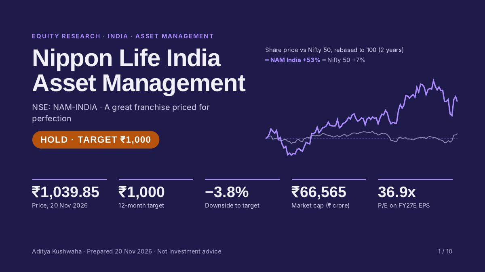
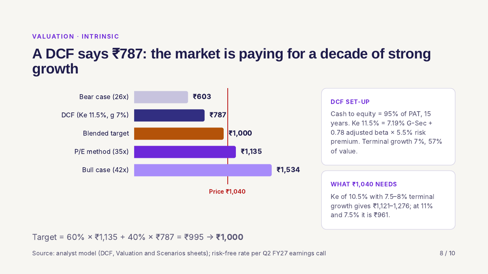

# Nippon Life India AMC: Stock Pitch (HOLD, Target ₹1,000)

A 10-slide equity research pitch on Nippon Life India Asset Management (NSE: NAM-INDIA), backed by a 9-sheet Excel valuation model. Pricing date: 20 November 2026.

| | |
|:--|:--|
| **What was analysed** | NAM India's AUM, market share, fee yields, costs and profits from FY22 to Q2 FY27, against six listed AMC peers |
| **What was done** | Earnings forecast to FY31E, a 15-year FCFE DCF, a peer P/E valuation and bull, base and bear scenarios, blended 60/40 into a 12-month price target |
| **Key finding** | A high-quality franchise that is fully priced: DCF value ₹787 and P/E value ₹1,135 give a ₹1,000 target, about 4% below the ₹1,039.85 price, so the call is **HOLD** |

## The Call

| | |
|:--|:--|
| Rating | HOLD |
| 12-month target | ₹1,000 (−3.8%) |
| Expected total return | About −1.5% including a 2.4% dividend yield |
| Scenarios | Bear ₹603 · Base (P/E method) ₹1,135 · Bull ₹1,534 |
| Buy level | Below about ₹865, where the blended value offers 15% upside |

## Investment Thesis

1. **Taking share.** MF average AUM market share rose 51 bps in a year to 9.02% (Q2 FY27), the fastest gain among the top-10 AMCs.
2. **Retail moat.** 24.3 million unique investors, 38.4% of all Indian mutual fund investors.
3. **Cash machine.** Core operating margin of about 66%, ROE of about 35% and over 90% of profit paid as dividends.
4. **But mix shift.** ETFs earn about 25 bps against 52 bps for equity funds, so revenue grows slower than AUM, while management guides 18–20% cost growth.

## Valuation Method

| Method | Value | Key inputs |
|:--|:--|:--|
| P/E | ₹1,135 | 35x Sep-2028E EPS of ₹32.4; a 13% premium to the large-AMC forward P/E median of 30.9x |
| DCF (FCFE) | ₹787 | Cost of equity 11.5% (7.19% G-Sec + 0.78 adjusted beta × 5.5% risk premium), terminal growth 7%, 15-year forecast |
| **Blended (60/40)** | **₹1,000** | Rounded to ₹10 |

## Files

| File | What it holds |
|:--|:--|
| [NAM_India_Stock_Pitch.pdf](NAM_India_Stock_Pitch.pdf) | The 10-slide pitch deck |
| [NAM_India_Valuation_Model.xlsx](NAM_India_Valuation_Model.xlsx) | Inputs, historical financials, earnings model, DCF with sensitivity table, valuation, scenarios, peers and sources: every assumption sourced, all formulas live |

**Sources:** NAM India Q2 FY27 media release and earnings call, Annual Reports, Screener consolidated financials, and Yahoo Finance market data (20 Nov 2026).

**Tools:** Excel (financial modelling), Python (market data), slide design

_For learning purposes only. Not investment advice._
