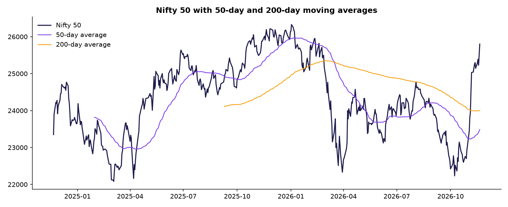
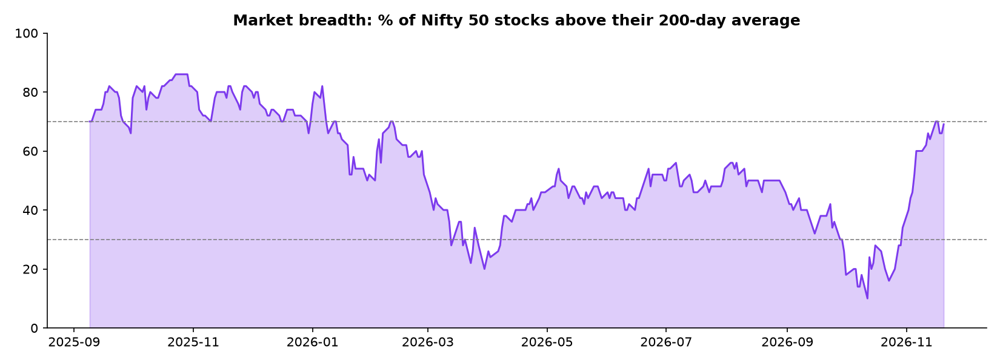
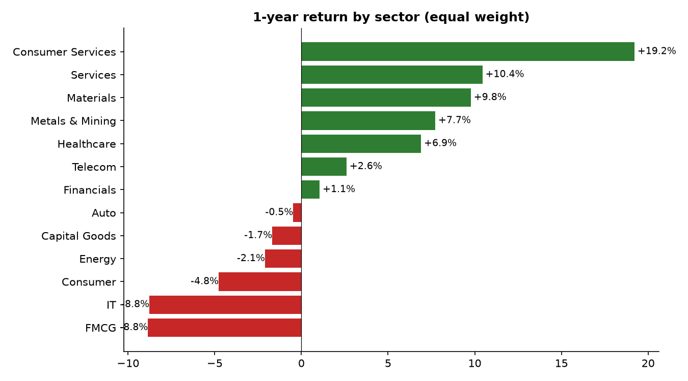

# Nifty 50 Market Trend Dashboard

Tracks the trend, momentum and breadth of every Nifty 50 stock from two years of daily prices, with a Streamlit dashboard and a weekly auto-updated report.

| | |
|:--|:--|
| **What was analysed** | Two years of daily prices for all 50 Nifty 50 stocks and the Nifty 50 index (November 2024 to November 2026, Yahoo Finance) |
| **What was done** | Returns over 1, 3, 6 and 12 months and year-to-date; 50-day and 200-day moving averages with golden and death crosses; RSI(14); volatility and maximum drawdown; market breadth (share of stocks above their 200-day average); equal-weight sector returns |
| **Key finding** | On 20 Nov 2026 the Nifty 50 was flat over the year (-0.3%) but up 13.1% in a month and 7.5% above its 200-day average. Breadth recovered from 10% of stocks above the 200-day average at the low to 69%, yet only 19 of 50 stocks were in a confirmed uptrend: a sharp rally that the slower trend signals had not yet confirmed. IT was the weakest sector over the year (-11.0%) |

**Live report:** [outputs/REPORT.md](outputs/REPORT.md), refreshed every Monday by GitHub Actions.







## How It Works

1. **Download:** `market.py` pulls daily prices for the 50 stocks (list in `nifty50.py`) and the index with yfinance, retrying any symbol that fails.
2. **Trend:** a stock is in an uptrend when its 50-day average is above its 200-day average; a cross in the last three months is flagged as golden (up) or death (down).
3. **Momentum and risk:** RSI(14) above 70 is overbought, below 30 oversold; volatility and drawdown use the last 12 months.
4. **Breadth:** the share of stocks above their own 200-day average, every day, shows whether a move is broad or led by a few names.
5. **Dashboard:** `app.py` shows the market view, a filterable stock table and a price chart with averages and RSI for any stock.

## Limitations

- Moving-average signals lag by design; they confirm trends rather than predict them.
- The constituent list is fixed in code and needs updating after index changes.
- Sector returns are simple averages, not weighted by market value as the index is.

## Run It Yourself

```bash
pip install -r requirements.txt
python market.py
streamlit run app.py
```

**Tools:** Python, pandas, NumPy, Matplotlib, yfinance, Streamlit

_For learning purposes only. Not investment advice._
