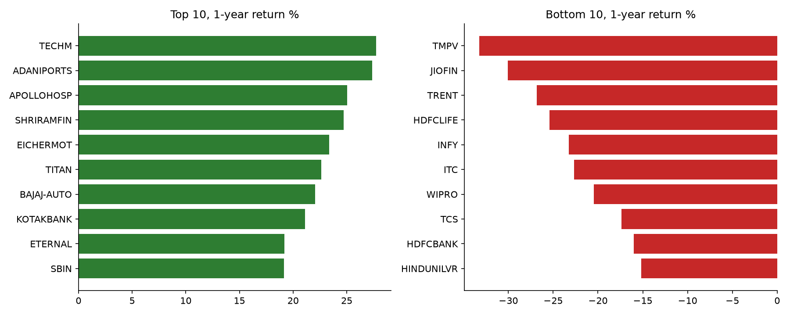

# Nifty 50 Market Trend Report — 2026-11-23

Nifty 50 at 25,349.7: downtrend, +5.6% vs its 200-day average. 70.0% of stocks trade above their 200-day average; 19 of 50 are in an uptrend.

## All stocks (sorted by 1-year return)

| symbol     | sector            |    price |   1M % |   1Y % |   vs 200DMA % |   RSI 14 | trend                      | recent cross   |
|:-----------|:------------------|---------:|-------:|-------:|--------------:|---------:|:---------------------------|:---------------|
| TECHM      | IT                |  1777.5  |  -2.02 |  27.76 |         18.15 |    57.2  | Uptrend (50DMA > 200DMA)   |                |
| ADANIPORTS | Services          |  1919    |   9.66 |  27.39 |         13.64 |    60.27 | Uptrend (50DMA > 200DMA)   |                |
| APOLLOHOSP | Healthcare        |  9257    |  21.73 |  25.06 |         12.75 |    71.38 | Uptrend (50DMA > 200DMA)   |                |
| SHRIRAMFIN | Financials        |   995.9  |  11.41 |  24.73 |          0.58 |    60.96 | Downtrend (50DMA < 200DMA) | Death cross    |
| EICHERMOT  | Auto              |  8172.5  |  15.36 |  23.35 |         10.74 |    71.23 | Uptrend (50DMA > 200DMA)   | Golden cross   |
| TITAN      | Consumer          |  4680    |   7.59 |  22.62 |          4.27 |    49.19 | Uptrend (50DMA > 200DMA)   |                |
| BAJAJ-AUTO | Auto              | 10643    |   4.81 |  22.05 |          2.98 |    49.2  | Uptrend (50DMA > 200DMA)   |                |
| KOTAKBANK  | Financials        |   502.85 |  15.07 |  21.1  |         24.14 |    68.86 | Uptrend (50DMA > 200DMA)   | Golden cross   |
| ETERNAL    | Consumer Services |   362.1  |  18.94 |  19.21 |         26.34 |    59.79 | Uptrend (50DMA > 200DMA)   |                |
| SBIN       | Financials        |  1132.65 |  16.77 |  19.14 |          9.43 |    70.28 | Downtrend (50DMA < 200DMA) | Death cross    |
| ICICIBANK  | Financials        |  1585.5  |  13.37 |  16.45 |         16.57 |    65.35 | Uptrend (50DMA > 200DMA)   |                |
| JSWSTEEL   | Metals & Mining   |  1311.9  |   7.53 |  12.98 |          4.75 |    52.31 | Uptrend (50DMA > 200DMA)   |                |
| HINDALCO   | Metals & Mining   |   900.45 |   1.68 |  12.63 |         -7.81 |    43.15 | Downtrend (50DMA < 200DMA) | Death cross    |
| AXISBANK   | Financials        |  1388.6  |  14.57 |  11.93 |          8.07 |    63.87 | Downtrend (50DMA < 200DMA) | Death cross    |
| DRREDDY    | Healthcare        |  1380.1  |  11.39 |  11.46 |         10.01 |    64.44 | Uptrend (50DMA > 200DMA)   | Golden cross   |
| GRASIM     | Materials         |  3075.2  |   6.25 |  10.83 |          2.46 |    51.14 | Uptrend (50DMA > 200DMA)   |                |
| ADANIENT   | Metals & Mining   |  2677.9  |   5.02 |   9.8  |          1.06 |    48.38 | Uptrend (50DMA > 200DMA)   |                |
| ULTRACEMCO | Materials         | 12650    |  15.44 |   8.71 |         10.21 |    66.69 | Downtrend (50DMA < 200DMA) | Golden cross   |
| BAJFINANCE | Financials        |  1095.5  |  16.28 |   8.22 |         11.85 |    60.72 | Uptrend (50DMA > 200DMA)   |                |
| SUNPHARMA  | Healthcare        |  1860    |   5.8  |   6.82 |          2.19 |    55.42 | Downtrend (50DMA < 200DMA) | Death cross    |
| COALINDIA  | Energy            |   382    |  -2.66 |   5.29 |         -7.57 |    38.16 | Downtrend (50DMA < 200DMA) | Death cross    |
| NESTLEIND  | FMCG              |  1305.9  |   9.75 |   3.75 |         -3.63 |    55.39 | Downtrend (50DMA < 200DMA) | Death cross    |
| LT         | Capital Goods     |  4099.9  |  12.69 |   3.38 |          4.17 |    59.08 | Downtrend (50DMA < 200DMA) | Death cross    |
| BHARTIARTL | Telecom           |  2128.5  |  12.32 |   2.6  |         13.06 |    64.84 | Uptrend (50DMA > 200DMA)   | Golden cross   |
| POWERGRID  | Energy            |   264.85 |   7.86 |   0.33 |         -5.03 |    57    | Downtrend (50DMA < 200DMA) |                |
| MAXHEALTH  | Healthcare        |  1089.55 |  33.36 |  -1.05 |          7.81 |    79.83 | Downtrend (50DMA < 200DMA) | Death cross    |
| NTPC       | Energy            |   315.45 |   5.24 |  -1.25 |         -9.35 |    47.64 | Downtrend (50DMA < 200DMA) |                |
| TATACONSUM | FMCG              |  1133    |  18.05 |  -1.31 |          4.39 |    67.99 | Downtrend (50DMA < 200DMA) |                |
| ONGC       | Energy            |   222.85 |   2.54 |  -4.22 |         -8.85 |    49.84 | Downtrend (50DMA < 200DMA) |                |
| TATASTEEL  | Metals & Mining   |   163    |  -5.41 |  -4.53 |        -14.88 |    32    | Downtrend (50DMA < 200DMA) |                |
| M&M        | Auto              |  3487.4  |  21.76 |  -4.72 |         10.23 |    68.98 | Downtrend (50DMA < 200DMA) |                |
| INDIGO     | Services          |  5523    |  20.07 |  -6.52 |         13.99 |    63.06 | Uptrend (50DMA > 200DMA)   |                |
| BEL        | Capital Goods     |   395.8  |   8.59 |  -6.75 |         -4.23 |    54.31 | Downtrend (50DMA < 200DMA) |                |
| CIPLA      | Healthcare        |  1399.9  |   5.18 |  -7.77 |          2.88 |    54.67 | Uptrend (50DMA > 200DMA)   |                |
| BAJAJFINSV | Financials        |  1880.1  |  12.04 |  -8.91 |          1.94 |    62.24 | Downtrend (50DMA < 200DMA) | Death cross    |
| SBILIFE    | Financials        |  1804.9  |   9.86 |  -9.67 |         -1.24 |    59.2  | Downtrend (50DMA < 200DMA) |                |
| MARUTI     | Auto              | 14010    |  25.43 |  -9.78 |          6.42 |    76    | Downtrend (50DMA < 200DMA) |                |
| ASIANPAINT | Consumer          |  2580.4  |  13.2  | -10.09 |          3.54 |    62.13 | Downtrend (50DMA < 200DMA) | Death cross    |
| HCLTECH    | IT                |  1364.3  |  -4.04 | -10.49 |          6.71 |    49.98 | Uptrend (50DMA > 200DMA)   | Golden cross   |
| RELIANCE   | Energy            |  1351    |  14.06 | -10.64 |          2.36 |    64.89 | Downtrend (50DMA < 200DMA) |                |
| HINDUNILVR | FMCG              |  2019.1  |  11.48 | -15.19 |         -3.13 |    60.75 | Downtrend (50DMA < 200DMA) |                |
| HDFCBANK   | Financials        |   817.8  |  17.83 | -15.99 |          5.81 |    65.19 | Downtrend (50DMA < 200DMA) |                |
| TCS        | IT                |  2460    |  -1.87 | -17.38 |          4.88 |    57.32 | Downtrend (50DMA < 200DMA) |                |
| WIPRO      | IT                |   187.29 |  -1.64 | -20.48 |         -0.33 |    49.83 | Downtrend (50DMA < 200DMA) |                |
| ITC        | FMCG              |   301    |  16.26 | -22.66 |          5.46 |    73.02 | Downtrend (50DMA < 200DMA) |                |
| INFY       | IT                |  1103.4  |  -2.14 | -23.27 |         -3.31 |    47.49 | Downtrend (50DMA < 200DMA) |                |
| HDFCLIFE   | Financials        |   574.95 |   8.82 | -25.42 |         -2.19 |    55.71 | Downtrend (50DMA < 200DMA) |                |
| TRENT      | Consumer          |  3208    |  15.57 | -26.84 |         13.64 |    63.77 | Uptrend (50DMA > 200DMA)   | Golden cross   |
| JIOFIN     | Financials        |   219.7  |   4.22 | -30.07 |         -7.51 |    46.73 | Downtrend (50DMA < 200DMA) |                |
| TMPV       | Auto              |   259    |  -4.07 | -33.24 |        -21.57 |    39.17 | Downtrend (50DMA < 200DMA) |                |

_Data: Yahoo Finance via yfinance. For learning purposes only, not investment advice._