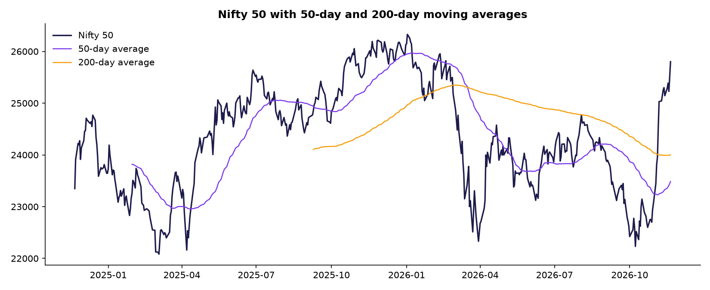
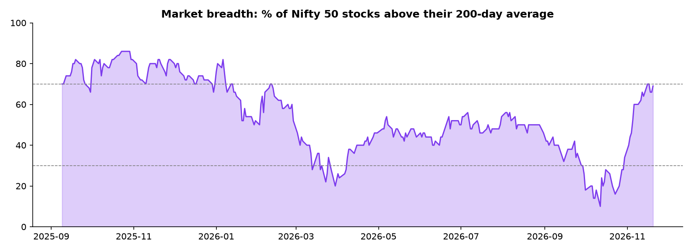
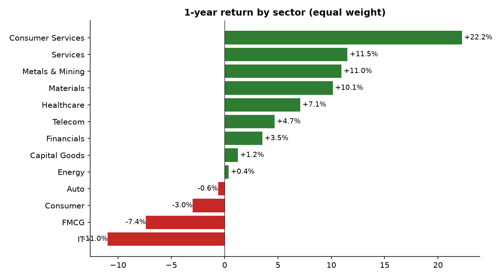

# Nifty 50 Market Trend Report — 2026-11-20

Nifty 50 at 25,800.6: downtrend, +7.5% vs its 200-day average. 69.0% of stocks trade above their 200-day average; 19 of 50 are in an uptrend.

## All stocks (sorted by 1-year return)

| symbol     | sector            |    price |   1M % |   1Y % |   vs 200DMA % |   RSI 14 | trend                      | recent cross   |
|:-----------|:------------------|---------:|-------:|-------:|--------------:|---------:|:---------------------------|:---------------|
| ADANIPORTS | Services          |  1917    |   9.62 |  28.42 |         13.7  |    60    | Uptrend (50DMA > 200DMA)   |                |
| KOTAKBANK  | Financials        |   515.8  |  17.82 |  24.49 |         27.48 |    80.83 | Uptrend (50DMA > 200DMA)   | Golden cross   |
| TECHM      | IT                |  1746.2  |  -4.04 |  24.46 |         16.09 |    52.06 | Uptrend (50DMA > 200DMA)   |                |
| SBIN       | Financials        |  1165.1  |  20.99 |  24.33 |         12.61 |    82.14 | Downtrend (50DMA < 200DMA) | Death cross    |
| APOLLOHOSP | Healthcare        |  9200    |  21.05 |  23.96 |         12.23 |    70.46 | Uptrend (50DMA > 200DMA)   |                |
| BAJAJ-AUTO | Auto              | 10765    |   6.88 |  23.11 |          4.23 |    53.01 | Uptrend (50DMA > 200DMA)   |                |
| ETERNAL    | Consumer Services |   364    |  16.54 |  22.25 |         27.19 |    61.61 | Uptrend (50DMA > 200DMA)   |                |
| SHRIRAMFIN | Financials        |   972    |   8.25 |  21.03 |         -1.84 |    56.49 | Downtrend (50DMA < 200DMA) | Death cross    |
| TITAN      | Consumer          |  4620    |   5.46 |  20.73 |          3.02 |    45.87 | Uptrend (50DMA > 200DMA)   |                |
| EICHERMOT  | Auto              |  8113    |  13.14 |  19.59 |         10.02 |    70.02 | Uptrend (50DMA > 200DMA)   | Golden cross   |
| ICICIBANK  | Financials        |  1640    |  18.41 |  19.33 |         20.67 |    81    | Uptrend (50DMA > 200DMA)   |                |
| AXISBANK   | Financials        |  1446    |  19.5  |  18.11 |         12.55 |    78.15 | Downtrend (50DMA < 200DMA) | Death cross    |
| HINDALCO   | Metals & Mining   |   929.5  |   4.1  |  15.07 |         -4.89 |    50.91 | Downtrend (50DMA < 200DMA) | Death cross    |
| JSWSTEEL   | Metals & Mining   |  1337    |   9.33 |  13.58 |          6.79 |    59.58 | Uptrend (50DMA > 200DMA)   |                |
| DRREDDY    | Healthcare        |  1390.2  |  11.71 |  13.29 |         10.9  |    68.96 | Uptrend (50DMA > 200DMA)   | Golden cross   |
| GRASIM     | Materials         |  3111.1  |   8.06 |  12.77 |          3.75 |    55.01 | Uptrend (50DMA > 200DMA)   |                |
| ADANIENT   | Metals & Mining   |  2709    |   4.41 |  12.35 |          2.36 |    51.16 | Uptrend (50DMA > 200DMA)   |                |
| BAJFINANCE | Financials        |  1122    |  21.17 |  12.28 |         14.66 |    67.69 | Uptrend (50DMA > 200DMA)   |                |
| SUNPHARMA  | Healthcare        |  1884.9  |   8.01 |   9.48 |          3.63 |    62.61 | Downtrend (50DMA < 200DMA) | Death cross    |
| COALINDIA  | Energy            |   390    |  -1.83 |   8.55 |         -5.68 |    43.8  | Downtrend (50DMA < 200DMA) | Death cross    |
| ULTRACEMCO | Materials         | 12560    |  17.93 |   7.51 |          9.45 |    70.91 | Downtrend (50DMA < 200DMA) | Golden cross   |
| LT         | Capital Goods     |  4209.1  |  15.76 |   6.19 |          6.97 |    73.48 | Downtrend (50DMA < 200DMA) | Death cross    |
| NESTLEIND  | FMCG              |  1325    |   8.26 |   4.97 |         -2.21 |    59.73 | Downtrend (50DMA < 200DMA) | Death cross    |
| BHARTIARTL | Telecom           |  2144    |  14.33 |   4.69 |         14.01 |    70.35 | Uptrend (50DMA > 200DMA)   | Golden cross   |
| TATASTEEL  | Metals & Mining   |   178    |   3.22 |   2.84 |         -7.14 |    47.17 | Downtrend (50DMA < 200DMA) |                |
| POWERGRID  | Energy            |   269    |   7.92 |   2.45 |         -3.52 |    62.44 | Downtrend (50DMA < 200DMA) |                |
| NTPC       | Energy            |   325    |   6.18 |   2.14 |         -6.67 |    58.59 | Downtrend (50DMA < 200DMA) |                |
| TATACONSUM | FMCG              |  1155.9  |  19.09 |   0.94 |          6.52 |    76.98 | Downtrend (50DMA < 200DMA) |                |
| ONGC       | Energy            |   223.46 |   2.54 |  -2.88 |         -8.67 |    50.98 | Downtrend (50DMA < 200DMA) |                |
| M&M        | Auto              |  3545    |  22.71 |  -3.17 |         12.07 |    74.24 | Downtrend (50DMA < 200DMA) |                |
| BEL        | Capital Goods     |   402    |   8.3  |  -3.7  |         -2.79 |    60.55 | Downtrend (50DMA < 200DMA) |                |
| ASIANPAINT | Consumer          |  2595    |  11.6  |  -5.13 |          4.19 |    65.5  | Downtrend (50DMA < 200DMA) | Death cross    |
| INDIGO     | Services          |  5587.6  |  20.38 |  -5.38 |         15.43 |    66.94 | Uptrend (50DMA > 200DMA)   |                |
| MAXHEALTH  | Healthcare        |  1040.65 |  25.38 |  -5.54 |          3.1  |    74.94 | Downtrend (50DMA < 200DMA) | Death cross    |
| CIPLA      | Healthcare        |  1418.5  |   7.13 |  -5.76 |          4.32 |    62.55 | Uptrend (50DMA > 200DMA)   |                |
| BAJAJFINSV | Financials        |  1892    |  11.95 |  -7.91 |          2.57 |    64.79 | Downtrend (50DMA < 200DMA) | Golden cross   |
| SBILIFE    | Financials        |  1826.5  |   9.96 |  -7.99 |         -0.11 |    63.47 | Downtrend (50DMA < 200DMA) |                |
| RELIANCE   | Energy            |  1377.5  |  13.94 |  -8.41 |          4.35 |    75.17 | Downtrend (50DMA < 200DMA) |                |
| MARUTI     | Auto              | 14011    |  25.1  | -10.14 |          6.42 |    76.03 | Downtrend (50DMA < 200DMA) |                |
| HCLTECH    | IT                |  1344.4  |  -5.6  | -12.01 |          5.03 |    45.1  | Uptrend (50DMA > 200DMA)   | Golden cross   |
| HINDUNILVR | FMCG              |  2074.2  |  12.99 | -12.76 |         -0.62 |    72.28 | Downtrend (50DMA < 200DMA) |                |
| HDFCBANK   | Financials        |   846    |  19.67 | -12.84 |          9.39 |    77.95 | Downtrend (50DMA < 200DMA) |                |
| TCS        | IT                |  2376.2  |  -6.04 | -20.19 |          1.18 |    47.34 | Downtrend (50DMA < 200DMA) |                |
| WIPRO      | IT                |   185.7  |  -1.83 | -21.47 |         -1.31 |    47.38 | Downtrend (50DMA < 200DMA) |                |
| ITC        | FMCG              |   299.1  |  14.16 | -22.68 |          4.79 |    71.88 | Downtrend (50DMA < 200DMA) |                |
| HDFCLIFE   | Financials        |   588.65 |   9.08 | -24.48 |          0.01 |    62.33 | Downtrend (50DMA < 200DMA) |                |
| TRENT      | Consumer          |  3256.1  |  15.38 | -24.63 |         15.48 |    69.67 | Uptrend (50DMA > 200DMA)   | Golden cross   |
| INFY       | IT                |  1098    |  -3.84 | -25.58 |         -3.99 |    46.17 | Downtrend (50DMA < 200DMA) |                |
| JIOFIN     | Financials        |   224.97 |   6.42 | -27.42 |         -5.36 |    53.62 | Downtrend (50DMA < 200DMA) |                |
| TMPV       | Auto              |   266.35 |  -3.39 | -32.51 |        -19.46 |    42.91 | Downtrend (50DMA < 200DMA) |                |

_Data: Yahoo Finance via yfinance. For learning purposes only, not investment advice._