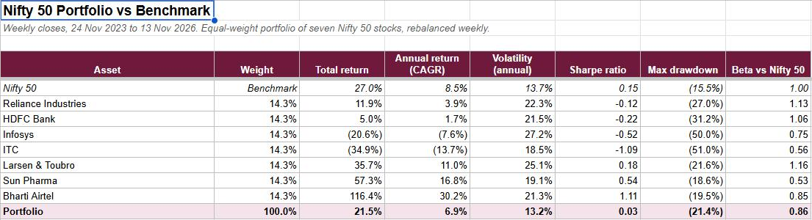
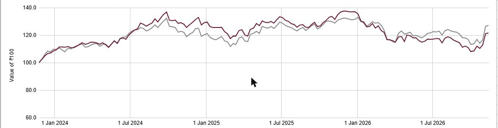

# Nifty 50 Portfolio Analysis | Google Sheets (live data)

A seven-stock Nifty 50 portfolio tracked in Google Sheets with live prices from GOOGLEFINANCE, measuring return, risk and diversification against the Nifty 50 index. Every number is a formula you can click and trace.

**Live sheet (view only):** [Nifty 50 Portfolio Analysis](https://docs.google.com/spreadsheets/d/1JUqTg-XZ8DH7J_B08A-JY59Os5YxuhR30mwX1inUhIo/edit?usp=sharing). Make a copy (File > Make a copy) to change the stocks, weights or dates.

| | |
|:--|:--|
| **What was analysed** | Weekly closing prices of seven Nifty 50 stocks from different sectors (Reliance, HDFC Bank, Infosys, ITC, L&T, Sun Pharma, Bharti Airtel) and the Nifty 50 index, 24 November 2023 to 13 November 2026 (152 weekly returns, Google Finance) |
| **What was done** | Live price pull with GOOGLEFINANCE; weekly returns; an equal-weight portfolio rebalanced weekly; total return, CAGR, annualised volatility, Sharpe ratio (risk-free rate 6.5%, assumed), maximum drawdown and beta for every holding; a 9×9 correlation matrix; growth, return and drawdown charts |
| **Key finding** | Diversification cut risk sharply: one stock averaged 22.1% volatility, the seven-stock portfolio 13.2%, because the stocks were only loosely correlated (average 0.25; Infosys and L&T 0.02). Returns were less helpful: the portfolio gained 21.5% (6.9% a year) against 27.0% for the Nifty 50, with a deeper fall from peak (−21.4% vs −15.5%). Bharti Airtel more than doubled (+116%) while ITC (−35%) and Infosys (−21%) pulled the portfolio below the index |

## Workbook Structure

| Tab | Contents |
|:--|:--|
| **Dashboard** | Metrics table for every holding and the portfolio, diversification summary, and three charts (growth of ₹100, total return by holding, drawdown) |
| **Inputs** | Tickers, sectors, relative weights, start date and risk-free rate (blue cells are inputs) |
| **Raw Prices** | One `GOOGLEFINANCE(ticker, "close", start, TODAY(), "WEEKLY")` formula per asset |
| **Prices** | Weekly closes aligned to the Nifty 50 dates with `VLOOKUP` |
| **Returns** | Weekly returns, and the portfolio return as `SUMPRODUCT` of returns and weights |
| **Growth** | Growth of ₹100 and drawdown from the running peak for every asset |
| **Correlation** | Correlation matrix of weekly returns with a colour scale |
| **Data Sources** | Where every input comes from and what was changed |

## Formulas Used

| Metric | Formula |
|:--|:--|
| Annual return (CAGR) | `(1 + total return) ^ (52 / weeks) − 1` |
| Volatility | `STDEV(weekly returns) × SQRT(52)` |
| Sharpe ratio | `(CAGR − risk-free rate) / volatility` |
| Max drawdown | `MIN(value / MAX(value to date) − 1)` |
| Beta | `SLOPE(stock returns, Nifty 50 returns)` |
| Correlation | `CORREL(returns A, returns B)` |

## Limitations

- GOOGLEFINANCE gives split- and bonus-adjusted closing prices but no dividends, so these are price returns; the ITC Hotels demerger (January 2025) is not adjusted either, which overstates ITC's loss by a few percent.
- Weekly rebalancing to equal weights is a simplification; no transaction costs.
- The Excel copy (`Nifty_50_Portfolio_Analysis.xlsx`) keeps the last values, but GOOGLEFINANCE works only in Google Sheets.

**Tools:** Google Sheets, GOOGLEFINANCE, Financial Analysis

_For learning purposes only. Not investment advice._
