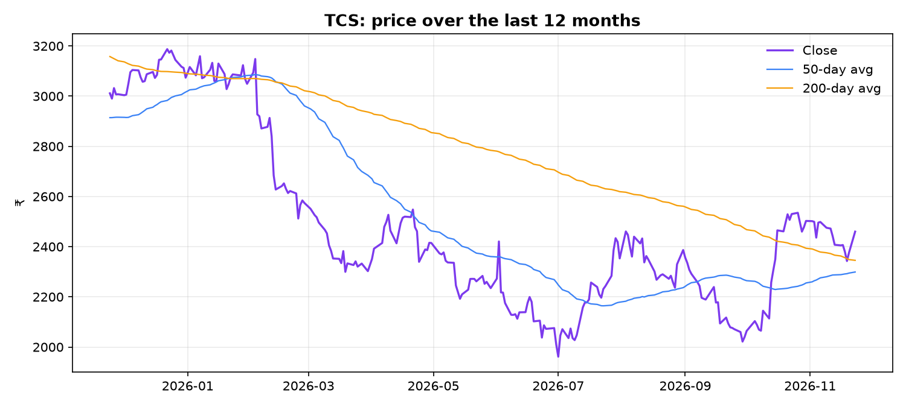

# NSE Stock Terminal

A command-line tool that prints a one-screen company snapshot for any NSE-listed stock, in the style of a market data terminal, and saves a report and price chart for each.

| | |
|:--|:--|
| **What was analysed** | Price history, valuation, profitability, leverage, dividends and four years of revenue and profit for a watchlist of 8 large NSE stocks |
| **What was done** | A Python terminal that turns Yahoo Finance data into a formatted snapshot, a markdown report and a price chart with 50- and 200-day averages, plus a side-by-side comparison table |
| **Key finding** | On 20 Nov 2026, TCS had the highest ROE in the watchlist (45.6%) at a P/E of 17x; ICICI Bank was the strongest 1-year performer (+17.6%) while Infosys fell the most (-24.0%) |

**Watchlist comparison:** [outputs/COMPARISON.md](outputs/COMPARISON.md), refreshed every Monday by GitHub Actions.

## Example Snapshot

Each stock gets its own page, for example [TCS](outputs/TCS.md) or [HDFC Bank](outputs/HDFCBANK.md).



## What the Snapshot Shows

| Section | Metrics |
|:--|:--|
| Price | Current price, 52-week high and low, % below high, 1-year return |
| Valuation | Market cap, P/E, P/B, EV/EBITDA |
| Profitability | ROE, net margin |
| Balance sheet | Debt/Equity |
| Shareholder return | Dividend yield, beta |
| History | Revenue, net profit and net margin for the last 4 years |

## Run It Yourself

```bash
pip install -r requirements.txt
python terminal.py TCS            # one stock
python terminal.py TCS INFY ITC   # several stocks
python terminal.py                # everything in watchlist.txt
```

Edit `watchlist.txt` to change the stocks.

**Tools:** Python, pandas, Matplotlib, yfinance

_For learning purposes only. Not investment advice._
