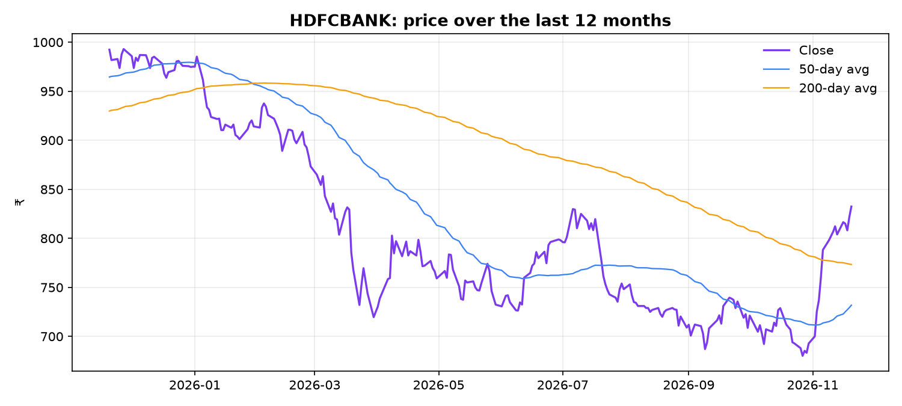

# HDFC Bank Limited (HDFCBANK)

**Sector:** Financial Services  |  **Industry:** Banks - Regional  |  **Generated:** 20 Nov 2026

| Metric | Value | Metric | Value |
|:--|--:|:--|--:|
| Price | ₹832.45 | 1Y Return | -16.1% |
| 52W High | ₹993.08 | 52W Low | ₹680.20 |
| Market Cap | ₹1,284,779 cr | Beta | 0.39 |
| P/E | 17.89x | P/B | 2.11x |
| EV/EBITDA | n/a | ROE | 11.0% |
| Net Margin | 26.5% | Debt/Equity | n/a |
| Dividend Yield | 1.6% | Below 52W High | -16.2% |

## Revenue and Profit

|      |   Revenue (₹ cr) |   Net Profit (₹ cr) |   Net Margin % |
|:-----|-----------------:|--------------------:|---------------:|
| FY23 |           120538 |               49545 |           41.1 |
| FY24 |           198693 |               62266 |           31.3 |
| FY25 |           237151 |               67351 |           28.4 |
| FY26 |           249562 |               70479 |           28.2 |

_Data: Yahoo Finance. For learning purposes only, not investment advice._