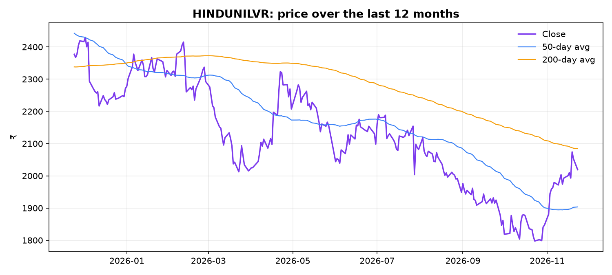

# Hindustan Unilever Limited (HINDUNILVR)

**Sector:** Consumer Defensive  |  **Industry:** Household & Personal Products  |  **Generated:** 23 Nov 2026

| Metric | Value | Metric | Value |
|:--|--:|:--|--:|
| Price | ₹2,019.10 | 1Y Return | -15.1% |
| 52W High | ₹2,429.81 | 52W Low | ₹1,797.65 |
| Market Cap | ₹474,406 cr | Beta | 0.31 |
| P/E | 44.83x | P/B | 9.72x |
| EV/EBITDA | 31.46x | ROE | 21.6% |
| Net Margin | 22.0% | Debt/Equity | 0.03x |
| Dividend Yield | 2.0% | Below 52W High | -16.9% |

## Revenue and Profit

|      |   Revenue (₹ cr) |   Net Profit (₹ cr) |   Net Margin % |
|:-----|-----------------:|--------------------:|---------------:|
| FY23 |            59549 |               10120 |           17   |
| FY24 |            60966 |               10277 |           16.9 |
| FY25 |            60573 |               10649 |           17.6 |
| FY26 |            63763 |               15040 |           23.6 |

_Data: Yahoo Finance. For learning purposes only, not investment advice._