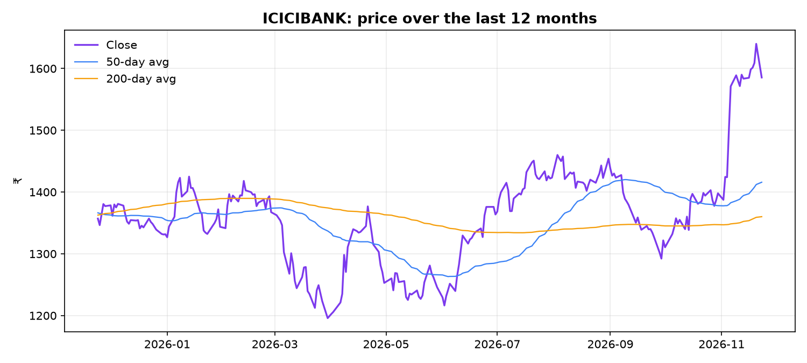

# ICICI Bank Limited (ICICIBANK)

**Sector:** Financial Services  |  **Industry:** Banks - Regional  |  **Generated:** 23 Nov 2026

| Metric | Value | Metric | Value |
|:--|--:|:--|--:|
| Price | ₹1,585.50 | 1Y Return | 16.8% |
| 52W High | ₹1,640.00 | 52W Low | ₹1,195.82 |
| Market Cap | ₹1,139,116 cr | Beta | 0.19 |
| P/E | 19.47x | P/B | 2.91x |
| EV/EBITDA | n/a | ROE | 16.5% |
| Net Margin | 27.8% | Debt/Equity | n/a |
| Dividend Yield | 0.8% | Below 52W High | -3.3% |

## Revenue and Profit

|      |   Revenue (₹ cr) |   Net Profit (₹ cr) |   Net Margin % |
|:-----|-----------------:|--------------------:|---------------:|
| FY23 |           135581 |               34037 |           25.1 |
| FY24 |           161210 |               44256 |           27.5 |
| FY25 |           204715 |               51029 |           24.9 |
| FY26 |           223407 |               54208 |           24.3 |

_Data: Yahoo Finance. For learning purposes only, not investment advice._