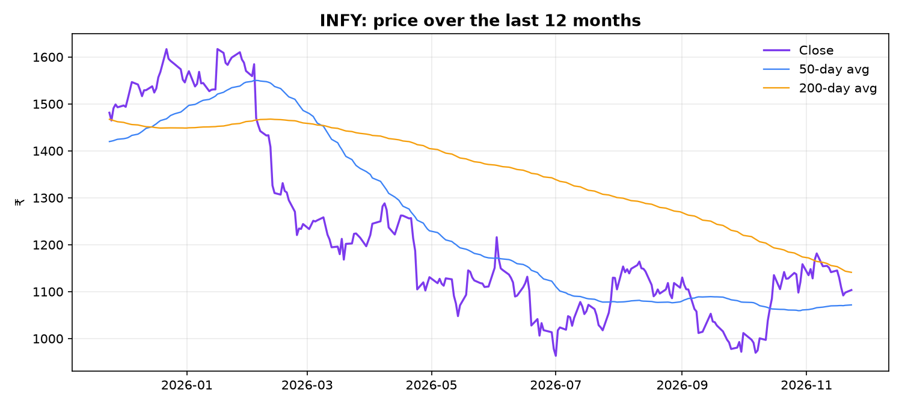

# Infosys Limited (INFY)

**Sector:** Technology  |  **Industry:** Information Technology Services  |  **Generated:** 23 Nov 2026

| Metric | Value | Metric | Value |
|:--|--:|:--|--:|
| Price | ₹1,103.40 | 1Y Return | -25.5% |
| 52W High | ₹1,616.97 | 52W Low | ₹963.23 |
| Market Cap | ₹446,919 cr | Beta | 0.02 |
| P/E | 14.69x | P/B | 4.59x |
| EV/EBITDA | 907.36x | ROE | 30.0% |
| Net Margin | 16.2% | Debt/Equity | 0.09x |
| Dividend Yield | 4.7% | Below 52W High | -31.8% |

## Revenue and Profit

|      |   Revenue (₹ cr) |   Net Profit (₹ cr) |   Net Margin % |
|:-----|-----------------:|--------------------:|---------------:|
| FY23 |             1821 |                 298 |           16.4 |
| FY24 |             1856 |                 317 |           17.1 |
| FY25 |             1928 |                 316 |           16.4 |
| FY26 |             2016 |                 331 |           16.4 |

_Data: Yahoo Finance. For learning purposes only, not investment advice._